# 🛠️ Antigravity Engineering Skills Suite (v2.0)

A battle-tested, high-craft software engineering operating system for **Google Antigravity**. Covers the full engineering lifecycle—from architectural intent extraction and visual image-first art direction to parallel worktree orchestration, adversarial diff review, and cryptographic release gate verification.

---

## ⚡ Quick Start

### 1. Supported Hosts & Prerequisites
- **Host**: Google Antigravity (IDE & `agy` CLI).
- **Core Dependencies**:
  - `git` $\ge 2.30$
  - `python3` $\ge 3.10$
  - `bash` $\ge 4.0$
  - `node` $\ge 18$ *(optional, required for `@playwright/cli`)*

### 2. Installation Options

#### Option A: Global Installation (Recommended)
Make skills available across all your Antigravity workspaces:
```bash
# Clone the repository
git clone https://github.com/reteesh-2002/Skills.git
cd Skills

# Install into Antigravity global configuration
mkdir -p ~/.gemini/config/skills
cp -r * ~/.gemini/config/skills/
```

#### Option B: Workspace-Local Installation
Equip a single project workspace with the skills:
```bash
mkdir -p .gemini/skills
cp -r /path/to/Skills/<selected-skills> .gemini/skills/
```

### 3. Release Gate Hook Setup
To prevent unverified commits or unproven pull requests, configure the Antigravity PreToolUse hook in your repository at `.agents/hooks.json`:
```json
{
  "evidence-policy": {
    "PreToolUse": [
      {
        "matcher": "run_command",
        "description": "Intercept git push and evaluate deterministic release gate",
        "hooks": [
          {
            "type": "command",
            "command": "bash scripts/verify-release-gate.sh --pre-tool",
            "timeout": 5
          }
        ]
      }
    ]
  }
}
```

### 4. First-Run Health & Conformance Check
Verify the skill metadata, relative documentation links, and runtime conformance test suite:
```bash
# 1. Validate skill frontmatter, metadata, and link integrity
python3 scripts/validate-skills.py

# 2. Run the 27-test runtime conformance and adversarial suite
./scripts/exec-proxy.sh --label test_runtime bash tests/verify_runtime.sh
```

---

## 🏗️ Master Architecture Topology

The suite operates as a 5-tier hierarchical engineering operating system:

```mermaid
graph TD
    subgraph "Tier 1: Core Autonomous Triad (Auto-Detected)"
        PM["plan-master<br>(Architect & Planner)"]
        DD["deep-debugger<br>(Root-Cause Repair)"]
        QS["qa-sentinel<br>(Anti-Tautology Verifier)"]
    end

    subgraph "Tier 2: Frontend & Interface Superstructure"
        FA["frontend-artisan<br>(Design Orchestrator)"]
        ITC["image-to-code<br>(Taste Skill & Anti-Slop)"]
        DMD["design-md<br>(15 Brand Design Systems)"]
        WIG["web-interface-guidelines<br>(Vercel Standards)"]
        PW["playwright-cli<br>(Headless Browser CLI)"]
        GUI["generative_ui<br>(Interactive Mini-Widgets)"]
        
        FA --> ITC
        FA --> DMD
        FA --> WIG
        FA --> PW
        FA --> GUI
    end

    subgraph "Tier 3: Specialist Systems Engineering"
        SC["schema-craft<br>(DB Migrations & Integrity)"]
        SV["security-verifier<br>(OWASP API & Boundary Audit)"]
        RR["runtime-reliability<br>(Graceful Shutdown & Soak)"]
        CR["code-reviewer<br>(Adversarial Diff Review)"]
    end

    subgraph "Tier 4: Distributed Orchestration & Council"
        AWO["adaptive-worker-orchestrator-v2<br>(Git Worktrees & Recovery)"]
        IC["idea-council<br>(Multi-Agent Deliberation)"]
    end

    subgraph "Tier 5: Runtime Enforcement & Gatekeeper"
        EP["exec-proxy.sh<br>(Bounded Logs & Receipts)"]
        RE["runtime_evidence.py<br>(Verification Engine)"]
        TL["task_ledger.py<br>(Flock .evidence/tasks.json)"]
        VRG["verify-release-gate.sh<br>(Anti-Tamper Release Gate)"]
        SI["ship-it<br>(Git Hygiene & PR Engine)"]
        
        EP --> RE
        TL --> RE
        VRG --> RE
        SI --> VRG
    end

    PM --> AWO
    PM --> QS
    DD --> QS
    FA --> QS
    SC --> QS
    SV --> QS
    RR --> QS
    CR --> SI
    QS --> EP
    AWO --> TL

    style PM fill:#e1f5fe,stroke:#0288d1,stroke-width:2px
    style DD fill:#ffebee,stroke:#d32f2f,stroke-width:2px
    style QS fill:#e8f5e9,stroke:#388e3c,stroke-width:2px
    style FA fill:#f3e5f5,stroke:#7b1fa2,stroke-width:2px
    style VRG fill:#fff3e0,stroke:#f57c00,stroke-width:2px
```



---

## 🎯 Autonomous Skill Routing (Core 3 Triad)

Through `AGENTS.md` and `GEMINI.md` rules, the agent **automatically detects and activates** the 3 core engineering workflows from plain English requests—no manual slash commands required:

| User Intent | Auto-Detected Skill | Operational Protocol |
| :--- | :--- | :--- |
| **Fix a bug / Error / Breakage / Failure** | [`deep-debugger`](deep-debugger/SKILL.md) | 1. Execute 6-stage protocol: `Reproduce → Isolate → State Inspection → Hypothesis → Surgical Minimal Fix → Regression Proof`.<br>2. Strictly bound probes by the "3+5" cycle ceiling before blast-radius rollback. |
| **Create new feature / System / Architecture** | [`plan-master`](plan-master/SKILL.md) | 1. Ingest requirements & formulate intent.<br>2. Generate dependency DAG with 1-writer-per-file bounds.<br>3. Enforce TDD Red-Green progression with [`qa-sentinel`](qa-sentinel/SKILL.md). |
| **Verify / Test / Validate code changes** | [`qa-sentinel`](qa-sentinel/SKILL.md) | 1. Apply Anti-Tautology discipline (observable side-effects, real failure questions).<br>2. Execute tests through `scripts/exec-proxy.sh` for physical receipts. |

*Note: All specialist skills (`frontend-artisan`, `schema-craft`, `code-reviewer`, `security-verifier`, `runtime-reliability`, `idea-council`, `ship-it`) remain **on-demand only** to prevent prompt bloat and unintended side-effects.*

---

## 🎨 Frontend Design & Generative UI Protocol

Whenever any frontend design or UI component is being designed, styled, or implemented:
1. **Master Orchestrator ([`frontend-artisan`](frontend-artisan/SKILL.md))**: Coordinates visual art direction, design system tokens, interaction guidelines, and browser audits with **strict zero-slop hard gates**.
2. **Visual Art Direction ([`image-to-code`](image-to-code/SKILL.md))**: Mandatory Image-First protocol using Antigravity's native `generate_image` tool. Deeply inspects reference images with `view_file` to eliminate the "cards-inside-cards-inside-cards" nesting loop, purple gradients, and cramped mobile heroes.
3. **Design System Ingestion ([`design-md`](design-md/SKILL.md))**: Ingests workspace `DESIGN.md` or adopts 15 production brand presets (**Linear, Vercel, Stripe, Supabase, Raycast, Resend, Apple, Figma, Framer, PostHog, Warp, etc.**).
4. **Vercel Standards ([`web-interface-guidelines`](web-interface-guidelines/SKILL.md))**: Enforces keyboard accessibility (WAI-ARIA), touch targets $\ge 44\text{px}$, `<input>` font-size $\ge 16\text{px}$ (prevents iOS Safari zoom), loading button label retention, skeleton flicker delays, and URL state persistence.
5. **Interactive Preview ([`generative_ui`](frontend-artisan/SKILL.md#gate-3-mandatory-generative-ui-interactive-mini-widget-artifact))**: Creates a self-contained `.html` mini-widget artifact and embeds it inline in chat via `<agent-embed src="file:///<path>/widget.html"></agent-embed>` with interactive color palette swatches and tactile controls.
6. **Automated Verification ([`playwright-cli`](playwright-cli/SKILL.md))**: Headless multi-viewport audits (375px mobile, 768px tablet, 1440px desktop) asserting zero horizontal overflow and full focus ring visibility.

---

## 📚 Complete Skills Directory

### Tier 1: Core Planning & Autonomous Triad
| Skill | Entry Point | Role |
| :--- | :--- | :--- |
| **`prompt-architect`** | [`prompt-architect/SKILL.md`](prompt-architect/SKILL.md) | **Master Prompt Composer**: Translates raw ideas into optimal execution prompts and assigns surgical 2–4 skill teams. Zero disk-crawling law. |
| **`plan-master`** | [`plan-master/SKILL.md`](plan-master/SKILL.md) | **Master Planner & Intent Architect**: Breaks complex tasks into dependency-aware execution DAGs with TDD Red-Green discipline. |
| **`deep-debugger`** | [`deep-debugger/SKILL.md`](deep-debugger/SKILL.md) | **Root Cause Investigator**: Systematic 6-stage scientific debugging protocol preventing shotgun patching and token loops. |
| **`qa-sentinel`** | [`qa-sentinel/SKILL.md`](qa-sentinel/SKILL.md) | **Verification Gatekeeper**: Anti-tautology testing engine capturing physical evidence receipts via `scripts/exec-proxy.sh`. |

### Tier 2: Frontend & Interface Superstructure
| Skill | Entry Point | Role |
| :--- | :--- | :--- |
| **`frontend-artisan`** | [`frontend-artisan/SKILL.md`](frontend-artisan/SKILL.md) | **Master Frontend Orchestrator**: Coordinates visual generation, design tokens, interaction standards, and browser audits. |
| **`image-to-code`** | [`image-to-code/SKILL.md`](image-to-code/SKILL.md) | **Taste Skill Anti-Slop Engine**: Full image-first art direction using `generate_image` to produce bespoke, breathable UIs. |
| **`design-md`** | [`design-md/SKILL.md`](design-md/SKILL.md) | **Design System Token Manager**: Ingests project `DESIGN.md` or applies 15 bundled world-class company presets. |
| **`web-interface-guidelines`** | [`web-interface-guidelines/SKILL.md`](web-interface-guidelines/SKILL.md) | **Vercel Production Standard**: Complete guidelines for keyboard accessibility, loading flickers, and touch targets. |
| **`playwright-cli`** | [`playwright-cli/SKILL.md`](playwright-cli/SKILL.md) | **Headless Browser CLI**: Microsoft's official agent skill for automated viewport snapshots, tracing, and video recording. |

### Tier 3: Specialist Systems Engineering
| Skill | Entry Point | Role |
| :--- | :--- | :--- |
| **`schema-craft`** | [`schema-craft/SKILL.md`](schema-craft/SKILL.md) | **Database Architect**: Relational integrity, compound query indexing, and zero-downtime expand/contract migration rehearsal. |
| **`security-verifier`** | [`security-verifier/SKILL.md`](security-verifier/SKILL.md) | **API Security Auditor**: Synthetic test probes targeting OWASP API Top 10 (BOLA/IDOR, auth, SSRF, injection). |
| **`runtime-reliability`** | [`runtime-reliability/SKILL.md`](runtime-reliability/SKILL.md) | **Operational Resilience**: SIGTERM/SIGINT graceful shutdown verification and memory leak soak testing under concurrent load. |
| **`code-reviewer`** | [`code-reviewer/SKILL.md`](code-reviewer/SKILL.md) | **Adversarial Diff Reviewer**: Independent diff inspection emitting structured finding cards (Critical / Warning / Suggestion). |

### Tier 4: Parallel Orchestration & Deliberation
| Skill | Entry Point | Role |
| :--- | :--- | :--- |
| **`adaptive-worker-orchestrator-v2`** | [`adaptive-worker-orchestrator-v2/SKILL.md`](adaptive-worker-orchestrator-v2/SKILL.md) | **Worktree Parallel Coordinator**: Task-shape gating (solo vs parallel), isolated git worktrees, and durable crash recovery. |
| **`idea-council`** | [`idea-council/SKILL.md`](idea-council/SKILL.md) | **Multi-Agent Deliberation Council**: 6-seat structured meeting (Product, Red-Team, Architect, User Proxy, CFO, SecOps). |

### Tier 5: Release & Runtime Infrastructure
| Skill / Script | Path | Role |
| :--- | :--- | :--- |
| **`ship-it`** | [`ship-it/SKILL.md`](ship-it/SKILL.md) | **Release Automator**: Conventional Commits, clean working tree audits, and release gate compliance. |
| **`exec-proxy.sh`** | [`scripts/exec-proxy.sh`](scripts/exec-proxy.sh) | **Execution Proxy**: Bounded log sink (`.evidence/logs/`), concise 3-line summaries, and receipt generation. |
| **`runtime_evidence.py`** | [`scripts/runtime_evidence.py`](scripts/runtime_evidence.py) | **Verification Engine**: Shared cryptographic receipt validation, ISO waiver parsing, and policy disposition logic. |
| **`task_ledger.py`** | [`scripts/task_ledger.py`](scripts/task_ledger.py) | **Live Task Flow Ledger**: Multi-process flock-protected task tracking (`.evidence/tasks.json`). |
| **`verify-release-gate.sh`** | [`scripts/verify-release-gate.sh`](scripts/verify-release-gate.sh) | **Deterministic Release Gate**: Verifies clean tree, receipt matches, non-zero test counts, and protojson hook payloads. |

### Forwarding Aliases
| Alias | Target Skill | When to Install / Retain |
| :--- | :--- | :--- |
| **`anti-slop-spec`** | [`plan-master`](plan-master/SKILL.md) & [`frontend-artisan`](frontend-artisan/SKILL.md) | Optional design-phase alias. Retain if invoking `/anti-slop-spec` prior to UI implementation. |

---

## ⚡ Standard Workflow Recipes

```bash
# 1. Frontend & Visual Design Sprint
Use /frontend-artisan
# Orchestrates image-to-code -> design-md -> web-interface-guidelines -> generative_ui -> playwright-cli

# 2. Full-Stack Feature Builder
Use /plan-master, /schema-craft, /qa-sentinel, and /ship-it

# 3. Surgical Bug Investigation & Repair
Use /deep-debugger and /qa-sentinel

# 4. Security & Tenant Boundary Audit
Use /security-verifier and /qa-sentinel

# 5. Production Zero-Downtime Migration & Resilience Rehearsal
Use /runtime-reliability and /schema-craft

# 6. Strategic Architecture Deliberation
Use /idea-council
```

---

## 🔬 Token & Context Efficiency Engineering

Rather than a one-size-fits-all claim, skill instructions follow strict tiered token budgeting:

| Category | Typical Token Footprint | Skills | Loading Strategy |
| :--- | :--- | :--- | :--- |
| **Compact Protocols** | $250 - 900$ tokens | `design-md` (~257), `security-verifier` (~629), `runtime-reliability` (~633), `code-reviewer` (~750), `adaptive-worker-orchestrator-v2` (~820), `ship-it` (~898) | Ingested inline into worker prompts with negligible context cost. |
| **Engineering Playbooks** | $1,200 - 2,000$ tokens | `schema-craft` (~1,209), `frontend-artisan` (~1,285), `deep-debugger` (~1,311), `qa-sentinel` (~1,635), `plan-master` (~1,953), `idea-council` (~2,017) | Structured operational workflows with hard gates and step-by-step protocols. |
| **Deep Domain Specs** | $> 2,000$ tokens | `playwright-cli` (~2,340), `web-interface-guidelines` (~3,107), `image-to-code` (~7,593) | Comprehensive reference standards. Multi-framework adapters and presets reside in subdirectories (`references/`, `presets/`) and are loaded on-demand only. |
| **Forwarding Aliases** | $< 200$ tokens | `prompt-architect` (~156), `anti-slop-spec` (~159) | Lightweight pointers that immediately route to their canonical targets. |

**Additional Optimizations**:
- **Bounded Log Capture (`exec-proxy.sh`)**: Raw `stdout`/`stderr` streams to disk (`.evidence/logs/<run_id>.log`). Terminal output is compressed to a clean 3-line status on pass, cutting model-facing log volume by **over 70%**.
- **Task-Shape Gating (`adaptive-worker-orchestrator-v2`)**: Small or tightly-coupled tasks remain in Solo mode, eliminating redundant subagent token burn. Only genuinely independent workstreams spawn isolated worktrees.

---

## 🛡️ Conformance & Verification Guarantee

The runtime safeguards, cryptographic gates, and execution proxies are verified by **27 automated adversarial tests**:

```bash
# Run the complete conformance & adversarial suite
bash tests/verify_runtime.sh

# Verify the cryptographic release gate against candidate commit
./scripts/exec-proxy.sh --label test_conformance bash tests/verify_runtime.sh
./scripts/verify-release-gate.sh
```

---

## 🤝 Contributing & License

- **Contributing**: Please review [`CONTRIBUTING.md`](CONTRIBUTING.md) for architectural guidelines, frontmatter specifications, and testing requirements.
- **License**: Released under the [MIT License](LICENSE).
  - Attribution Notice: Portions of `plan-master` incorporate concepts or material from Prompt Master (Copyright © 2026 Nidhin Joseph Nelson, MIT License, see [`plan-master/LICENSE.prompt-master`](plan-master/LICENSE.prompt-master)).
