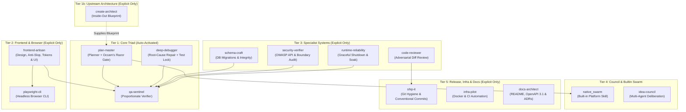

# Antigravity Engineering Skills Suite (v2.3)

A modular software engineering toolkit and skills suite for **Google Antigravity**. Covers the engineering lifecycle—from architectural intent extraction and visual design direction to parallel worker orchestration, adversarial review, specialist verification, and release gate enforcement.

---

## ⚡ Quick Start

### 1. Supported Hosts & Prerequisites
- **Host**: Google Antigravity (IDE & `agy` CLI).
- **Operating Systems**: Linux, macOS, and **Windows** (PowerShell, CMD, Git Bash, WSL).
- **Core Dependencies**:
  - `git` $\ge 2.30$
  - `python3` $\ge 3.9$
  - `bash` $\ge 4.0$ *(optional; all core scripts are native cross-platform Python 3)*
  - `node` $\ge 18$ *(optional, for Playwright headless browser testing)*

### 2. Installation & Environment Health

Use the suite installer to cleanly install the 15 skills and runtime helpers with manifest tracking:

#### Option A: Workspace Installation (Single Project)
Run from the cloned Skills repo pointing `--target-dir` at your project (do not run `--workspace` inside the Skills repo root itself):
```bash
python3 scripts/install-skills.py --workspace --target-dir /path/to/your-project
```

#### Option B: Global Installation (All Antigravity Workspaces)
```bash
python3 scripts/install-skills.py --global
```

#### Option C: Selective Removal & Clean Uninstallation
Cleanly remove specific skills or completely uninstall the suite and restore original configurations:
```bash
# Selectively remove specific skills (e.g. idea-council, infra-pilot)
python3 scripts/install-skills.py --global --remove idea-council infra-pilot

# Completely uninstall suite and restore original hooks/configs
python3 scripts/install-skills.py --global --uninstall

# Preview changes with dry-run
python3 scripts/install-skills.py --global --uninstall --dry-run
```

#### Option D: Health Check & Self-Healing via Skills Doctor
Run the diagnostic doctor to audit runtime helpers, hooks, and tool availability:
```bash
# Diagnostic audit (pass --project-dir /path/to/your-project for external workspaces)
python3 scripts/skills-doctor.py

# Self-healing auto-repair (recreates missing hooks, directories, and executable bits)
python3 scripts/skills-doctor.py --fix
```
*(Supports `--json` for automated environment auditing.)*

### 3. Frictionless Safety Hook (Anti-Exact-Retry)
Hooks in `.agents/hooks.json` run [`guard_anti_retry.py`](scripts/guard_anti_retry.py) to halt runaway identical-failure retry loops without blocking `git push` or normal developer commands.

### 4. Test Suite & Validation
Verify skill metadata, policy parity, environment health, and core tooling:
```bash
# 1. Validate skill frontmatter, metadata, and token budgets (15 skills)
python3 scripts/validate-skills.py

# 2. Run the environment health check
python3 scripts/skills-doctor.py

# 3. Run the unit & policy test suite
python3 -m unittest discover -s tests -p 'test_*.py'
```

---

## Architecture & Skill Topology

The suite is governed authoritatively by [`suite-policy.json`](suite-policy.json) (3 auto-activated skills, 11 explicit-only skills):



### Division of Responsibilities
1. **Create Architect vs Plan Master**:
   - [`create-architect`](create-architect/SKILL.md) owns **Inside-Out Engineering Blueprints** (Data Flow, Tech Stack, Data Model, API & 4 UI States).
   - [`plan-master`](plan-master/SKILL.md) owns **execution planning** with the **Anti-Overengineering Gate (Occam's Razor)** (`< 3 files` skip planning ceremony).
   - `create-architect` does **not** auto-run before `plan-master`.
2. **Core Workflows**:
   - **Features**: `plan-master` $\rightarrow$ implement (or `native_swarm` when genuinely parallel) $\rightarrow$ `qa-sentinel` $\rightarrow$ `ship-it`.
   - **Bugs**: `deep-debugger` (reproduce first, never weaken existing tests at `HEAD`) $\rightarrow$ `qa-sentinel`.

3. **Pipeline Output Suppression Rule**:
   - Intermediate skills in a pipeline suppress verbose chat cards to a **single-line milestone heartbeat** (e.g. `✓ [deep-debugger]: Fixed bug in worker.py:L42 (exit 0)`).
   - Only the terminal skill or coordinating agent outputs the final **4–8 line executive card**.

---

## 🎯 Skill Routing Policy

Routing policy is defined authoritatively in [`suite-policy.json`](suite-policy.json) and mirrored in [`AGENTS.md`](AGENTS.md) and [`GEMINI.md`](GEMINI.md):

### Automatic Skill Activation (3 Skills Only)

| User Intent | Auto-Activated Skill | Operational Protocol |
| :--- | :--- | :--- |
| **Fix a bug / Error / Breakage / Failure** | [`deep-debugger`](deep-debugger/SKILL.md) | 1. 6-stage protocol: `Reproduce → Isolate → State Inspection → Hypothesis → Surgical Minimal Fix → Regression Proof`.<br>2. Multi-file fixes permitted when root cause requires it.<br>3. Protects user edits outside failure path; preserves intermittent bug uncertainty in Compact Hypothesis Log. |
| **Plan / Implement / Architect multi-step feature** | [`plan-master`](plan-master/SKILL.md) | 1. Current-state inspection & dependency DAG ($T_1 \dots T_n$).<br>2. Anti-Overengineering Gate (Occam's Razor) before task generation.<br>3. Strict 1-writer-per-file bounds.<br>4. Small tasks (< 3 files) go directly to implementation. |
| **Verify / Test / Validate code changes** | [`qa-sentinel`](qa-sentinel/SKILL.md) | 1. Pure verification engine (no implementation duties).<br>2. Executes real test suites (`pytest`, `npm test`, `cargo test`, `unittest`).<br>3. Rejects zero-inventory false greens and labels unverified checks honestly. |

### All Other Skills: Explicit Only

The remaining 11 skills activate **only** when explicitly requested by name or slash command:
`create-architect`, `frontend-artisan`, `schema-craft`, `code-reviewer`, `security-verifier`, `runtime-reliability`, `idea-council`, `ship-it`, `playwright-cli`, `infra-pilot`, `docs-architect`.
*(Multi-worker swarm coordination delegates natively to Antigravity's built-in `native_swarm` skill.)*

### Mandatory Host Behaviors
1. **Always read `SKILL.md`** using `view_file` when activating skills.
2. **Never auto-trigger specialist skills** without explicit user instruction.
3. **Execution Discipline**: Run real verification commands and report exact exit codes and counts.
4. **Concise Reporting**: Chat summaries must stay compact (4–8 lines default per [`references/output-policy.md`](references/output-policy.md)), highlighting outcome, verified tests, and evidence paths.
5. **Planning Does Not Authorize Publishing**: A plan or release check does not authorize `git push` or package publishing without explicit user permission.

---

## 📐 Inside-Out Engineering Blueprint Standard

Implemented in [`create-architect`](create-architect/SKILL.md) with canonical template in [`references/blueprint-template.md`](create-architect/references/blueprint-template.md), this standard ensures grounded technical clarity before code is written:

```markdown
Executive Intent                  # Goal and target user
1. Data Flow Architecture         # Inflow -> Transformation -> Storage -> Outflow
2. Pragmatic Tech Stack           # Backend, Database, Frontend, Design Preset & Motion Style
3. Data Model & Schemas           # Relational schemas, constraints, foreign keys, seed data
4. API & 4 UI States Contract     # Endpoints + Empty, Loading, Success, Error states
5. Inside-Out Build Sequence      # Phase 1: DB -> Phase 2: API -> Phase 3: UI -> Phase 4: Verify
6. Module Directory Scaffold      # Vertical Slice Layout (for multi-domain apps)
7. Defensive Layers               # Proportional security, state machines, and reliability guards
```


---

## 📁 Repository Directory & File Map

### 1. Root Configuration & Governance
| File | Role |
| :--- | :--- |
| [`suite-policy.json`](suite-policy.json) | **Authoritative Suite Policy**: Single source of truth for routing (3 auto, 12 explicit = 15 skills), output defaults, and tool boundaries. |
| [`AGENTS.md`](AGENTS.md) | Host routing instructions for Antigravity agents; defines the 3 auto-detected skills and on-demand rules. |
| [`GEMINI.md`](GEMINI.md) | Workspace-level routing instructions mirroring AGENTS.md for compatibility with Google Gemini agent runtimes. |
| [`REQUIREMENTS.md`](REQUIREMENTS.md) | System binary and optional tool requirements for the 15-skill suite. |
| [`CHANGELOG.md`](CHANGELOG.md) | Version history and release notes. |
| [`README.md`](README.md) | Master documentation, quick start, architecture, and file directory. |
| [`CONTRIBUTING.md`](CONTRIBUTING.md) | Contributor guidelines, frontmatter rules, and testing requirements. |
| [`LICENSE`](LICENSE) | MIT License for the repository. |
| [`.gitignore`](.gitignore) | Ignored runtime artifacts (`.evidence/`, caches, temp files). |
| [`.github/workflows/validate.yml`](.github/workflows/validate.yml) | CI workflow running `py_compile`, `validate-skills.py`, `skills-doctor.py`, and `unittest`. |
| [`references/output-policy.md`](references/output-policy.md) | Shared output formatting and effort-profile contract. |
| [`.agents/hooks.json`](.agents/hooks.json) | Lightweight hook configuration running `guard_anti_retry.py`. |

### 2. Core Scripts (`scripts/`)
| Script | Language | Purpose & Functionality |
| :--- | :---: | :--- |
| [`install-skills.py`](scripts/install-skills.py) | Python 3 | **Suite Installer & Manifest Manager**: Installs the 14 skills, policy, and core scripts to workspace or global config with `--remove`, `--uninstall`, and `--dry-run`. |
| [`validate-skills.py`](scripts/validate-skills.py) | Python 3 | **Skill Metadata & Policy Linter**: Validates all 14 skills' YAML frontmatter, token budgets, relative links, and `suite-policy.json` parity. |
| [`skills-doctor.py`](scripts/skills-doctor.py) | Python 3 | **Environment Health Diagnostic & Self-Healing**: Audits Python $\ge 3.9$, core scripts, `.agents/hooks.json`, and optional tools (`--fix`, `--json`). |
| [`guard_anti_retry.py`](scripts/guard_anti_retry.py) | Python 3 | **Anti-Exact-Retry Guard**: Halts runaway identical-failure loops while whitelisting exploratory commands (`grep`, `diff`, `find`, `git status`). |

### 3. Test Suites (`tests/`)
| Test File | Type | Focus & Scenarios |
| :--- | :---: | :--- |
| [`test_install_doctor.py`](tests/test_install_doctor.py) | Unit/Integration | Installer clean install, repeat install, `--remove`, `--uninstall`, doctor diagnostics, and `--fix` self-healing. |
| [`test_validate_skills.py`](tests/test_validate_skills.py) | Unit/Integration | Frontmatter parsing, relative/backticked links, token budgets, and policy parity validation. |
| [`test_suite_policy_enforcement.py`](tests/test_suite_policy_enforcement.py) | Policy | Validates `suite-policy.json` (3 auto, 11 explicit = 14 skills), routing rules, and output defaults. |
| [`test_runtime_guards.py`](tests/test_runtime_guards.py) | Unit/Integration | Anti-Exact-Retry failure recording, exploratory command whitelisting, and mutation-triggered reset. |

---

## 📚 Complete Skills Directory & Token Footprints

Every skill in the suite is optimized for high information density with zero fluff. Token measurements are computed directly via `python3 scripts/validate-skills.py`:

| Skill | Entry Point | Tokens | Tier & Role | Loading Policy |
| :--- | :--- | :---: | :--- | :--- |
| **`ship-it`** | [`ship-it/SKILL.md`](ship-it/SKILL.md) | ~319 | **Tier 5**: Staged candidate release scanner & git hygiene automator. | Explicit only |
| **`qa-sentinel`** | [`qa-sentinel/SKILL.md`](qa-sentinel/SKILL.md) | ~347 | **Tier 1**: Pure verification engine & zero-test-trap validator. | **Auto-activated** |
| **`deep-debugger`** | [`deep-debugger/SKILL.md`](deep-debugger/SKILL.md) | ~487 | **Tier 1**: 6-stage root-cause repair engine with Git Assertion Lock. | **Auto-activated** |
| **`runtime-reliability`** | [`runtime-reliability/SKILL.md`](runtime-reliability/SKILL.md) | ~692 | **Tier 3**: Operational resilience, RSS memory soak, SIGTERM graceful drain. | Explicit only |
| **`repo-auditor`** | [`repo-auditor/SKILL.md`](repo-auditor/SKILL.md) | ~718 | **Tier 3**: Cold-start full-repo defect & parity auditor (Reproducer-or-Drop). | Explicit only |
| **`plan-master`** | [`plan-master/SKILL.md`](plan-master/SKILL.md) | ~722 | **Tier 1**: Execution planner with Anti-Overengineering (Occam's Razor) Gate. | **Auto-activated** |
| **`playwright-cli`** | [`playwright-cli/SKILL.md`](playwright-cli/SKILL.md) | ~755 | **Tier 2**: Headless browser automation and end-to-end verification. | Explicit only |
| **`infra-pilot`** | [`infra-pilot/SKILL.md`](infra-pilot/SKILL.md) | ~825 | **Tier 5**: Production Dockerfiles, docker-compose stacks, and CI automation. | Explicit only |
| **`docs-architect`** | [`docs-architect/SKILL.md`](docs-architect/SKILL.md) | ~843 | **Tier 5**: Developer documentation, OpenAPI 3.1 contracts, and ADR records. | Explicit only |
| **`security-verifier`** | [`security-verifier/SKILL.md`](security-verifier/SKILL.md) | ~868 | **Tier 3**: OWASP API, BOLA/IDOR, injection, and payload boundary probes. | Explicit only |
| **`code-reviewer`** | [`code-reviewer/SKILL.md`](code-reviewer/SKILL.md) | ~912 | **Tier 3**: Independent adversarial diff reviewer with mode disclosure. | Explicit only |
| **`frontend-artisan`** | [`frontend-artisan/SKILL.md`](frontend-artisan/SKILL.md) | ~1,003 | **Tier 2**: Frontend orchestrator (DESIGN.md tokens, anti-slop, accessibility). | Explicit only |
| **`schema-craft`** | [`schema-craft/SKILL.md`](schema-craft/SKILL.md) | ~1,003 | **Tier 3**: Migration Impact Checklist, ESR indexing, reversible DDL. | Explicit only |
| **`idea-council`** | [`idea-council/SKILL.md`](idea-council/SKILL.md) | ~1,300 | **Tier 4**: Multi-agent council (Full 6-seat or Express 3-seat deliberation). | Explicit only |
| **`create-architect`** | [`create-architect/SKILL.md`](create-architect/SKILL.md) | ~1,432 | **Tier 1b**: Inside-Out engineering blueprint architect. | Explicit only |

---

## Verification Summary

```bash
# 1. Validate skill metadata, policy parity, and token budgets (15 skills)
python3 scripts/validate-skills.py

# 2. Environment health check
python3 scripts/skills-doctor.py

# 3. Run the unit & policy test suite (45 tests)
python3 -m unittest discover -s tests -p 'test_*.py'
```

---

## 🤝 Contributing & License

- **Contributing**: Please review [`CONTRIBUTING.md`](CONTRIBUTING.md) for architectural guidelines, frontmatter specifications, and testing requirements.
- **License**: Released under the [MIT License](LICENSE).
  - Attribution Notice: Portions of `plan-master` incorporate concepts or material from Prompt Master (Copyright © 2026 Nidhin Joseph Nelson, MIT License, see [`plan-master/LICENSE.prompt-master`](plan-master/LICENSE.prompt-master)).
