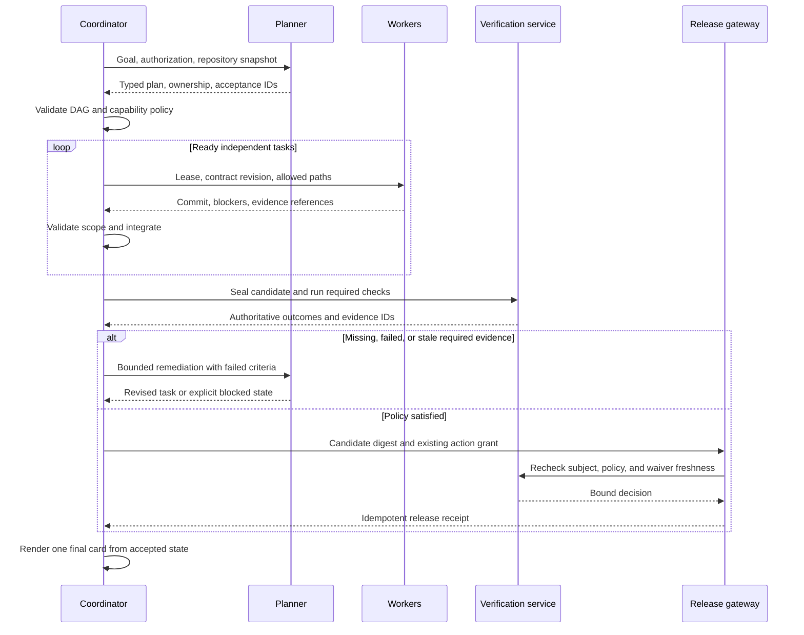

# Principal Engineering Architecture Audit Report
## The 12-Skill Antigravity Engineering Runtime

**Audit date:** 25 September 2026  
**Subject:** The actual implementation in the supplied `Skills.zip`, assessed against its stated invariants  
**Archive SHA-256:** `337f0ff4d02c81cc931e3a960be1b5e36038495a83a615cf79b1b9701cfdfad2`  
**Overall disposition:** **Suitable for a supervised engineering-workflow pilot; unsuitable as the sole autonomous release authority.**

---

## Executive assessment

The suite contains useful engineering procedures, but its strongest runtime guarantees are not implemented. It is currently a prompt library with an evidence-capture prototype and a bypassable release predicate. Calling its receipts “immutable” or “cryptographic,” its checks “deterministic security verification,” or its gate a solution to self-grading materially overstates the supplied code.

This conclusion is based on source inspection and executable counterexamples, not skepticism about prompts in general. The bundled conformance suite reports **5/5 passing**. Nevertheless, isolated tests reproduced approval of zero-test checks, fabricated manifests, unstaged changes, stale individual checks, warnings, and failed-then-passing retries. An interrupted rerun left earlier Green evidence available. Concurrent manifest writers lost completed check entries. Worktree cleanup deleted uncommitted changes.

The Tri-Surface idea should survive the redesign. A short human card, durable diagnostic logs, and structured machine evidence are a sound division of information. The missing architectural element is **independent authority**: a protected process must own capture, policy, evidence state, and release credentials. Neither another skill name nor another agent creates that boundary.

| Decision area | Assessment | Engineering consequence |
|---|---|---|
| Specialist procedures | Useful, with conflicting and overbroad rules | Retain modular expertise; simplify shared policy |
| Human output design | Strong direction, incomplete implementation | Generate cards from validated state; keep material caveats visible |
| Evidence integrity | Critical deficiencies | Replace agent-editable truth with protected, append-only records |
| Source freshness | Index-only and aggregate-only | Test a sealed candidate; validate every required check against it |
| Parallel execution | Helpful checkout separation; unsafe shared state and cleanup | Add ownership, leases, isolated resources, and transactional aggregation |
| Security and reliability | Sensible probe prompts; no complete executable verifier | Register actual boundary checks, mutation controls, and workload budgets |
| Comparison with modern harnesses | No demonstrated performance superiority | Benchmark controlled configurations, not marketing categories |
| Successor feasibility | High for an incremental implementation | Build a small policy-and-evidence kernel before adding a “mesh” |

**Immediate priorities:** remove destructive cleanup, stop relying on the current gate for autonomous publishing, protect release authority, seal verification inputs, replace regex result parsing, and make evidence updates transactional. Vector memory and more agents come later.

## 0. Scope, method, and limits

### 0.1 Inspected material

This audit inspected all twelve root `SKILL.md` files, all twelve `contract.yaml` sidecars, both top-level runtime scripts, the hook registration and alternate hook script, both worktree scripts, the bundled conformance test, relevant integration/host references, the supplied manifest, and relevant sections and evidence declarations of both included reports. The archive contains **75,208 bytes / 74,639 characters** across the twelve root skill files, before references and reports.

The earlier architecture whitepaper explicitly says the then-current skill source was **not supplied** and that its nine probes were generic local counterexamples. It should be treated as design guidance, not certification of this newer implementation. This report closes that source-inspection gap. Its experiments do not imply that the complete AGY application was exercised.

Three labels distinguish evidence:

- **Observed:** executed against disposable copies of the supplied scripts, or against clearly identified synthetic demonstrations.
- **Source finding:** follows directly from the inspected implementation, with a file and line locator.
- **Proposed / modeled:** a recommended design, workload scenario, estimate, or future acceptance criterion.

### 0.2 Execution method

The shell/Git experiments used newly initialized temporary repositories, copied scripts, local fixture files, and no real remotes or release credentials. Copied shell files were made executable to avoid ZIP permission loss affecting the result. The imported `.git` repository was not used as an execution environment. Tests used Bash **5.2.21**, Git **2.51.1**, Python **3.12.14**, and Node **24.19.0**.

There are **23 numbered probes, P00–P22**, including a positive stale-index control and four six-process concurrency trials. Two additional synthetic demonstrations exercise a mock-shadowed HTTP boundary and a late-onset listener leak. These are counterexamples and limited observations, not product failure-rate estimates. The evidence bundle includes sources, captured outputs, source hashes, and rerun instructions.

No installed Antigravity session, production database migration, provider billing trace, or head-to-head vendor benchmark was run. Platform comparisons use current primary documentation, accessed on the audit date. “Unknown” means unverified; it does not mean secure or broken.

## 1. Topology, separation of concerns, and cognitive overhead

### 1.1 Twelve skills should not become twelve compulsory services

The natural design is a small coordinator selecting procedures on demand. The number of skill folders is not itself the main cost. Repeated authority, overlapping output rules, and unnecessary transitions are.

| Skill | Proper responsibility | Boundary problem in this archive | Recommendation |
|---|---|---|---|
| `prompt-architect` | Classify intent and select needed expertise | Also composes plans, injects policy, and can select manual-only skills | Make it a thin routing front end; policy comes from the kernel |
| `plan-master` | Own acceptance criteria, dependency DAG, and handoffs | Repeats prompt refinement; its output type differs from the orchestrator input type | Keep one planning authority; define a checked adapter |
| `idea-council` | Optional deliberation with preserved dissent | Skill permits three seats, host reference still requires exactly six | Keep manual activation; one authoritative mode schema |
| `adaptive-worker-orchestrator-v2` | Schedule and integrate implementation | Calls worktree separation enforcement of file ownership; assumes platform defaults | Move scheduling and ownership into executable control logic |
| `anti-slop-spec` | Establish visual direction | Repeats frontend bans and creates a second prompt-generation pass | Fold into the frontend skill as an optional design phase |
| `frontend-artisan` | Implement approved design within project constraints | Absolute style rules can fight the established design system | Keep; make brand, usability, and accessibility the governing inputs |
| `schema-craft` | Author schemas and migrations | Also promises operational safety and universal rollback | Keep authorship separate from measured migration verification |
| `deep-debugger` | Form hypotheses and repair defects | Verifies, then removes diagnostics without requiring another run | Retain; final source mutation invalidates earlier proof |
| `qa-sentinel` | Assess required functional verification | Prose claims exceed count parser and gate behavior | Make it a consumer of authoritative check results |
| `security-verifier` | Threat model and probe real trust boundaries | No mandatory production-path fidelity or complete threat inventory | Keep specialization; enforce check registration and mutation controls |
| `runtime-reliability` | Operational experiments and lifecycle checks | Fixed operation counts and simplistic rollback semantics | Keep specialization; require workload-specific budgets |
| `ship-it` | Prepare commits, release notes, and release requests | Agent also evaluates a mutable gate before release | Keep presentation/preparation; move authorization to a protected gateway |

**Recommended packaging:** ten public procedures after folding `anti-slop-spec` into frontend design and absorbing `prompt-architect` as a routing mode of the planning/coordinator interface. Preserve aliases so users do not lose familiar invocations. Do not merge security and reliability into a generic QA prompt merely to reduce folder count: their test oracles and environments differ.

### 1.2 Concrete drift and ping-pong risks

Several contradictions are already present:

1. `prompt-architect/SKILL.md:40–46` selects `plan-master` and `idea-council`; both require explicit activation. A generated blueprint may recommend them, but classification alone must not authorize their execution. Store the user's selected mode explicitly.
2. `plan-master/contract.yaml` outputs `implementation-plan.v1` and `worktree-profile.v1`; the orchestrator requires `multi-module-plan.v1`. Similar near-matches occur around QA's `task.v1`, security's `task-contract.v1`, and prompt routing's `execution-blueprint.v1`. These are names, not interoperable schemas.
3. The planner integration reference says the diff auditor can run task verification commands. `audit_diff.sh` only inspects paths and patch text. A coordinator can therefore believe a build was delegated to a tool that never executes it.
4. `idea-council/SKILL.md:15–18` permits Express mode, while `references/host-adapter.md` repeatedly requires exactly six participants. Its lower-cost model claim of approximately 75% savings and latency below 45 seconds is unsupported by a measured workload or pricing model.
5. Pipeline suppression is explicit in QA and debugging, but security and reliability demand standalone cards; their contracts also specify `standalone_card`. The router's universal suppression instruction does not resolve precedence consistently.
6. `anti-slop-spec:30` mislabels archetype numbers: hardware is 05 in the actual canon, and neo-brutalism is 07. It also bans system sans-serif at line 19 while later permitting native system stacks. Frontend says zero horizontal scrolling but separately requires scrollable data tables. These need explicit exceptions rather than agent negotiation.
7. Runtime declarations such as `modify_source`, `modify_code`, `modify_backend`, and `execute_code` have no shared capability taxonomy. No shipped dispatcher loads these sidecars to remove permissions.

A likely planning loop is router → planner → request revised design → design prompt → router → planner. Another is QA reports a flaky result → debugger cannot reproduce → QA reruns → Green → later failure. The planner's integration reference already discourages recursive loops, which is good; the missing piece is executable transition accounting.

Use one task ID, one coordinator, a versioned plan, and explicit replan triggers. Suggested bounds: one clarification round when needed; one planned remediation cycle per invalid assumption; further failure becomes a visible blocked state. A new user instruction or new evidence can legitimately reopen planning. A skill handing back another prompt cannot silently do so.

### 1.3 Thirty-turn context model

**The following is an illustrative model, not measured token billing or model accuracy.** Approximate text size using four characters per token; this is not a tokenizer count. Loading every root skill contributes roughly **18,660 token-equivalents**, excluding tool declarations, references, repository content, and messages. The two included reports add approximately **36,200** more. They should be retrieval sources, not permanent prefixes.

Assume thirty assistant steps, ten three-step chains, and these output sizes:

| Reporting design | Assumed new report text | Report text accumulated after 30 steps | Repeated exposure in subsequent inputs* |
|---|---:|---:|---:|
| Verbose report at every step | 2,500 tokens/step | 75,000 | 1,087,500 |
| A short card at every step | 400 tokens/step | 12,000 | 174,000 |
| Two heartbeats, then one card | 25 + 25 + 400 per chain | 4,500 | 61,500 |

\* Sum of each output's tokens multiplied by its remaining turns, assuming full history is retained, no compaction, and the last output is not read again within the modeled thirty turns. These figures exclude common input and all tool results. They are input-token exposure, not necessarily uncached billable tokens.

For outputs \(o_j\), this exposure is \(\sum_{j=1}^{30}(30-j)o_j\). A more complete per-turn context is:

\[
C_t = B + S_t + R_t + A_t + \sum_{j<t}(o_j + u_j),
\]

where \(B\) is the host/tool prefix, \(S_t\) loaded skills, \(R_t\) repository material, \(A_t\) active structured state, and \(u_j\) tool/user history retained from earlier turns. Even 1,000 new repository/tool tokens per turn add 30,000 tokens before accounting for repeated exposure.

**The current proxy does not achieve the modeled suppression of tool output.** `exec-proxy.sh:44` uses `tee` without suppressing its stdout. Full logs go both to disk and back to the caller. Reducing the assistant's prose does not remove those logs from its tool-result context. The script also loads the entire log into Python memory at lines 59–62; “streamed to disk” does not imply bounded parsing memory.

Prompt caching may reduce price or prefill work, but it does not make irrelevant context semantically harmless. Cache behavior depends on the provider, model, prefix stability, and retention. Separate contexts can improve focus while adding duplicated inputs and coordination. Current context-engineering guidance supports selective retrieval, compaction, and durable notes; it does not prove that a particular card length prevents attention degradation. [S1]

Use measured usage to calculate:

\[
\text{cost}=p_u U+p_c H+p_o O,
\]

with uncached input \(U\), cached input \(H\), and output \(O\). Do not claim network-byte savings from token counts: compression, transcript handling, model requests, and tool uploads differ by host.

### 1.4 Suppress presentation, preserve operational meaning

A one-line heartbeat is a notification, not a handoff. The current receipt stores counts, command text, duration, and an index tree. It does not preserve acceptance coverage, warnings, mock usage, uncertainty, retry history, or assumptions.

A downstream task needs a compact but complete handoff containing:

```json
{
  "task_id": "T7",
  "plan_revision": 3,
  "snapshot_id": "candidate-17",
  "outcome": "completed",
  "verification": "incomplete",
  "accepted_criteria": ["A1"],
  "unverified_criteria": ["A2-cross-tenant-read"],
  "warnings": ["unit repository was mocked"],
  "assumptions": ["old clients still send customer_id"],
  "evidence_ids": ["receipt-42"],
  "next_action": "run-real-boundary-check"
}
```

The human card can remain short. The machine record cannot discard unresolved material facts to meet a display budget. A diagnostic is untrusted input; embedded instructions in logs or repository text must never change permissions, policy, or the task's authorization.

### 1.5 Four to six agents: actual coordination limits

Git worktrees have separate working directories and indexes, while some repository metadata is shared. Independent workers do **not** inevitably collide on one common `index.lock`. The real risks include shared refs, setup/cleanup operations, an accidentally shared checkout, and non-Git shared resources. [S2]

| Resource / boundary | Failure mode | Required control |
|---|---|---|
| File ownership | Two worktrees can independently edit the same logical file | Checked path ownership plus merge-time conflict/semantic checks |
| Dependency directories | Script symlinks `node_modules`, `.venv`, `vendor`, and `target`; generators/installers can mutate shared contents | Read-only dependency stores; private generated output and mutable caches |
| Database, ports, queues | Identical local defaults cause data contamination and port conflicts | Per-task database/schema, port allocation, queue namespace, cleanup lease |
| Evidence aggregation | Whole-file read/modify/write loses concurrent updates | Transactional single writer or append-only events with atomic reduction |
| Branches | Reused `orch/<worker>` names collide across runs | Run-scoped names and pinned base commit |
| Lifecycle | Late worker result applies after task reassignment | Lease generation/fencing token checked on every submission |
| CPU/RAM/I/O | Several test runners each use all cores; builds compete for cache and disk | Separate agent concurrency and heavy-job concurrency limits |
| Model requests | Cold or divergent prefixes, retries, rate limits | Small stable briefs, measured cache hits, bounded retries |
| Council reasoning | Shared model priors produce correlated blind spots | Blind first round; demand evidence and preserved dissent, not vote counts |
| Review capacity | Parent cannot audit results as quickly as workers produce them | Bound queue depth; schedule according to integration capacity |

The orchestrator actually caps workers around **four**, while Full Council uses **six plus a chair**. Those are separate modes, not evidence that the suite supports six implementation workers efficiently. Read-only council participants generally do not generate worktree contention; giving them write tools would be a separate configuration error.

For a parallel fraction \(p\), serial work \(W\), and coordination cost \(H(N)\), a rough time model is \(T(N)=(1-p)W+pW/N+H(N)\). With modeled \(p=0.6\) and no overhead, four workers cap speedup at 1.82× and six at 2×. Coupled migrations often have less parallelizable work. File count is only a discovery hint; critical path, resource demand, and reviewer capacity should decide concurrency.

## 2. Tri-Surface evidence and the self-grading trust boundary

### 2.1 What the prototype genuinely improves

The proxy executes `"$@"`, rather than evaluating a concatenated command string. It captures ordinary child exit status; the bundled exit-42 test confirms that. It creates individual receipt files and has a central gate that rejects some obvious failures. The gate correctly rejects a changed **staged index** in P03.

These are useful foundations. They do not independently establish that the intended checks ran on the released code or that the evidence was preserved.

### 2.2 Source-backed finding register

Severity is relative to the claimed role as an autonomous release boundary. “Critical” means direct bypass or destructive loss under that role; “High” means material evidence or correctness failure.

| ID | Severity | Finding and source locator | Evidence |
|---|---|---|---|
| F01 | Critical | Gate never requires test `collected > 0`; it only checks equality when positive. `scripts/verify-release-gate.sh:65–90` | P01; supplied manifest also contains zero-count Green checks |
| F02 | Critical | Tree binds to index, not executed working files; only manifest-level tree is compared. Proxy `34–38, 141–144`; gate `49–63` | P02–P04 |
| F03 | Critical | Agent-writable JSON is accepted without receipt/log existence, digest, signature, or producer identity. Proxy `122–123,157–161`; gate `44–106` | P05 |
| F04 | Critical | Worktree cleanup falls back to `remove --force` before preserving anything uncommitted. `setup_worktrees.sh:19–29` | P19 |
| F05 | High | Git errors and literal `unknown` skip freshness; script-relative evidence root can disagree with command CWD | P06, P09; proxy `23–25,36–37`; gate `18–19,49–58` |
| F06 | High | Process-substitution sink status is ignored; no timeout, process-group supervision, or signal trap exists | P10, P14, P17; proxy `42–46` |
| F07 | High | Regex text is mistaken for structured runner evidence; real Node spec output is not parsed | P11, P16; proxy `70–103` |
| F08 | High | Same-label replacement discards active failure/retry history; warnings are not represented | P12–P13; proxy `141–155` |
| F09 | High | Whole-file manifest updates race and malformed prior state is silently ignored | P18; proxy `134–158` |
| F10 | High | Hook registration does not implement documented stdin/stdout contract; alternate handler always allows | P15; `.agents/hooks.json:10`; `.agents/scripts/verify-release-gate.sh:22–31` |
| F11 | High | Disposition enum, waiver authority, required check inventory, types, and per-check subjects are not validated | P07–P08; gate `44–45,65–101` |
| F12 | High | Scope audit skips all symlinks and matches unsafe path prefixes | P20–P21; `audit_diff.sh:25–32` |
| F13 | Medium | Placeholder scan omits untracked content and can miss violations while printing CLEAN | P22; `audit_diff.sh:20,35–44` |
| F14 | High | Sidecars and production-readiness claims have no executable capability or coverage enforcement | All `contract.yaml`; security/reliability contain no bundled verifier implementation |

### 2.3 Why `git write-tree` is insufficient

Git documents `write-tree` as constructing a tree object from the **current index**. It does not snapshot unstaged or untracked content. [S3] This creates two symmetric problems:

- The index contains version A, but tests execute unstaged version B. A successful receipt is attached to A even though A was not tested.
- Tests execute A, then the working file changes to B without staging. The gate still sees A and permits the next action.

A third defect is more subtle: run unit checks on staged tree A, stage tree B, and run only `lint=true`. The proxy replaces the manifest-level tree with B while retaining the old unit receipt for A. The gate never compares each receipt's tree. **P04 reproduced release approval in this state.**

There is also a time-of-check/time-of-use window: after the gate returns, `ship-it` can stage files, format code, run commit hooks, or publish a different artifact. Checking a branch name is not binding an action to an immutable subject. The current manifest itself is not excluded by the supplied `.gitignore`; if tracked and staged, self-referential evidence can cause avoidable invalidation cycles.

**Replacement:** create a sealed candidate from explicitly selected work, test a clean checkout of that candidate, build an artifact, and authorize release of exactly its digest. Include generated code, lockfiles, submodule/LFS materialization policy, relevant toolchain/environment identity, check-set revision, and migration fixtures. A Git tree is one component of identity, not the complete execution environment.

### 2.4 Pipefail, logging, and interruption

`set -o pipefail` applies to pipelines evaluated by that shell. It does not automatically enable pipefail in an arbitrary child `bash -c`. P10 ran `false | cat` inside a child shell and received Green. The bundled conformance test explicitly enables pipefail inside the child, so it does not test this weakness.

The proxy uses process substitution:

```bash
"$@" > >(tee -a "${LOG_PATH}") 2>&1
EXIT_CODE=$?
```

The recorded status is the command's status, not the sink's status. P14 substituted a `tee` that consumed input and exited 23: no log was created, but the proxy and gate both returned success. There is no explicit wait for and validation of the sink before parsing. Merged stdout/stderr also loses stream identity.

There is **no `trap` statement** in the supplied proxy, despite the mission's signal-trapping claim. P17 terminated a rerun and found the prior Green manifest unchanged and still accepted. A trusted supervisor must register an attempt as running before launch, record cancellation/timeout, terminate descendants, close and verify logs, then atomically finalize the receipt. An incomplete required attempt cannot be mistaken for a completed one.

### 2.5 Counts, schemas, and mutable receipts

The Node regex expects `tests`, immediately followed by `pass`, then `fail`. Actual Node spec output includes `suites` between them. **P16 executed a real passing assertion and the proxy recorded all counts as zero.** TAP output is not handled by that regex either. Jest-style summaries may be intercepted by the broad pytest regex first; cargo parsing selects a match rather than aggregating all suites. Cancelled, todo, expected-failure, deselected, shard, and retry states lack a coherent model.

P11 printed `999 passed in 0.01s` without running assertions. The proxy accepted 999 tests. Better structured reporters remove accidental ambiguity, but an agent allowed to rewrite the runner, tests, or reporter can still fabricate results. Preserve protected acceptance tests, compare inventory changes, and use mutation/negative controls to measure whether important assertions discriminate defects.

`chmod 644` makes a receipt writable by its owner. Even `chmod 444` would not create a security boundary against that same owner. There is no signature or MAC, no content digest of logs, and no trusted receipt-store lookup. A Git object hash establishes content identity for the index tree; it does not authenticate an unrelated JSON document.

Waivers are similarly untrusted: a nonempty `open_waivers` array satisfies the Amber check. P08 used a string, `self-approved`. An invalid disposition of `BANANA` passed in P07. A full schema must reject unknown states, wrong types, impossible counts, duplicate check identities, unsupported versions, and extraneous authority-bearing fields.

### 2.6 Hooks do not currently enforce the boundary

Current AGY documentation specifies JSON input on stdin and JSON decisions on stdout for `PreToolUse`. [S4] The registered command invokes the top-level gate with `--pre-tool` but supplies no second argument. That gate reads neither stdin nor the proposed command's CWD. It emits human text instead of the documented decision object. With no manifest it may interfere with ordinary commands as well as release actions, depending on installed-host failure handling.

The alternate `.agents/scripts/verify-release-gate.sh` does parse input, but its release condition contains only `pass`, followed by unconditional `{"decision":"allow"}`. It is also not the registered command. P15 confirmed both behaviors at script level. No claim is made that the installed AGY host accepted or rejected malformed output; that remains a required conformance test.

Even a repaired substring hook misses `git -C . push`, wrappers, aliases, SDK publishing, or an MCP tool holding credentials. Match and validate known host calls for convenience, but enforce releases at the credential/service boundary. The implementation agent must lack an alternate publishing path.

### 2.7 What actually closes the self-grading gap

| Layer | What a hardened implementation can establish | What remains outside that guarantee |
|---|---|---|
| Schema validation | A record has the required structure | Its claims are true |
| Protected capture | An identified runner observed specified completion, streams, and artifacts | The runner or host is uncompromised |
| Sealed source/build identity | Evidence belongs to the released declared inputs/artifact | Undeclared external conditions match production |
| Registered acceptance suite | Required tests executed without silent omission | Tests cover every important property |
| Mutation and boundary probes | Named defects are detectable in the tested environment | Absence of unknown vulnerabilities |
| Protected release gateway | The controlled publish action satisfies policy and existing authorization | No other release authority exists unless credentials are isolated |

The LLM can still author code and propose tests. It must not be the authoritative producer of execution outcomes, the sole owner of the acceptance oracle, and the holder of release credentials. A second LLM with the same writable files and credentials is another reviewer, not an independent security boundary.

## 3. Adversarial stress scenarios

### 3.1 The 100-file monolith database migration

**Constructed scenario:** replace `customer_id` with a tenant-scoped account relation across 8 migration files, 12 ORM/shared-type files, 40 service/repository files, 25 API files, and 15 tests. Existing and new application versions must coexist during rollout; the production table is large enough that lock time and backfill rate matter. This complete application was not executed in the audit.

Naively assigning “migration / ORM / services / API” to four workers creates a dependency chain, not four independent chunks. Disjoint filenames do not prevent incompatible assumptions. The migration author may permit null during expansion while API code assumes the new key is always present; the ORM generator may write a client into shared `node_modules`; workers may all run migrations against the same database. Their individually passing tests do not prove a consistent integrated state.

**Where the current suite helps:** the planner requests contracts and coordinator-owned shared files; the orchestrator recognizes coupling and asks for final integrated verification. These are good requirements. **Where it breaks:** those rules are not enforced by worktrees, shared generated/dependency output defeats isolation, and the gate can accept checks from different snapshots. Migration behavior, routing, and authorization are not covered by path auditing.

Use a staged ownership plan:

| Phase | Owner | Permitted parallel work | Completion evidence |
|---|---|---|---|
| 1. Freeze compatibility contract | Coordinator + schema specialist | Read-only impact discovery | Versioned old/new payload and nullability matrix |
| 2. Expand schema | One migration owner | Independent test-fixture preparation | Real-engine DDL execution, bounded lock impact, old-app compatibility |
| 3. Implement against expansion | Separate bounded workers | Repository adaptation, API compatibility, independent acceptance tests | Contract tests and scope-audited commits |
| 4. Integrate candidate | One integrator | Read-only review only | Clean build and full required suite on the merged candidate |
| 5. Backfill and dual-version rehearsal | Runtime verifier | Independent security boundary probes if environments are separate | Resumable backfill, data counts/checksums, mixed-version workload results |
| 6. Contract after compatibility window | Migration owner through release gateway | None on shared schema state | No old readers/writers; restore/roll-forward procedure demonstrated |

The migration rehearsal must cover old app/expanded schema, new app/expanded schema, mixed deployment, interrupted backfill, restart, and rollback of the **application** while expanded schema remains. Contracting the schema is a later operation. Blind `UP → DOWN → UP` on an empty database cannot establish zero downtime.

`schema-craft` also needs technical corrections:

- PostgreSQL does not automatically create indexes on referencing foreign-key columns. That supports examining these indexes; it does not establish a universal “100× slowdown” or a universal table-lock consequence. Existing composite indexes, workload selectivity, and write cost matter. [S5]
- `CREATE INDEX CONCURRENTLY` has restrictions, including exclusion from a transaction block, additional work, and possible invalid indexes after failure. It is not a promise of zero locks. Probe the selected database/version and migration framework. [S6]
- A `DOWN` migration cannot resurrect dropped data. Use compatibility-preserving roll-forward, tested backups/restores, and explicit recovery objectives when logical reversal is impossible.
- The “Equality, Range, Sort” label conflicts with its own equality→sort→range instructions. Avoid treating a cross-database mnemonic as a universal PostgreSQL optimizer rule; validate actual plans on representative data.
- The Prisma example lacks an explicit PostgreSQL timezone-aware native type, despite the blanket timezone invariant. Examples must be provider-specific and validated against pinned ORM versions.

**Release acceptance:** all required checks bind to the integrated candidate; schema compatibility is demonstrated under concurrent load; no cross-tenant regression; backfill can resume without duplication; lock/error/latency limits meet declared SLOs; recovery preserves required data. Worktree count is secondary.

### 3.2 The flaky asynchronous network race

**Constructed scenario:** an API test passes with probability 0.8 because a response can arrive before a listener is registered. Attempts are modeled as independent only for the calculations below; real races may be strongly correlated by timing and environment.

| Policy | Modeled probability of a reassuring outcome | Interpretation |
|---|---:|---|
| One attempt passes | 80% | One Green is weak evidence of determinism |
| Retry until one pass, at most 3 attempts | 99.2% | A badly flaky test is almost always presented as eventually passing |
| All 3 attempts pass | 51.2% | More discriminating, still not a reliability proof |
| At least one failure in 14 attempts | 95.60% | Useful detection probability for this assumed failure rate |
| All 30 attempts pass | 0.124% | Unlikely under this exact independent 20% failure model |

The QA skill explicitly requires retry success to be Amber. The proxy instead replaces checks by label. P12 failed `unit`, reran `unit` successfully, and obtained a Green manifest containing only the successful active check. Two receipt files remained on disk, but the gate never queried history. Therefore the Amber requirement is currently honor-based.

Use a stable `check_id`, separate immutable `attempt_id`s, explicit seed/schedule, retry reason, and a derived disposition. Preserve every attempt. A test that passes only on retry remains `FLAKY`; a new source candidate that fixes it can become clean after the specified fresh validation procedure. Failures from historical candidates should remain searchable without poisoning all future candidates indefinitely.

Do not rely on random reruns for root cause. Place a deterministic scheduling barrier around listener registration and response delivery, use a controlled local network fixture, exercise both interleavings, and verify cleanup and timeouts. The regression should fail on the old implementation and pass on the fix. A statistical soak can complement that proof.

If a scoped waiver is allowed, it needs the specific check/candidate, observed impact, expiration, authorized signer, and remediation owner. An exception for an unrelated UI timing test cannot waive a payment consistency race. “Amber” is an evidence state; release eligibility is a separate policy result.

### 3.3 The mock-shadowed BOLA / SSRF exploit

**Constructed failure:** a mock repository filters documents by caller tenant, but the production repository fetches only by ID. The handler trusts the repository and performs no ownership check. A URL-fetching endpoint is similarly tested against a mock client that rejects private addresses while the real HTTP client follows them.

**Observed local demonstration:** `scenarios.cjs` first passes a unit assertion against the tenant-filtering mock. The deliberately defective local HTTP application then serves tenant A's document to synthetic tenant B with **HTTP 200**. A local fetch endpoint also returns a canary from a second loopback server. No cloud metadata endpoint, third-party target, or production system was contacted.

This is not a discovery of an application vulnerability inside the skills repository; it demonstrates the verification failure mode that the suite must resist.

`security-verifier` already asks for synthetic accounts, cross-tenant probes, and seeded vulnerabilities. Those are strong directions. It does not require a real HTTP/auth/ORM path, a backend identity receipt, a prohibition on mocking the boundary under test, or a required suite registration. The generic proxy cannot tell a real boundary test from a mocked assertion.

| Boundary | Minimum discriminating experiment | False reassurance to reject |
|---|---|---|
| Object authorization | Two authenticated synthetic tenants, real route and persistence, cross-tenant read/update/delete/list attempts | Only checking a mock function or one GET route |
| BOLA oracle quality | Temporarily remove the tenant predicate in a disposable candidate; test must fail | A 403 caused by an unrelated validation error |
| Positive controls | Tenant A can perform the permitted operation on A's object | An endpoint that denies everybody |
| SSRF | Isolated canary network; inspect resolved address, redirects, and connection destination | A string check for `127.0.0.1` alone |
| SSRF adversarial variants | IPv6 and mapped forms, redirects, resolver changes, parser ambiguity, denied schemes/ports as relevant | A mock fetch implementation that enforces policy absent in production |
| Secret/data exposure | Assert denied responses and logs do not disclose the canary | Only checking status codes |

OWASP's SSRF guidance emphasizes address/domain validation and network-layer controls, including redirect and DNS considerations. [S7] Select probes for the actual URL client and deployment topology. Validation and the eventual connection must use a consistent resolution policy; checking a hostname and allowing a later unconstrained resolution can reopen the boundary.

Test code may stub an unrelated billing provider while exercising a real authorization path. “No mocks anywhere” is unnecessarily expensive. The enforceable rule is **do not mock the security property being claimed**, and record all substitutions that affect interpretation.

Replace the example claim “Zero SQL/command injection paths” with “These named probes passed against these endpoints and adapters.” Finite probes do not establish universal absence of vulnerabilities. Critical/high findings must block by policy, and failure to run a required security probe must be incomplete, not Green.

### 3.4 The silent memory-soak degradation

**Constructed scenario:** a Node service begins retaining one EventEmitter listener per request after 8,000 operations. Each closure retains a small buffer. The service otherwise returns successful responses.

The actual skill specifies **5,000–10,000** synthetic operations, not a mandatory minimum of 10,000. Its lower allowed budget never reaches the defect. Sampling at start, 25%, 50%, 75%, and end yields only one post-threshold sample even at 10,000 operations. The output example introduces “heap delta <5%,” but the protocol does not define a statistical threshold, warmup, settling window, or workload fidelity.

**Observed demonstration on Node 24.19.0:** after a stable baseline allocation, the fixture attaches listeners only after operation 8,000. At operation 10,000 it retains **2,000 listeners** and **2,048,000 additional array-buffer bytes**. After forced GC, heap growth is approximately **2.73%**, so the example's five-percent rule would pass. Node emits `MaxListenersExceededWarning`. The proxy's warning blindness was independently reproduced in P13.

| Operations | Retained listeners | Meaning |
|---:|---:|---|
| 0 | 0 | Warm baseline |
| 2,500 | 0 | Defect not activated |
| 5,000 | 0 | Shortest allowed soak could finish here |
| 7,500 | 0 | Still before threshold |
| 10,000 | 2,000 | Sustained retention, despite <5% heap growth |

The fixture uses a synchronous loop and a deliberately warmed heap; it is not a production request benchmark. Its purpose is to falsify a universal inference from percentage heap change. The raw memory values and warning are in `scenario_results.json` and `scenarios.stderr.log`.

Node documents that the listener warning is not a hard limit. Memory measurement also distinguishes heap, RSS, external memory, and array buffers. [S8–S9] A heap-only threshold can miss growth in retained native buffers; an RSS-only threshold can mistake allocator behavior for a JavaScript leak.

**Replacement soak contract:**

1. Define endpoint mix, concurrency, data cardinality, cache capacity, warmup, minimum elapsed duration, minimum operations, and idle/GC settling behavior.
2. Sample repeatedly after the trigger horizon; for this fixture, extend beyond 8,000 with several post-threshold windows. A longer operation count alone is not a universal solution.
3. Track post-GC heap slope where instrumentation permits, external/array-buffer growth, RSS, listener counts, descriptors, event-loop delay, throughput, and latency percentiles. Use workload-specific absolute and slope budgets.
4. Compare with a baseline build and require the seeded leak to fail the oracle. Keep instrumented-GC runs distinct from natural-GC production-like runs.
5. Treat new listener warnings as evidence requiring classification. Raising `setMaxListeners` is not a repair for retained unwanted listeners.
6. Report the tested operating envelope. Finite-duration tests support “no detected growth under this workload,” not “leak-free.”

For SIGTERM, verify readiness withdrawal, rejection of new work, completion or safe requeue of in-flight jobs, resource close order, and a bounded shutdown deadline. A zero exit code alone cannot establish drainage, and an infinite wait for an unfinishable job is not graceful behavior.

## 4. Comparative state-of-the-art analysis

### 4.1 Compare equivalent architectural layers

This archive is an extension/workflow package. Claude Code, Cursor, Devin, and Factory are execution harnesses or products; SWE-bench is an evaluation framework. The suite runs on AGY and inherits its native behavior. Attributing all host benefits to the twelve prompts would distort the comparison.

Current AGY documentation itself provides subagents with independent context and worktree options, lifecycle hooks, and SDK policy/structured-output facilities. [S4, S10–S12] The successor can extend these facilities; a new agent platform is not a prerequisite.

The requested Notepads comparison is historical: Cursor announced their deprecation in October 2025. SWE-agent documentation describes maintenance-only status and points to mini-swe-agent. Mini's v2 migration guide specifies native tool calling by default; repeating the older “never uses tool calling” description would be stale. [S13–S15]

| System | Documented or inspected strengths | Relation to this suite | What is not established |
|---|---|---|---|
| **Supplied AGY suite** | Domain procedures, explicit Amber language, compact-report intent, local receipts, worktree helper | More explicit project-level evidence semantics than a bare prompt file | Protected evidence, reliable release enforcement, speed or solve-rate gains |
| **Claude Code** | `CLAUDE.md` context plus specialized subagents, tool permissions, hooks, and independent context | Native capability scoping is stronger than unenforced sidecars; suite procedures could run above it | A universal signed release-receipt policy enabled by default [S16–S17] |
| **Cursor** | Scoped rules, multi-file agent workflow, isolated worktree support, cloud-agent environment preparation | Stronger integrated diff/environment workflow; custom evidence policy remains possible | That Rules alone authenticate outcomes or guarantee release safety [S18–S20] |
| **Devin** | Durable knowledge, parallel-session workflow, reproducible benchmark-oriented task guidance | Stronger productized session coordination and continuity; suite offers a portable explicit policy vocabulary | Vendor example performance is not a reproduced benchmark [S21–S22] |
| **Factory Droid** | Custom subagents, managed command controls, hooks, sandboxing, egress controls, credential scanning | Protected/managed enforcement is materially ahead of repo-local editable checks | Absolute security of any particular deployment or harness configuration [S23–S24] |
| **SWE-agent / mini-swe-agent** | Inspectable agent loop, trajectories, benchmark integration; current mini supports native tool calling | Simpler core lowers moving parts and provides a strong baseline | Release governance, migration safety, or human DX from issue-resolution score alone [S14–S15, S25] |

The table compares documented capabilities, not identical configurations under load. In particular, Factory documents managed controls and hard blocklists; this audit did not adversarially validate those vendor claims. Claude's hooks also execute with the user's permissions, so customization alone does not isolate an agent from a writable policy file. [S17, S23]

### 4.2 Where Tri-Surface is structurally stronger

Compared with **unstructured chat-only verification**, an explicit machine evidence contract gives downstream tools stable identities and supports replayable policy decisions. Separating concise summaries from detailed logs can improve review ergonomics without discarding diagnostics. Preserving warnings and unknown coverage is a valuable design requirement.

Those are advantages of the **intended architecture**, not proven advantages over every named product. Logs, trajectories, summaries, and artifacts already exist in competing harnesses. Tri-Surface becomes differentiated only when the surfaces agree, retain provenance, and bind to a controlled release action. The present implementation does not meet that standard.

### 4.3 Where the suite lags

The largest gaps are enforced capability boundaries, environment reproducibility, reliable task lifecycle recovery, protected policy administration, and verifiable evidence aggregation. It also lacks a compact authoritative state model: twelve procedures can express twelve slightly different meanings of “done.” Native diff review and interaction recovery are host capabilities, not supplied by these markdown files.

A frequent false comparison is “a 100-line agent is simpler, therefore less rigorous.” A small agent paired with a strong external evaluator can be better controlled than a large prompt suite whose own author controls every test. Conversely, passing benchmark tests does not establish operational deployment readiness.

### 4.4 A defensible benchmark design

The official SWE-bench site distinguishes benchmark splits and reports percent resolved; Verified contains 500 human-filtered tasks. [S25] The supplied suite has no comparable published run. This audit does **not** establish that Devin, Factory, or any named system is today's leaderboard leader, and does not invent a rank or percentage.

For a first controlled study, compare these arms on matched tasks and pinned versions:

| Arm | Purpose |
|---|---|
| A. Native AGY with a short project instruction file | Host baseline |
| B. Native AGY plus the supplied twelve-skill suite | Incremental effect of current prompts/scripts |
| C. AGY plus corrected evidence kernel and selected procedures | Effect of actual enforcement |
| D. A pinned minimal agent with the same model where supported | Orchestration-overhead baseline |
| E. Current vendor products with documented configurations | End-to-end product comparison, explicitly not a pure scaffold ablation |

Use a stratified repository task set containing simple fixes, cross-module refactors, UI work, schema changes, authorization defects, concurrency bugs, and lifecycle failures. Run paired tasks, multiple seeds where stochastic behavior matters, the same resource/time budgets, and hidden acceptance checks outside the agent's write scope. Record native model differences for product arms. Include clean tasks to measure false blocking, not only seeded failures.

Report:

- Accepted correct changes and escaped defects, adjudicated independently.
- False-Green and false-block rates with confidence intervals.
- Cost per accepted correct change, including failed attempts, subagents, retries, and evaluator compute.
- Median and tail completion time, human review time, correction rounds, and intervention count.
- Input/output/cache-hit tokens, peak RAM, CPU time, disk I/O, and network bytes measured at the relevant process boundary.
- Evidence completeness, stale-receipt rejection, warning recall, and recovery after cancellation or coordinator restart.

Add ablations for four versus six workers, solo versus parallel implementation, card-only versus typed handoffs, and mocked versus real boundary checks. Claims of 75% savings or sub-45-second council latency should remain hypotheses until this data exists.

## 5. Successor blueprint: a programmatic neuro-symbolic runtime

### 5.1 Define the term operationally

“Neuro-symbolic” here means that models propose interpretations, plans, code, and experiments while deterministic components govern types, state transitions, scheduling constraints, evidence, and authorization. It does not mean that a schema validator proves program correctness.

Use compiler-like phases:

1. **Parse:** interpret user intent and preserve existing authorization.
2. **Type-check:** resolve skills, artifact schemas, capabilities, and required fields.
3. **Validate the graph:** reject cycles, overlapping concurrent ownership, missing acceptance criteria, and unsupported operations.
4. **Execute:** dispatch bounded tasks against explicit snapshots and environments.
5. **Verify:** run registered checks and evaluate predicates outside the model.
6. **Link and release:** integrate artifacts and authorize only the verified immutable subject.

The resulting proof is bounded: “the candidate satisfied this policy with this evidence.” Correctness of the specifications, test oracles, compiler, runner, and infrastructure remains part of the trusted computing base.

### 5.2 Minimal components and authority separation

| Component | Owns | Must not trust |
|---|---|---|
| Task controller | User goal, plan revisions, acceptance IDs, transitions, cancellation | A worker's unsupported “done” message |
| Policy registry | Required check sets, capabilities, waiver rules, versioned schemas | Agent edits to local `contract.yaml` |
| Workspace manager | Sealed candidates, ownership, branches, leases, merge queue | Worktree paths supplied without validation |
| Verification supervisor | Registered command execution, environment, timeouts, reports, logs | Model-supplied counts or free-form “passed” output |
| Evidence store/reducer | Append-only attempts, digests, final states, query indexes | Writable project copies of manifests |
| Release gateway | Credentials and idempotent publication of an exact digest | Branch names or chat approval as proof of tests |
| Report renderer | Human cards and drill-down links | Unvalidated narrative as gate state |

For a single-user pilot, these may be modules in one small protected service, not seven microservices. Put implementation code in a sandbox with no release credentials. Keep the service policy and private evidence store outside that sandbox. If everything still runs under the same unconstrained writable identity, the threat boundary has not materially changed.

### 5.3 Multi-skill lifecycle with a deterministic controller



Commit preparation does not necessarily imply publication. A draft PR, protected-branch merge, package publication, and production deployment are distinct actions with different grants. The runtime should preserve authorization already supplied by the user and avoid unnecessary repeated confirmation.

### 5.4 Custom MCP wrappers

MCP provides typed tool interfaces, including input and optional output schemas in the pinned specification used here. That is a transport boundary, not a sandbox or authenticity guarantee. [S26]

Expose narrow operations:

| Tool | Model supplies | Runtime resolves and returns |
|---|---|---|
| `candidate.seal` | Task ID, approved file selection, plan revision | Candidate identity, source/build-input digests |
| `check.run` | Candidate ID, registered check ID, attempt reason | Run ID immediately; final authoritative receipt later |
| `check.status` | Run ID | Running/completed/cancelled/infrastructure-error state |
| `code.inspect_ast` | Snapshot, path, registered query ID | Structured symbols/edges/findings with parser version and locations |
| `evidence.query` | Task/check IDs, bounded query/cursor | Relevant excerpts, provenance, digests, continuation cursor |
| `worker.submit` | Lease generation, commit, contract revision | Accepted or rejected submission with concrete reasons |
| `release.evaluate` | Candidate/build identity, action type | Eligibility and blocking conditions |
| `release.execute` | Bound decision ID, existing grant, idempotency key | Publication receipt or reconciliation-required state |

The model must not submit arbitrary argv, an arbitrary report path, a policy disposition, or a waiver approval to `check.run`. The registry supplies the executable, argument vector, timeout, expected reporter, minimum inventory, environment, and report locations. Exploratory shell commands remain available in the sandbox but cannot mint release-grade receipts by printing test-like text.

The verification supervisor should:

1. Insert a running attempt transactionally before process launch.
2. Start the pinned executable in a fresh sandbox/process group with explicit CWD, environment allowlist, resource limits, and no release secrets.
3. Drain stdout and stderr concurrently to private, bounded storage; retain stream identity and timestamps. Return only a small result envelope to the LLM.
4. Supervise timeout/cancellation, terminate descendants, and await both process completion and pipe EOF. A grandchild keeping a pipe open needs a deadline.
5. Validate sink success, close/flush according to durability requirements, compute hashes, parse the configured structured report, and check inventory and completion.
6. Atomically finalize the attempt and reduce candidate state. Truncated logs, missing reports, killed jobs, or parser failures become incomplete/infrastructure errors, not zero-count success.

Do not promise unlimited “uncompressed raw logs.” A malicious or buggy child can emit indefinitely. Allocate a log budget; if it is exhausted, record an incomplete run and block the required gate. Store restricted raw data where needed and redact human-facing excerpts. Logs can contain secrets even when the source diff does not.

AST wrappers should use language parsers or compiler APIs to inspect syntax, symbol ownership, import edges, route registration, or unsafe API use. They must report uncertainty for reflection, dynamic dispatch, generated code, and framework magic. Parsing an AST is not a proof of tenant isolation; pair static reachability evidence with executed boundary tests.

### 5.5 Typed contracts and semantic validation

The supplied YAML files are interface sketches. Replace them with versioned, validated definitions whose capability identifiers map to actual host permissions and registered tools. Reject unsupported versions and ambiguous input alternatives before starting a task.

The following **illustrative Zod 4 design** is not installed or executed by this audit. The API choices follow the current Zod documentation. [S27] It demonstrates a model-authored handoff that cannot claim release authority:

```typescript
import { z } from "zod";

const Handoff = z.strictObject({
  schemaVersion: z.literal("handoff.v2"),
  taskId: z.string().min(1).max(80),
  planRevision: z.number().int().positive(),
  snapshotId: z.string().min(1).max(128),
  outcome: z.enum(["completed", "blocked", "failed"]),
  summary: z.string().min(1).max(600),
  acceptanceIds: z.array(z.string().max(80)).max(40),
  evidenceIds: z.array(z.string().max(128)).max(40),
  warnings: z.array(z.string().max(240)).max(20),
  unverified: z.array(z.string().max(240)).max(20),
  artifactIds: z.array(z.string().max(128)).max(20)
});

async function acceptHandoff(bytes: Uint8Array, expected: Task) {
  if (bytes.byteLength > 24_000) throw new ProtocolError("oversize");
  const h = Handoff.parse(JSON.parse(new TextDecoder().decode(bytes)));
  assertTaskAndRevision(h, expected);
  assertSnapshot(h.snapshotId, expected.snapshotId);
  // Look up existing records; do not accept supplied evidence bodies.
  const records = await evidenceStore.resolveAuthorized(h.evidenceIds);
  assertEvidenceSubjects(records, expected);
  return { handoff: h, evidence: records };
}
```

`Task`, `ProtocolError`, `evidenceStore`, and the assertion functions are proposed runtime components, not omitted claims of a working library. Byte limits, schema checks, identity checks, provenance validation, and policy evaluation are separate barriers. Duplicate JSON keys should be rejected by the production decoder rather than silently taking the last value. Never coerce strings or booleans into numeric test counts.

Validate runtime-owned results separately. Use a discriminated union: a test result requires nonnegative integer counts and a declared inventory; a static analysis result has findings; an HTTP probe has assertions and observed exchanges; a soak has sampled metrics and workload identity. A `tsc` success should not be required to pretend it ran one test. A test check, however, must meet its positive test-count and inventory policy.

Support framework semantics explicitly: selected/discovered tests, completed/pass/fail, skipped, cancelled, todo, xfail/xpass, retries, and shards. A count total does not prove the expected IDs ran. Store the expected inventory digest and compare it with the executed set.

**Before-display enforcement:** buffer the model's candidate JSON, validate it, and render the card yourself. Reject oversize or malformed output before publication; permit at most a small bounded repair cycle, then emit a deterministic protocol-error card. If the native host has already streamed text, a post-invocation hook cannot retract it. Use a controlled SDK/UI path where this guarantee is required. AGY's SDK documents `response_schema` with Pydantic; an equivalent typed implementation can use that native facility. [S11]

Do not discard warnings to fit an array or line cap. Store the complete finding collection separately and render a count, highest-impact findings, and a drill-down reference. Output limits constrain presentation, not evidence retention.

### 5.6 Evidence authenticity and deterministic reduction

A durable receipt should include at least:

```yaml
schema_version: receipt.v2
run_id: runtime-generated-unique-id
task_id: T7
attempt_id: runtime-generated-attempt-id
candidate_id: candidate-17
source_digest: digest-with-explicit-algorithm
artifact_digest: digest-of-built-subject
policy_digest: digest-of-required-check-policy
check_id: api-cross-tenant
check_definition_digest: digest-of-command-and-oracle-definition
runner_identity: isolated-runner-identity
environment_digest: digest-of-pinned-relevant-environment
started_at: runtime-recorded-time
finished_at: runtime-recorded-time
termination: exited
exit_code: 0
capture_complete: true
report_digest: digest-of-structured-report
log_digests: [stdout-digest, stderr-digest]
result_ref: immutable-structured-result-id
```

An authenticated store may be sufficient within one protected service. If receipts cross trust domains, sign canonical bytes with a runtime-held key; the agent and test subprocess must not read that key or call an unrestricted signing endpoint. Signatures establish issuer integrity, not test adequacy. Add expiry/revocation as appropriate and bind the receipt to the task, candidate, policy, and intended action to prevent replay.

Reduce state from authoritative events. A minimal policy is:

```python
def eligible(candidate, required_checks, store, action_grant):
    require(action_grant.permits(candidate, requested_action))
    require(candidate.is_sealed and candidate.artifact_digest)
    for check in required_checks:
        r = store.completed_result(candidate.id, check.id, check.revision)
        require(r is not None and r.authenticated and r.capture_complete)
        require(r.subject == candidate.subject)
        require(r.policy_digest == required_checks.policy_digest)
        require(r.termination == "exited" and r.exit_code == 0)
        require(check.oracle_accepts(r.result))
        require(no_unresolved_running_attempt(candidate.id, check.id))
        require(retry_and_warning_policy_accepts(r, store))
    require(all_material_exceptions_authorized_and_unexpired(candidate))
    return bind_decision_to(candidate, requested_action, action_grant)
```

This is policy pseudocode, not a complete release implementation. The gateway must re-evaluate freshness at action time and publish the exact artifact, rather than rebuilding from a mutable branch afterward. If the provider times out after accepting publication, reconcile using the idempotency key before retrying.

### 5.7 Hierarchical memory with explicit truth rules

| Tier | Contents | Retrieval / retention | Authority |
|---|---|---|---|
| **L1: active window** | Latest task state, unresolved blockers, acceptance IDs, current snapshot, short cards | Bounded working set, refreshed at milestones | Derived view; must cite durable records |
| **L2: local evidence and decisions** | Raw logs, structured reports, attempts, decisions, warning history | Ripgrep for text; SQLite/FTS for indexed metadata and excerpts | Runtime records authoritative for observed events |
| **L3: repository knowledge** | Symbol/import graph, interfaces, migration history, semantic retrieval index | Incremental snapshot-aware index with provenance | Retrieval aid; claims checked against current source |

L1 must retain unresolved conditions until explicitly resolved. A new milestone should not overwrite a still-relevant warning. When the active set grows, summarize details but retain exact identifiers and links to full records. Compaction is a controlled change to a view, not deletion of history.

For L2, use a single evidence writer or short SQLite transactions, a busy timeout, and explicit checkpoint/retention policy. WAL permits concurrent readers and a writer, but not unrestricted simultaneous writers; it also has deployment constraints, including same-host shared-memory behavior. [S28] Store large immutable log files outside the database and index their digests and ranges. Do not make a global mutable JSON manifest the synchronization primitive.

A small relational core is sufficient initially:

```sql
CREATE TABLE attempts (
  attempt_id TEXT PRIMARY KEY,
  candidate_id TEXT NOT NULL,
  check_id TEXT NOT NULL,
  check_revision TEXT NOT NULL,
  state TEXT NOT NULL CHECK (
    state IN ('running','completed','cancelled','infra_error')),
  result_digest TEXT,
  started_at TEXT NOT NULL,
  finished_at TEXT
);

CREATE TABLE findings (
  finding_id TEXT PRIMARY KEY,
  candidate_id TEXT NOT NULL,
  acceptance_id TEXT,
  severity TEXT NOT NULL,
  evidence_id TEXT NOT NULL,
  resolution_event_id TEXT
);
```

Add foreign keys and full constraints when the referenced candidate/event tables exist. This excerpt shows the state separation, not a complete schema.

L3 should combine lexical/symbol lookup with semantic retrieval. Every record needs repository identity, revision or content digest, source range, extractor version, and a distinction between observed source facts and model interpretation. Re-index changed symbols and relevant reverse dependencies. A vector hit on an old authorization helper must not outrank the current implementation merely because the text is similar.

A resume protocol should verify the current candidate and policy, reconcile running attempts and worker leases, retrieve unresolved findings, invalidate obsolete derived state, then resume the next eligible task. Missing evidence stays unknown. No finite memory scheme guarantees perfect retention or retrieval; measure warning recall and correct recovery on deliberately long, interrupted tasks.

### 5.8 Scheduling, leases, and safe integration

Each task receives an ownership scope, pinned base commit, contract revision, resource budget, deadline, and monotonically increasing lease generation. Workers can submit only for their active generation. A late result from a cancelled task is stored for inspection but cannot merge automatically.

Validate paths structurally: exact file matches or directory membership, NUL-delimited Git paths, rename destinations, deletes, symlinks, submodules, and generated files. Do not simply skip symlinks; resolve permitted behavior within the sandbox and reject escapes. Separate a path permission failure from a Git command failure; both must prevent acceptance.

Keep one integrator. Audit worker commits, merge in dependency order, seal the integrated candidate, and run global checks once its inputs are stable. If the contract changes, invalidate affected tasks and tests explicitly. Task state must survive coordinator restart without duplicate dispatch or premature cleanup.

Cleanup should refuse dirty worktrees. Preserve uncommitted tracked and untracked work before any removal; a rescue branch alone preserves only commits. Do not archive secrets or dependency trees indiscriminately. A safe stop with a known retained worktree is preferable to forced cleanup that reports success after deleting work.

## 6. Prioritized upgrade and hardening roadmap

### 6.1 Order by risk reduction, not architectural novelty

| Priority | Change | Why it comes here | Exit criterion |
|---|---|---|---|
| **P0 — immediate containment** | Remove automatic forced worktree cleanup; preserve dirty trees | Present implementation can delete user work | P19 no longer removes either tracked or untracked uncommitted changes |
| **P0 — release authority** | Treat current gate as advisory; require a protected CI/gateway decision for publication | Current evidence can be forged locally | Agent credentials cannot publish around the gateway |
| **P0 — identity and inventory** | Seal candidate; bind every required check; reject unknown Git state and missing subjects | Closes ordinary stale and mixed-snapshot acceptance | P01–P06, P09 cannot authorize release under equivalent registered policies |
| **P0 — trustworthy capture** | Replace asynchronous `tee` receipt production with a supervised runner | Prevents incomplete/cancelled/logless checks from looking complete | Sink failure, cancellation, timeout, and partial reports all block required checks |
| **P1 — result semantics** | Structured framework adapters, required test IDs, immutable attempt history | Removes regex ambiguity and retry laundering | Node/Jest/pytest/cargo fixtures, shards, retries, skips, cancellations correctly classified |
| **P1 — evidence transactions** | Single writer or transactional event store; atomic publication | Prevents losing completed checks | All submitted attempts retained after parallel writes and crash/restart fault injection |
| **P1 — policy and hooks** | Real schema, authenticated scoped waivers, host-specific JSON adapters | Removes permissive state and integration ambiguity | Invalid disposition/waiver rejected; actual installed-host allow/deny/timeout tests pass |
| **P1 — worker safety** | Correct path auditing, leases, isolated mutable dependencies/DBs, run-specific branches | Enables useful parallelism without cross-contamination | Symlink/prefix/rename tests reject escapes; stale workers cannot merge |
| **P2 — acceptance quality** | Real-boundary security checks, mutation controls, migration compatibility, soak/lifecycle profiles | Valid execution of weak tests is still weak assurance | All four scenario fault families are detected with positive controls |
| **P2 — contract and prompt consolidation** | One policy owner, typed artifacts, common output renderer, prune duplicate routing/design steps | Reduces semantic drift and handoff cost | Every declared edge has a schema adapter; one terminal card per workflow |
| **P3 — memory and economics** | L1 state + L2 retrieval first; add L3 graph/vector retrieval if measured need | Avoids indexing complexity before correctness | Long-task recovery and retrieval tests improve without raising escaped defects |
| **P3 — adaptive scaling** | Resource-aware concurrency and model routing | More workers cannot repair a weak gate | Lower cost/time per accepted change on controlled trials |

Suggested planning envelope, **not a delivery commitment**: containment is a small patch/reconfiguration effort; a protected single-host runner and gate is a multi-day-to-multi-week engineering project depending on the existing CI and host integration; broad framework adapters and representative operational fixtures are ongoing product work. The full distributed “mesh” should not be a prerequisite for safer releases.

### 6.2 Specific prompt changes

These patches improve model behavior while deterministic enforcement is built. They must not be advertised as equivalent to that enforcement.

| Target | Concrete instruction to add or replace |
|---|---|
| Shared policy | “A card or heartbeat is not evidence. Read registered evidence by ID. Preserve missing coverage, warnings, assumptions, and retry history. Never invent receipt IDs or edit runtime-owned state.” |
| `prompt-architect` | “Recommend a minimal skill set. Selecting a manual-only skill does not invoke it. Carry user authorization explicitly; do not expand implementation or release scope through a generated prompt.” |
| `plan-master` | “Own the single task DAG. Emit typed acceptance IDs, ownership, revisions, and bounded replan triggers. Verify that each tool actually performs the operation assigned to it.” |
| `idea-council` | “Resolve Full/Express mode once. Keep first-round positions blind. Each decisive claim needs evidence or a falsification experiment. Preserve dissent and unknowns. Never promise fixed savings or latency.” |
| Orchestrator | “Worktrees isolate checkouts, not permissions. Use runtime-discovered capabilities, pinned bases, task leases, and isolated mutable resources. Never force-remove a dirty worktree. Late results need a valid generation.” |
| `anti-slop-spec` | “Respect established brand and accessible conventions. Distinctiveness must serve the task. Do not require novelty, custom controls, or new fonts where they impair usability or performance.” |
| `frontend-artisan` | “Use the approved design contract and existing dependencies. Define exceptions for scrollable data tables. Verify interaction, keyboard behavior, text scaling, and reduced motion in rendered output.” |
| `schema-craft` | “State database and ORM versions. Evaluate existing indexes and actual query plans. Distinguish schema reversal, data recovery, and app rollback. Never claim zero locks or guaranteed performance multipliers.” |
| `deep-debugger` | “For an intermittent defect, use a bounded reproduction/instrumentation budget and document uncertainty. Any cleanup or code change after verification invalidates affected proof. Do not dump secret environment values.” |
| `qa-sentinel` | “Require registered scope and test inventory. Missing runner/report, cancelled work, and zero-test test checks are incomplete/fail. Read all attempts; retry success does not erase failure. A non-test check uses its own oracle.” |
| `security-verifier` | “Do not mock the boundary being certified. Require positive controls and seeded negative controls against real selected adapters. Report exact tested surface and substitutions; never infer universal security from probe success.” |
| `runtime-reliability` | “Use a declared workload envelope and recovery SLOs. Count and duration are both relevant. Measure retention and external resources; warning and shutdown effects must be asserted. Do not equate exit zero with drain success.” |
| `ship-it` | “Prepare commits before sealing the final candidate. Formatting/hooks alter the candidate and require applicable rechecks. Publish only the artifact authorized by the gateway. A `git revert` is not a database recovery plan.” |

Example change to QA language:

```diff
- Immutable receipt bound to git write-tree written to .evidence/manifest.v1.json.
+ Reference runtime-owned evidence for the sealed candidate and registered check set.
+ The project manifest is a generated view, not an authoritative receipt store.
+ Missing provenance, incomplete capture, or mismatched subjects block eligibility.

- All required checks executed, 100% assertions passed, 0 new warnings.
+ Report execution, verification completeness, and action eligibility separately.
+ Use runner-produced counts and inventory; retain skips, cancellations and retries.
+ New warnings require classification and must survive every downstream handoff.
```

### 6.3 Deterministic tooling that should replace prompt checks

| Present manual/prose check | Replacement | Important limitation |
|---|---|---|
| “Verify DAG is acyclic” | Graph validation/topological sort | Acyclic tasks can still have hidden dependencies |
| “One writer per file” | Ownership registry, constrained write tools, diff admission checks | File boundaries alone do not prevent semantic conflicts |
| “Run all required tests” | Protected check registry + executed test-ID inventory | Test quality requires independent design and mutation checks |
| “Counts look correct” | Pinned structured-report adapters with compatibility fixtures | Reporter authority must remain outside agent control |
| “Evidence is fresh” | Sealed source/build identity and per-check subject validation | External state must also be declared |
| “Record warnings/retries” | Event reducer over immutable attempts/findings | Warning classification needs maintained policy |
| “Scan for secrets” | Maintained scanner on selected release contents and generated artifacts | Detectors have false positives/negatives; credentials still need isolation |
| “Check migration safety” | Real database rehearsal, compatibility matrix, lock/latency probes | Staging data and scale must represent important production behavior |
| “Check heap plateau” | Versioned soak harness with slope/resource oracles and negative controls | Finite tests cannot prove absence of every leak |
| “Trim to 20 lines” | Deterministic card renderer from accepted structured state | Renderer must expose material omitted details through links |
| “Clean up workers safely” | Dirty-state checks, lease-aware lifecycle and retained recovery artifacts | Do not destroy uncommitted data to make status look clean |

The current secret scan uses a broad keyword grep and `|| true`; its detection result is interpreted by the agent. It can flag innocent schema names and miss credentials outside the staged diff or in generated files. Replace it with a versioned scanner and an explicit blocking result. Secret scanning must precede logging sensitive content where feasible; source cleanliness does not imply log cleanliness.

### 6.4 Acceptance gates for the successor itself

Do not certify the replacement only with a happy-path suite. At minimum, inject:

| Fault | Required result |
|---|---|
| Required test command runs zero selected tests | Block with zero-inventory reason |
| One required check omitted entirely | Block despite other successful checks |
| Working source changes during or after testing | Candidate remains sealed or becomes invalid; changed artifact cannot publish |
| Old check combined with a new cheap check | Reject subject mismatch |
| Agent writes convincing JSON or prints `999 passed` | Cannot create an authoritative check result |
| Runner or evidence sink crashes | Incomplete attempt; no release eligibility |
| Coordinator restarts with active workers | Reconcile leases and attempts without duplicate dispatch |
| Six writers complete simultaneously | All distinct attempts retained exactly once |
| Failure followed by same-label success | Flakiness preserved for that check/candidate |
| Waiver forged, expired, or for another finding | Reject |
| Dirty worktree cleanup requested | Refuse removal and identify retained work |
| Symlink/rename/path-prefix escape | Prevent write or reject submission |
| Unit mock hides a seeded tenant bug | Real-boundary suite fails |
| Listener leak starts after 8,000 operations | Retention oracle fails even if heap percentage is small |
| Release request times out after provider acceptance | Reconcile by idempotency key; do not double-publish |
| Log contains instructions to alter policy | Treat as inert evidence text |
| Invalid output schema repeats | Bounded repair, then visible protocol error |

A staged rollout should begin in observation mode, compare runtime decisions with human review, then enforce at the protected release boundary. Rollback means disabling the new automation while retaining the established protected release process; it must not mean silently allowing releases when the gate is unavailable.

## 7. Audit disposition

The most valuable next step is **not another skill**. It is a small protected verification-and-release kernel with a stable data model and fault-injection tests. Keep specialist reasoning in readable skill files. Move facts about execution, ownership, and release eligibility into code with narrowly controlled authority.

The suite can then become an evidence-controlled engineering runtime. Until those changes are made, its honest description is: **a useful supervised workflow library whose runtime helpers do not yet uphold the advertised trust guarantees.**

## Appendix A. Executed probe register

Every numbered result is preserved in `evidence/probe_results.json`. “Gate 0” means the gate accepted the condition; it does not mean the adversarial condition was safe.

| Probe | Observation | Recorded outcome |
|---|---|---|
| P00 | Bundled conformance suite | 5/5 reported passing, exit 0 |
| P01 | `true` as a test-labeled check | Zero counts; gate 0 |
| P02 | Change tracked file without staging; add untracked file | Gate 0 |
| P03 | Stage those changes without new evidence | Gate 1: stale evidence; positive control |
| P04 | Run only a new `lint=true` check after P03 | Gate 0; old unit check subject retained |
| P05 | Handwrite minimal manifest without logs or receipt files | Gate 0 |
| P06 | Set manifest tree to literal `unknown` | Gate 0 |
| P07 | Set disposition to `BANANA` | Gate 0 |
| P08 | Set Amber plus `['self-approved']` waiver | Gate 0 |
| P09 | Run gate from non-repository directory | Gate 0 with current tree `unknown` |
| P10 | Child `bash -c 'false | cat'` | Proxy 0; gate 0 |
| P11 | Print fake pytest-like pass text | 999 tests recorded; gate 0 |
| P12 | Failed check then successful same-label attempt | Final Green; only successful attempt in active manifest |
| P13 | Deprecation warning plus successful summary | Final Green; gate 0 |
| P14 | Inject failing `tee` sink | Sink exit 23; no log; proxy 0; gate 0 |
| P15 | Exercise hook stub, registered command, and command variant | Stub allows; registered path ignores stdin; option-bearing push variant escapes regex |
| P16 | Real Node spec runner, one real passing assertion | Metrics incorrectly all zero; gate 0 |
| P17 | SIGTERM process group during rerun | Proxy terminated; previous manifest unchanged; gate 0 |
| P18 | Four rounds, six concurrent proxy processes each | Retained checks: **6, 6, 2, 3**; all process exits 0 |
| P19 | Cleanup dirty worker checkout | Tracked/untracked uncommitted work removed; no rescue branch |
| P20 | Out-of-scope symlink | Audit exit 0, CLEAN |
| P21 | `src` prefix with changed `src-evil/bad.py` | Audit exit 0, CLEAN |
| P22 | Untracked TODO/placeholder with strict placeholder flag | Audit exit 0, CLEAN |

The concurrency result demonstrates the existence of lost updates; four trials do not estimate a production probability. Timing and counts can differ on rerun. P14 injects a failing sink process rather than filling a real disk. P15 tests script behavior rather than an installed-host event loop. P11 deliberately uses synthetic output; P16 uses an actual test runner.

The supplied five-test suite has three important blind spots: its pipefail test turns the setting on in the child; its metric test checks file existence rather than metric correctness; and its “untracked changes” case stages the file before invoking the gate. These tests verify narrower behavior than their labels imply.

## Appendix B. Reproducibility and deliverables

The companion ZIP contains this report and an `evidence/` folder with:

- `source/`: byte-preserving copies of the twelve root skills, twelve contracts, and runtime/hook/test files used in the audit.
- `source_inventory.json`: archive hash, source sizes, and SHA-256 checksums.
- `audit_probes.py`: isolated probe harness, adapted only to use bundle-relative input and output locations.
- `probe_results.json`: captured outcomes from this audit, including stdout/stderr and relevant manifests.
- `scenarios.cjs`, `scenario_results.json`, and captured scenario logs.
- `signal-process.log`: captured interrupted-process output.
- `README.md` and `SHA256SUMS.json`: reproduction instructions and bundle integrity inventory.

Running the harness creates temporary repositories and then deletes only its own temporary fixture root. It does not push, publish, contact real services, or alter the attached archive. The scenario script binds ephemeral ports on loopback only. Linux, Bash, Git, Python 3, and Node are required. The archive is left unchanged.

Checksums help detect accidental modification and tie findings to the supplied bytes. They do not independently authenticate this report or turn its artifacts into protected runtime receipts.

## References

Primary documentation was retrieved on **25 September 2026**. Product documentation is rolling; pin and conformance-test the installed version before implementation. Source-backed local findings refer to paths relative to the supplied `Skills/` directory. The recommendations, formulas, threat models, and prototype designs are this audit's analysis.

| Ref | Primary source | Used for |
|---|---|---|
| S1 | Anthropic, [Effective context engineering for AI agents](https://www.anthropic.com/engineering/effective-context-engineering-for-ai-agents) | Selective context, compaction, durable notes |
| S2 | Git, [git-worktree](https://git-scm.com/docs/git-worktree) | Per-worktree versus shared repository state |
| S3 | Git, [git-write-tree](https://git-scm.com/docs/git-write-tree) | Index-tree semantics |
| S4 | Google, [Antigravity hooks](https://antigravity.google/docs/hooks) | Hook registration and stdin/stdout contract |
| S5 | PostgreSQL, [Constraints](https://www.postgresql.org/docs/current/ddl-constraints.html) | Referencing-side foreign-key indexes |
| S6 | PostgreSQL, [CREATE INDEX](https://www.postgresql.org/docs/current/sql-createindex.html) | Concurrent index restrictions and failure behavior |
| S7 | OWASP, [SSRF Prevention Cheat Sheet](https://cheatsheetseries.owasp.org/cheatsheets/Server_Side_Request_Forgery_Prevention_Cheat_Sheet.html) | Address, redirect, DNS, and network controls |
| S8 | Node.js, [Events](https://nodejs.org/api/events.html) | Listener warning semantics |
| S9 | Node.js, [process.memoryUsage](https://nodejs.org/api/process.html#processmemoryusage) | Heap, RSS, external memory, and array buffers |
| S10 | Google, [Antigravity custom subagents](https://antigravity.google/docs/subagents) | Context isolation and workspace modes |
| S11 | Google, [SDK structured output](https://antigravity.google/docs/sdk/structured-output/) | Pydantic response schemas |
| S12 | Google, [SDK policies](https://antigravity.google/docs/sdk/policies/) | Declarative tool policies |
| S13 | Cursor, [Deprecating Notepads](https://forum.cursor.com/t/deprecating-notepads-in-cursor/138305) | Historical terminology correction |
| S14 | SWE-agent, [Project documentation](https://swe-agent.com/latest/) | Maintenance status and mini-swe-agent direction |
| S15 | mini-swe-agent, [v2 migration guide](https://mini-swe-agent.com/latest/advanced/v2_migration/) | Native tool calling and trajectory changes |
| S16 | Anthropic, [Claude Code subagents](https://code.claude.com/docs/en/sub-agents) | Specialized contexts and capability configuration |
| S17 | Anthropic, [Claude Code hooks](https://code.claude.com/docs/en/hooks) | Hook controls and execution permissions |
| S18 | Cursor, [Rules](https://cursor.com/docs/rules) | Scoped instructions and AGENTS.md |
| S19 | Cursor, [Worktrees](https://cursor.com/docs/configuration/worktrees) | Isolated agent checkouts |
| S20 | Cursor, [Cloud agents](https://cursor.com/docs/cloud-agent) | Environment configuration and branch workflows |
| S21 | Devin, [Knowledge](https://docs.devin.ai/product-guides/knowledge) | Durable task/project context |
| S22 | Devin, [Parallel checkout-latency workflow](https://docs.devin.ai/use-cases/gallery/batch-3-agents-best-solution) | Parallel comparison workflow, not benchmark proof |
| S23 | Factory, [Agent Safety & Controls](https://docs.factory.ai/enterprise/llm-safety-and-agent-controls) | Managed controls, hooks, sandbox and egress |
| S24 | Factory, [Custom droids](https://docs.factory.ai/harness/subagents) | Scoped subagent configuration |
| S25 | SWE-bench, [Official leaderboards](https://www.swebench.com/) | Benchmark split and metric definitions |
| S26 | MCP, [Tools specification, 2025-06-18 revision](https://modelcontextprotocol.io/specification/2025-06-18/server/tools) | Pinned typed input/output tool interface |
| S27 | Zod, [Defining schemas](https://zod.dev/api) | Strict objects, enums, limits, and validation |
| S28 | SQLite, [Write-ahead logging](https://sqlite.org/wal.html) | Concurrency and deployment constraints |

The MCP revision above is intentionally pinned, not asserted to be the newest revision. Node documentation currently describes a newer release than the local Node 24.19.0 experiment; the local measurements are recorded separately and do not imply that every current-documentation feature was exercised.
