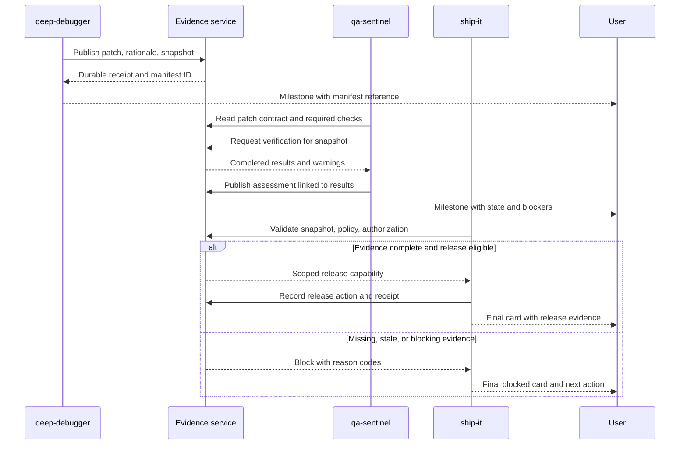
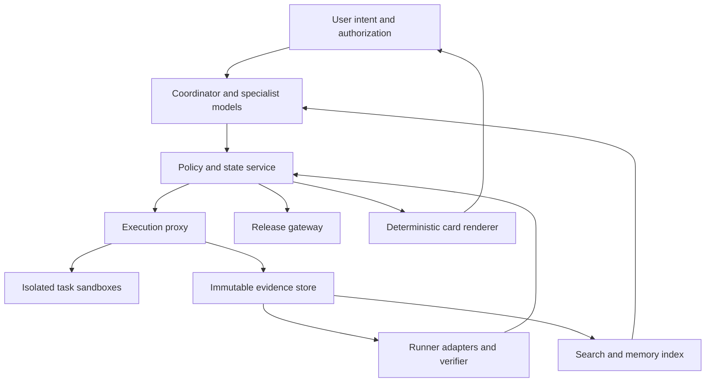
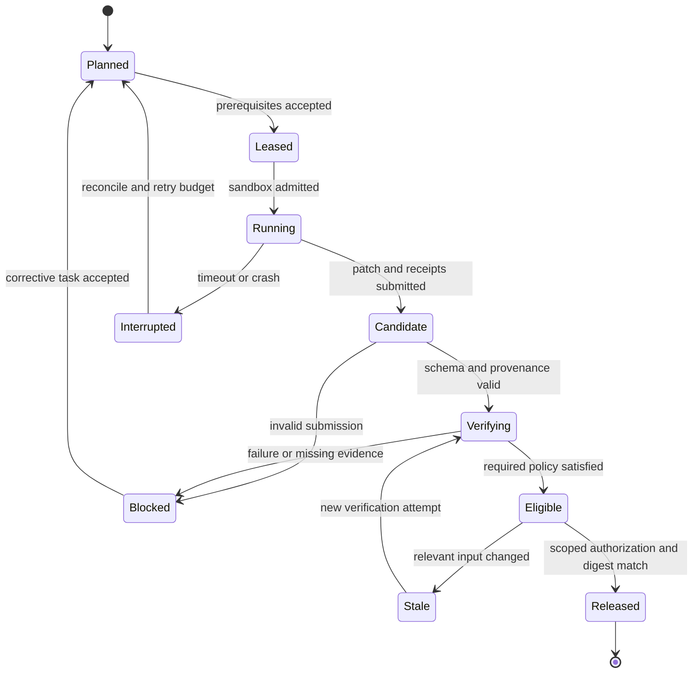
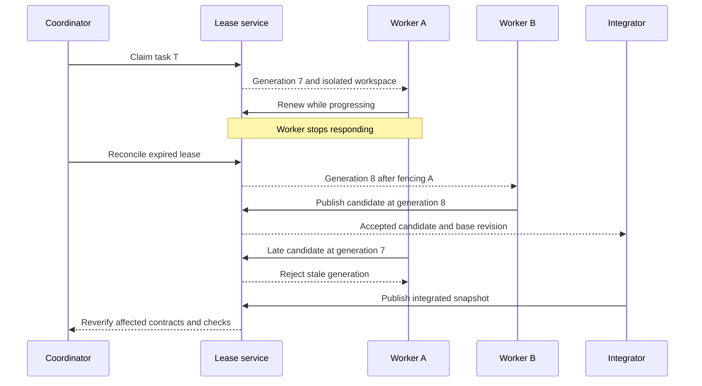

# From Prompt Protocols to an Evidence-Controlled Engineering Runtime

## Architectural feasibility, adversarial testing, and a successor blueprint for the Antigravity Engineering Skills Suite

**Engineering whitepaper | 25 September 2026 | Version 1.0**

**Scope:** The ten-skill design supplied in the mission; current primary documentation; an earlier available orchestrator artifact; and reproducible local failure probes. This is an architectural audit and implementation blueprint, not certification of an installed AGY environment.

---

## Executive summary

**Verdict: conditionally feasible as an engineering workflow; insufficient as a trustworthy autonomous release control system in its described prompt-only form.** The suite has useful separation of responsibilities and an unusually explicit approach to evidence presentation. Its central weakness is that the same probabilistic actor may perform work, summarize evidence, decide whether that evidence is complete, and authorize the next step. Better prose cannot close that trust boundary.

The Dual-Surface Evidence Model should be retained as a **human interface**, then backed by a third, machine-readable surface: a versioned evidence manifest. Chat cards explain; logs preserve; manifests coordinate. A downstream skill must consume the manifest and relevant artifacts, never infer readiness from a heartbeat. The release decision must bind to the exact integrated source snapshot and resulting build artifact.

The strongest claims in the proposed system require correction:

| Claim or assumption | Audit conclusion | Immediate replacement |
|---|---|---|
| A 15–25-line card plus logs eliminates context rot | It reduces exposure to redundant text; it does not guarantee retrieval, retention, freshness, or correct reasoning | Bounded active state, durable evidence, explicit retrieval and freshness checks |
| `collected > 0 && passed == collected` defeats false greens | It checks reported execution counts, not assertion quality, production fidelity, or coverage of required scope | Framework adapters, expected test inventories, boundary tests, completion evidence |
| Amber means safe to continue | Amber conflates known exceptions, unverified work, and accepted residual risk | Separate outcome, evidence completeness, and release disposition |
| Six personas guarantee adversarial critique | Correlated models can independently miss the same flaw or converge socially | Blind first opinions, evidence challenges, executable counterexamples, preserved dissent |
| More than 12 files justifies multi-agent execution | File count poorly predicts dependency coupling or integration cost | Schedule independent contract-bound tasks under resource and review budgets |
| Typed JSON makes model conclusions trustworthy | Types constrain representation; they cannot establish factual truth | Runtime-produced measurements, provenance checks, capability isolation |
| Three memory tiers guarantee zero degradation | No finite, lossy retrieval system provides this general guarantee | Measured retention and recovery objectives with explicit unknowns |

**Five actions to implement first:**

1. Introduce a runtime-owned `run_id`, immutable source snapshot, evidence manifest, and release gate. Missing or stale evidence blocks release.
2. Execute verification through a capture proxy that preserves the child exit status, timeout/signal, logs, structured reports, runner version, and command configuration.
3. Replace prose handoffs with typed contracts. Preserve warnings, assumptions, unverified scope, acceptance criteria, and required next actions under pipeline suppression.
4. Implement task leases, fencing generations, explicit file ownership, isolated databases/ports, and a single integration owner before expanding parallelism.
5. Run a seeded fault benchmark before tuning token budgets or adding more skills. Optimize cost per **accepted, correct change**, not tokens per conversation.

**Platform finding:** AGY currently documents skills with optional scripts/resources, subagents with isolated conversation context and worktree options, and lifecycle hooks. The migration can therefore begin inside AGY rather than requiring an immediate platform replacement. Native hooks are integration points; their actual coverage and failure behavior still need conformance tests on the installed version. [S1–S3]

**Empirical result from this audit:** Nine local probes reproduced false-success mechanisms involving unawaited asynchronous work, mock-only testing, shell pipelines, exit-code wraparound, and ignored log-write failure. All nine matched their expected observations. These are counterexamples to broad assurance claims, not measured failure rates for Antigravity. The full scripts and outputs accompany this report.

---

## 1. Method, evidence boundaries, and audit criteria

### 1.1 What was actually inspected

The mission specifies the roles and two invariants of ten skills. Their exact current `SKILL.md` files, helper scripts, runtime configuration, repository, and execution traces were not supplied. Searches located an earlier `SKILL.md`, internally named `adaptive-multi-worker-orchestrator`, last modified on 15 September 2026. It was read in full. It is **not assumed identical** to `adaptive-worker-orchestrator-v2` in this mission.

That earlier artifact already contains one-writer ownership, contract freezing, supported-capability discovery, separate heavy-job concurrency limits, integrated verification, dispatch reconciliation, and bounded delegated correction rounds. These are strengths worth preserving. It does not establish that the current ten-skill release implements the mission's Dual-Surface or Amber conventions. The supplied brief remains the baseline for those features. [L1]

Three evidence labels apply throughout:

- **Documented:** behavior described in a retrieved primary source, cited as `[S#]`.
- **Observed:** a local probe performed for this report, identified as `[E#]`.
- **Proposed / inferred:** architecture, risk analysis, or acceptance targets designed here. These are not claimed as installed behavior or measured vendor performance.

Documentation was accessed on 25 September 2026. Rolling documentation can differ from deployed binaries. Pin versions and validate actual schemas before adopting examples. Two requested comparison labels are historical: Cursor announced Notepads' deprecation for October 2025, and SWE-agent's documentation now describes it as maintenance-only and recommends mini-swe-agent. [S27, S31]

### 1.2 What “feasible” means

A feasible runtime must satisfy five independent properties:

1. **Safety of transitions:** prohibited state changes cannot be authorized by unsupported model claims.
2. **Evidence integrity:** measurements are bound to an identifiable execution and source snapshot.
3. **Recovery:** crashes, duplicate messages, missing artifacts, and restarts produce explicit recoverable states.
4. **Useful autonomy:** valid work proceeds within the user's existing authorization without unnecessary ceremony.
5. **Economic value:** coordination and verification overhead buy a measurable improvement in accepted outcomes.

No amount of runtime enforcement proves arbitrary software correct. The achievable guarantee is narrower: a release cannot proceed through the controlled path without satisfying a declared, versioned policy against available evidence. Requirements may still be incomplete; tests may still miss defects.

### 1.3 Severity and confidence

**P0** means a plausible invalid release, secret exposure, destructive shared-state action, or fabricated evidence can pass the designed control boundary. **P1** means materially unreliable execution, recovery, or decision quality. **P2** means efficiency, usability, or maintainability degradation. These are prioritization categories, not numerical likelihood estimates. Confidence is high for deterministic counterexamples and documented semantics; confidence in the installed suite is limited by unavailable source and runtime access.

---

## 2. Architectural feasibility and agent failure modes

### 2.1 Dual surfaces solve presentation, not memory correctness

The card/log split is sound progressive disclosure: short outcome-oriented communication with inspectable supporting detail. But it only reduces context load if the full tool result is kept out of model input **before ingestion**. Writing a 20,000-token trace to disk after returning it to the model does not recover those tokens or undo its influence.

Four distinct problems are often bundled into “context rot”:

| Problem | Does a compact card solve it? | Additional control |
|---|---|---|
| Attention diluted by repetitive output | Partially | Capture and summarize at the tool boundary |
| Important constraints lost during compaction | No | Protected decision/constraint records with identifiers |
| Relevant evidence not retrieved | No | Searchable manifests and targeted retrieval queries |
| Retrieved evidence refers to old code | No | Snapshot and dependency fingerprints |
| Contradictory facts accumulated over time | No | Supersession, provenance, and reconciliation rules |

Long-context research demonstrated position-sensitive retrieval in evaluated models; it does not establish a universal 30-turn failure threshold for current models. Anthropic's context-engineering guidance also treats compaction, external notes, and delegation as complementary techniques. Treat turn count as a workload descriptor, not a reliability boundary. [S4, S5]

**A card needs a byte/token budget, not only a line budget.** Twenty lines can contain 200 words or 20,000 characters. Count logical lines after normalization, cap field lengths, and render untrusted strings as text. Do not silently chop a risk list to fit a fixed card. Aggregate by severity, preserve every blocking category, and link to full detail.

The 15-line minimum creates waste for trivial tasks. Preserve 15–25 lines as the standard terminal engineering card where it adds value, but permit a smaller card for a one-file edit and an emergency exception when multiple independent blockers require visibility. The asymmetry should concern information value: Green is brief; Amber foregrounds conditions; Red foregrounds failure and recovery.

### 2.2 Token economics: an explicit model

Let `R` be raw trace tokens per stage, `C` card tokens, `M` manifest tokens actually read, `Q` retrieval overhead, and `K` repair/coordination overhead. An approximate incremental cost difference is:

`saved tokens = stages × (R − C − M − Q) − K`

This excludes shared prompts, source reads, model reasoning tokens, caching effects, and provider-specific billing. An illustrative 30-stage run with `R=4,000`, `C=400`, and no manifest/retrieval overhead removes 108,000 newly appended tokens. If every prior stage's output is resent on every later turn, the avoided repeated input exposure is `3,600 × (30×29/2) = 1,566,000` tokens. These are arithmetic examples, not observed usage or guaranteed savings.

Six council seats do not necessarily cost exactly six times a solo run: briefs, cross-examination, synthesis, and retries add cost; narrower context may subtract some. Measure input, cached input, output, reasoning usage where exposed, elapsed time, and accepted outcome separately. Do not translate missing counters into invented estimates presented as telemetry.

### 2.3 Disk sinks are fallible infrastructure

The model must not be responsible for remembering to preserve evidence after a command finishes. The execution layer should allocate a unique run directory before launch and capture output as it is produced.

| Failure | Why the card can lie | Required behavior |
|---|---|---|
| Disk full, quota, permission denial | Command succeeds but logs are absent or partial | Mark evidence incomplete; block required verification |
| Tool output truncation | Parser sees only the tail or success banner | Parse authoritative reporter artifact; record capture completeness |
| Process dies before flush | File exists but is incomplete | Final completion record only after process reaped and artifacts closed |
| Worker writes `result.json` twice | Last writer silently replaces earlier run | Immutable attempt paths and conditional publication |
| Success report reused from earlier run | Correct JSON describes wrong source | Match run ID, command, environment and snapshot |
| Agent can edit its own evidence | Hashes can be recomputed after fabrication | Runner-owned storage and credentials outside agent write scope |
| Logs contain secrets | Durable evidence becomes a leak | Restricted raw retention, redacted views, scoped access and deletion policy |
| Unbounded output floods disk | Logging becomes denial of service | Byte/time quotas with explicit overflow state |

“Full raw traces forever” is neither practical nor desirable. Define required capture scope, maximum volume, retention, compression, and access. If a quota is reached, record exactly what was dropped and preserve the failure as a release-relevant fact. A hash proves content identity; it does not prove the truth of content written by an untrusted actor.

Use a staging directory, durable file writes where required, atomic publication on the same filesystem, and a manifest committed last. A file rename alone is not a cross-host transaction or a universal durability guarantee. For distributed storage, publish immutable objects and reference them transactionally from the state store.

### 2.4 Pipeline heartbeat drift

Suppression is safe only when it suppresses presentation, not information flow. The heartbeat `✓ qa-sentinel: checks complete` cannot convey changed test selection, expected failures, a skipped migration test, a newly discovered compatibility constraint, or the fact that the checked tree differs from the staged tree.

The downstream consumer should receive a manifest containing:

- Task and acceptance-criterion IDs; source snapshot; contract revision; evidence producer.
- Changed files and semantic changes, with rationale and breaking-change notes.
- Required checks, executed checks, selected test IDs, outcome partitions, retry history, and raw exit/signal.
- Warnings with stable fingerprints, severity, owner, expiry, and affected release surface.
- Unverified areas, falsified hypotheses, unresolved assumptions, and next-step prerequisites.
- Artifact references with hash, byte count, format, attempt ID, and completeness.

`ship-it` needs the implementation change manifest and actual diff as well as QA evidence. QA's heartbeat is not a commit-message source. Nor should QA be required to reproduce every design rationale.



A nested pipeline needs an explicit `terminal_report_owner`, inherited by subflows, and an idempotent report ID. Otherwise several coordinators may each believe they are terminal, or every skill may suppress its output and no final card appears. A watchdog should publish a failure card if the owner dies. Never suppress a new critical blocker behind a success-shaped tick; render the actual state.

### 2.5 Asynchronous subagent coordination

AGY's documented subagents begin without the parent's conversation history. A role name or file path alone is insufficient context. Include relevant accepted requirements, contract revision, accessible artifact references, and failure policy in each brief. Verify actual tool names: AGY's subagent documentation also identifies a known issue involving unmapped tool names. [S2]

| Failure mode | Mechanism | Control and recovery |
|---|---|---|
| Duplicate dispatch after timeout | Coordinator does not know whether spawn succeeded | Idempotency key; reconcile returned IDs before retry |
| Split-brain task ownership | Expired worker continues after reassignment | Monotonic fencing generation; reject old publication |
| Shared-file overwrite | Two workers touch lockfile, routes, generated types, or global CSS | One owner, enforced write scope, explicit change requests |
| Partial completion | Patch exists but report does not, or vice versa | Two-phase candidate publication; incomplete state stays unverified |
| Out-of-order completion | Older attempt arrives after successful retry | Compare attempt generation and predecessor revision |
| Worktree resource collision | Distinct filesystems share DB, ports, caches or services | Per-attempt service namespaces and resource leases |
| Integration semantic conflict | Patches merge cleanly but disagree on behavior | Contract tests and integration checks on the merged snapshot |
| Orphan process after timeout | Killing an agent leaves tests/services alive | Process-group or sandbox termination, reconciliation, cleanup receipt |
| Dispatch fan-out exceeds resources | Six agents each launch many test workers | Separate agent, CPU, RAM, browser and DB concurrency budgets |
| Context laundering | Worker treats hostile repository/log text as instructions | Data/provenance labeling and capability controls |
| Worker “success” without execution | Natural-language assertion replaces evidence | Runtime receipts are mandatory; missing receipt is unverified |
| Coordinator failure | No one integrates or reports | Durable task graph; restart reconciliation; leased coordinator role |

Git worktrees isolate working directories and per-worktree state such as indexes; they still share repository objects and some references/configuration. It is inaccurate to claim every parallel worktree commit competes for the same index lock. Shared ref updates, same-branch checkout, repository maintenance, and mutable external resources remain collision points. `git worktree lock` protects a worktree from removal/pruning; it is not a general agent write mutex. [S7]

Use distinct branches from one recorded base, serialize shared ref/integration operations, and retain failed worktrees until their patches and diagnostics are secured. Do not “fix” lock contention by deleting lockfiles without proving no live process owns the operation. Fencing must be checked at the mutation boundary; rejecting an old report does not undo edits already made to a shared filesystem.

### 2.6 Replace the 12-file trigger

File count can inform estimation but must not authorize parallelism. A 50-file mechanical rename may be safest as one script. A six-file project can contain three independent modules.

Dispatch when `estimated serial critical-path reduction > coordination + integration + expected rework`, subject to risk and resource constraints. Choose active workers as the minimum of ready independent tasks, runtime slots, compute capacity, budget, and review capacity. Use dependency edges and shared-contract ownership to determine readiness. Record estimates as estimates and update them from observed runs.

The inspected earlier orchestrator already prioritizes dependency/ownership analysis over file count. Replacing that judgment with a rigid `>12` threshold would be a regression. [L1]

---

## 3. False-green defense and release rigor

### 3.1 Why counts and exit codes are necessary but insufficient

`collected > 0 && passed == collected` can be true when the selected suite is irrelevant, the test body contains no meaningful assertion, the assertion is never awaited, production dependencies are mocked away, or the test command filters out the failing package. It can also incorrectly reject legitimate expected failures or intentional skips if its denominator is undefined.

Use a versioned adapter to normalize runner semantics. A useful partition is:

`selected = passed + failed + skipped + expected_failed + unexpected_passed + cancelled`

Here each selected case has one terminal outcome; flaky is an additional property of attempts, not another mutually exclusive case count. `discovered = selected + deselected` is meaningful only when discovery and filtering are known to the adapter. Collection errors and crashed workers can make these equalities unavailable; do not invent counts to force reconciliation.

Minimum Green evidence requires all mandatory checks complete, selected IDs matching the intended inventory, no unapproved exclusions, no failures/cancellations/unhandled errors, valid report provenance, fresh snapshot binding, and all required acceptance criteria covered by appropriate evidence. This still does not prove that tests are good or requirements complete.

### 3.2 Boundary audit by framework

| Runner | Documented or plausible false-green boundary | Adapter policy |
|---|---|---|
| Vitest | `passWithNoTests` can permit empty runs; `dangerouslyIgnoreUnhandledErrors=true` prevents unhandled errors from failing a run | Pin effective config; deny unsafe overrides for release checks; inspect structured results and error channels; require expected project/test IDs [S10, S11] |
| pytest | No tests normally exits 5; plugins can change semantics; skips/xfails may leave exit 0; non-strict XPASS can hide obsolete expectations | Record plugin/config fingerprint; parse setup/call/teardown and collection outcomes; make relevant XPASS strict; apply skip/xfail policy [S9] |
| Cypress | Default failure-count exit behavior can wrap at multiples of 256; Module API can resolve its promise even when tests fail | Use supported `--posix-exit-codes`; read structured totals and infrastructure failures; do not equate resolved promise with success [S12, S13] |
| Playwright | Passing after retries can be classified flaky; focused tests or missing projects reduce scope; async assertions need awaiting | Use supported `--forbid-only` and `--fail-on-flaky-tests`; preserve attempts, selected projects and assertion discipline [S14, S15] |
| Cargo / libtest | Filters can select no tests; ignored tests are not executed by default; `--no-run` only compiles; custom harnesses change reporting | Inventory packages/targets/features; distinguish compile from execute; record per-binary outcomes and ignored cases; use a pinned supported reporter strategy [S16] |

The current pytest stable documentation lists exit code **6** for exceeding a warning limit. Hard-coding only the historically familiar 0–5 list would already be stale. An unknown nonzero code must fail a required check, while the adapter records the original code for diagnosis. [S9]

Do not assume `cargo test --message-format=json` universally supplies stable per-test JSON: Cargo compiler messages and test-harness results are distinct streams. Use a validated parser or an explicitly adopted test runner, and document which unit, integration, and doctest targets it covers. Do not silently drop doctests when changing runners. [S16]

### 3.3 Asynchronous tests that never verify the work

Consider this intentionally defective test:

```javascript
const { test } = require('node:test');
const assert = require('node:assert/strict');

test('purports to verify asynchronous work', () => {
  new Promise(() => {}).then(() => assert.equal(1, 2));
});
```

The assertion is unreachable because the promise never resolves, and the test does not await it. The local probe reports one passed test and exit 0. This is not an unhandled rejection: no rejection occurs. Global rejection monitoring cannot catch this case. [E1]

The repair must connect test completion to the operation and bound it:

```javascript
test('actually awaits the operation', { timeout: 100 }, async () => {
  await operationUnderTest();
  assert.equal(observedEffect(), expectedEffect);
});
```

For the deliberately unresolved operation, the bounded local probe exits 1 with a timeout/cancelled result. An initial unbounded awaited probe exceeded the harness's 15-second limit, illustrating why awaiting alone is not a sufficient liveness policy. [E2]

Controls include floating-promise linting where supported, explicit assertion expectations for callback tests, timeouts, checks of postconditions, and application-specific drain/close semantics. An arbitrary fixed sleep is not proof that all asynchronous effects finished. Node's process lifecycle and promise rejection behavior must be interpreted in the context of the actual runtime and runner. [S17]

### 3.4 Mocks, weak assertions, and measurement integrity

Mocks are useful for isolating behavior, but passing against a fake DB response does not verify SQL, migrations, constraints, authentication, or network behavior. In the local fixture, the mock-only test passes while the same service using its intentionally broken real boundary fails. [E3, E4]

For each critical acceptance criterion, classify evidence as unit, contract, integration, end-to-end, static, or operational. Require real-boundary evidence where the risk lives. Examples: a real database for migration compatibility; two principals for authorization isolation; a browser exercising the built app for critical flows; cancellation and shutdown tests for asynchronous work.

Use targeted mutation or fault injection to verify that meaningful regressions make the tests fail. A mutation score is not a proof of correctness and should not be optimized through trivial mutants. Review tests and production code together; an implementation agent must not silently weaken assertions or update snapshots to make its own change pass.

### 3.5 Amber must be a policy result, not a reassuring color

Separate three fields:

| Axis | Values | Meaning |
|---|---|---|
| Execution | `passed`, `failed`, `not_run`, `cancelled`, `timed_out`, `error` | What the runner observed |
| Evidence | `complete`, `partial`, `missing`, `stale`, `invalid` | Whether the claim can be assessed |
| Release disposition | `eligible`, `blocked`, `waiver_required` | Whether this release may proceed |

Derive the visible color. **Red**: a required check failed, evidence integrity is invalid, or a nonwaivable safety/correctness rule is violated. **Amber**: known warning, approved exception, flake, or incomplete verification whose underlying cause is not yet a demonstrated product failure. **Green**: required evidence is complete and fresh with no outstanding policy-relevant warning. Unknown or unrecognized states can never become Green.

Amber may be blocked. Green does not grant authority to deploy: user authorization and environment permissions remain separate predicates.

| Condition | Color | Deployment default | Rationale |
|---|---|---|---|
| Known deprecation, supported target runtime, owner and valid expiry | Amber | Eligible if policy pre-accepts this fingerprint | Bounded maintenance debt |
| Deprecation removes functionality on target runtime | Red | Block | Actual compatibility failure |
| Optional noncritical test skipped with approved rationale | Amber | Eligible only within scoped policy | Exclusion is visible and bounded |
| Required auth, payment, migration, data-loss or rollback check skipped | Amber | Block | Critical assurance missing |
| Failure disappears only after retry | Amber | Block by default; scoped quarantine may be allowed | Flakiness remains evidence of instability |
| Unhandled rejection/exception in a required check | Red | Block | Execution defect, even if the wrapper exits 0 |
| Missing/stale/truncated required report | Amber | Block | Unknown result; do not call the product broken |
| Report tampering or contradictory provenance | Red | Block | Integrity violation |
| Test intentionally selects zero cases in a package with no tests | Amber or not applicable | Only if the requirement explicitly permits this | No fake “0 tests passed” assurance |
| Newly discovered warning with no rule match | Amber | Waiver required for release | Classification is unresolved |
| Expired waiver or warning budget exceeded | Amber | Block | Previously accepted risk is no longer accepted |
| Measured memory/latency SLO breach | Red | Block | Functional tests do not override operational failure |

Classify by stable diagnostic code, origin, impact, and release scope before text matching. A warning called “deprecation” may be critical; a line containing “error” may quote a deliberately exercised negative test. Regex is a triage aid, not a final semantic classifier.

An exception record needs a fingerprint, affected check and artifact, owner, justification, compensating control, expiry, and authorizing identity. Carry it into the release record. Do not let the implementation worker approve its own waiver. Configure recurring accepted exceptions once; do not repeatedly ask users to accept the same bounded condition.

### 3.6 Freshness and the final release gate

Required release condition:

`authorized AND snapshot_matches AND build_digest_matches AND evidence_complete AND mandatory_checks_satisfied AND exceptions_valid AND policy_current`

The snapshot must include tracked changes, relevant untracked inputs, dependency locks, submodule state, effective test configuration, tool versions, and declared environment inputs. A clean Git SHA alone is insufficient if tests executed an altered working tree. Prefer a sealed source snapshot and isolated build; otherwise detect mutation during verification and invalidate the result.

After integration or a relevant edit, invalidate dependent checks. An advanced impact map may reuse unaffected evidence, but a conservative full invalidation is the safe initial implementation. Test the deployable artifact where practical and promote that digest; rebuilding between test and deployment introduces an additional reproducibility obligation.

`ship-it` should distinguish commit creation, push, tag, release publication, and deployment. A conventional commit message and a clean worktree establish none of the later steps. Report exact receipts for each authorized action. Secret scanning should inspect the staged diff and, when pushing, newly reachable history and relevant generated artifacts under an explicit scope. No scanner guarantees absence of secrets.

---

## 4. Four adversarial stress scenarios

These scenarios are designed experiments, not claims that the unavailable suite was run. Each includes seeded faults, expected breakpoints, controls, and a measurable oracle.

### 4.1 The 50-file legacy monolith refactor

**Fixture:** A monolith migrates `customers.full_name` into structured fields while changing its API and dashboard. Fifty files include migrations, ORM models, serializers, API contracts, UI consumers, fixtures, route registries, and shared lockfiles. Old and new app versions overlap during rollout. Legacy rows contain NULLs, duplicates, and nonstandard names.

**Faults to inject:** Two workers choose the same migration sequence; one changes a shared type after another has implemented against it; both test against the same database; a backfill crashes at 40%; a generated client is stale; an index build encounters duplicates; a UI worker passes unit tests against fixtures that never migrated. A final integration edit occurs after QA succeeds.

**Where the described system breaks:** `>12 files` creates parallel workers before schema/API contracts are settled. Worktrees prevent source overwrite but not DB collisions. Each branch passes scoped tests against its own assumptions. The coordinator integrates clean diffs, treats worker greens as cumulative proof, and suppresses the compatibility warning to one line. `ship-it` deploys a mixed-version-incompatible schema.

**Controlled execution:**

1. Record data invariants, API compatibility, source snapshot, and rollout/rollback constraints. Inventory consumers and DDL operations.
2. Give `schema-craft` sole migration ownership; give one owner the API contract and generated client. Freeze contract revisions before consumer work starts.
3. Separate **expand**, **migrate/backfill**, **switch reads/writes**, and **contract**. Keep destructive removal out of the initial deployment.
4. Parallelize UI modules and unrelated components only after contracts are ready. Allocate per-worker DB/schema, port, output directory and resource budgets.
5. Make backfill idempotent, checkpointed, resumable and observable. Reconcile old/new representations explicitly if dual writes are used; dual writes themselves can diverge.
6. Integrate on one branch. Run old-app/new-schema and new-app/expanded-schema compatibility checks plus production-like data validation and query-plan checks.
7. Rehearse rollout, lock waits, resource saturation, interruption and recovery. Verify the final integrated artifact after all edits.
8. Contract only after old consumers have retired and the agreed rollback window has elapsed. Record point-of-no-return and forward-repair strategy.

**DDL nuance:** In PostgreSQL, concurrent index creation avoids the ordinary build's write blocking but has restrictions, can fail leaving an invalid index, and cannot be wrapped in a normal transaction block. Certain constraints can be added `NOT VALID` then validated separately, with operation-specific lock behavior. “Zero downtime” is a tested rollout property, not a property inferred from a migration filename. Pin the database version and review each operation. [S18, S19]

**Index mandates should be workload-aware.** Automatically indexing every column increases write cost and storage. Require a rationale tied to access paths, uniqueness, foreign-key maintenance and observed plans; record exceptions rather than rewarding index count.

**Pass oracle:** No stale-contract task is accepted; no workers share mutable test data; the resumed backfill preserves invariants; mixed-version compatibility holds; injected post-QA edits invalidate evidence; the destructive phase cannot start early. Measure p95/p99 latency, lock waits, replication lag where relevant, backfill progress and data reconciliation, using project-specific budgets.

### 4.2 The silent asynchronous memory leak

**Fixture:** A service attaches per-request listeners and retains request bodies in a closure after cancellation. Short unit tests and mocked HTTP calls pass with exit 0. Under sustained load, memory grows until the process is killed.

**Likely failure:** `deep-debugger` equates passing tests with closure, tries several unrelated edits, and mistakes one lower RSS sample after restart for a fix. `qa-sentinel` has no operational criterion in its required-check manifest.

**Hypothesis-driven protocol:**

| Hypothesis | Discriminating experiment | Evidence against it |
|---|---|---|
| Unbounded cache | Hold request cardinality fixed; inspect cache entry count and retained keys | Memory grows while cache size is stable |
| Listener retention | Count listeners across repeated connect/cancel cycles; inspect retaining paths | Listener count and retained request objects remain bounded |
| External buffers/native memory | Compare heap-used, external/array-buffer metrics and RSS | Growth is primarily reachable JavaScript objects |
| Delayed cleanup/backpressure | Stop load and observe queue/drain/close behavior | Retained objects remain after legitimate work drains |
| Test/load harness leak | Run control service with the same harness | Growth occurs in the target only |

Start with a reproducible load schedule, concurrency, request cardinality, payload size, cancellation rate, warm-up, and observation duration. Record heap-used and RSS separately, queue depth, active requests, listeners, GC behavior and latency. RSS growth alone can reflect allocator behavior or caching, not necessarily a retained-object leak.

Take comparable heap snapshots in an isolated environment after warm-up and after sustained load; inspect dominators/retaining paths. Sampling and snapshots can perturb the workload. Change one causal mechanism, then rerun the same workload and a cancellation/shutdown regression. Use an explicit experiment budget and stop when observations invalidate the current hypothesis rather than launching shotgun edits.

An illustrative acceptance envelope might specify a calibrated upper bound on post-warm-up retained-heap growth across repeated runs, stable queue/listener counts after drain, and no p99 latency regression. A bound such as 1 MiB/minute must come from the service's workload and memory budget; it is not a universal standard. Positive controls should show the original leak is detected.

**Pass oracle:** The original defect is reproducible, retaining paths support the causal explanation, the focused patch reverses the signal under identical conditions, and the soak run meets predeclared budgets. A short unit pass remains insufficient. If operational verification is unavailable, the fix is Amber and deployment is blocked where this criterion is mandatory.

### 4.3 The AI-slop hallucination trap

**Fixture:** “Build a clean modern dashboard.” No brand references, density target, accessibility requirements, or primary workflow are supplied. The model chooses a purple gradient hero, repeated rounded cards and generic icons.

**Likely failure:** `anti-slop-spec` lists forbidden visual tropes, while `frontend-artisan` chooses one of ten archetypes as a template. The output avoids purple but reproduces the same generic hierarchy in beige. A lexical ban passes while usability and visual specificity remain poor.

**Responsibility boundary:** `anti-slop-spec` produces a design contract; `frontend-artisan` implements it. The contract needs user tasks, information hierarchy, density, typography roles, palette rationale, layout geometry, navigation, state treatments, accessibility and performance budgets. Ten archetypes should be starting hypotheses, not ten mandatory templates.

For a server dashboard, a concrete contract could prioritize container identity/state and actions in the main area, put system telemetry in a fixed right rail, use restrained state colors, and choose a dense list with expandable operational detail. That is more constraining than “make it unique.” Loading, empty, error, stale-data, permission-denied and narrow-screen states must be specified.

```json
{
  "contract_version": "design.v1",
  "primary_task": "identify and inspect an unhealthy container",
  "hierarchy": ["container state", "container identity", "actions", "telemetry"],
  "layout": "dense main list with a right telemetry rail",
  "prohibited_patterns": ["decorative gradient hero", "identical KPI card wall"],
  "required_states": ["loading", "empty", "error", "stale", "narrow-screen"],
  "review": ["task completion", "keyboard access", "visual hierarchy"]
}
```

A preflight scan can flag `rounded-xl`, gradient utilities, or an unapproved icon dependency **when the selected contract prohibits them**. Those strings do not intrinsically establish poor design. Inspect rendered pages at agreed viewports and with realistic data, long labels and error states. Use human or calibrated visual review for composition; use deterministic checks for keyboard behavior, semantics and known contrast constraints.

**Pass oracle:** The dashboard supports the actual operational task, matches the approved contract, and handles required states. No percentage “originality score” is claimed from token scanning. Useful familiar patterns should not be rejected merely to force novelty.

### 4.4 The false-consensus council

**Fixture:** A proposal recommends a single shared database with cross-tenant access enforced only in the UI, synchronous writes to two stores, and no restore exercise. Six identical-model personas receive the author's enthusiastic framing and see one another's answers immediately.

**Likely failure:** The first favorable response anchors the discussion; later agents paraphrase it; the chair interprets six endorsements as six independent validations. Different persona names do not create independent evidence. Research on multi-agent debate has examined sycophancy and conformity, supporting evaluation of these effects rather than assuming debate removes them. [S20]

**A stronger six-seat protocol:**

| Seat | Independent obligation |
|---|---|
| Systems architect | Find violated consistency/availability assumptions and alternatives |
| Security reviewer | Attempt an authorization boundary counterexample |
| Reliability engineer | Trace failure, recovery, backup and restore paths |
| Data engineer | Check invariants, migration and reconciliation behavior |
| Product/operator advocate | Evaluate workflow, operational burden and user impact |
| Evidence auditor | Challenge unsupported claims, benchmarks and test adequacy |

First obtain sealed independent reviews before sharing any vote. Each review must include at least one falsifiable risk hypothesis or an explicit explanation of why no supported objection was found. Do not require invented criticism. Then exchange anonymized challenge records, run the most consequential experiments, and collect revised positions identifying which evidence changed them.

Use different evidence sets and, where available and justified, different model families. This can reduce correlated failure but does not guarantee independence. Keep an external acceptance oracle: for example, a cross-tenant API request must be denied by the backend, and an interrupted dual write must reconcile correctly.

The chair must preserve unresolved dissent and distinguish “six agents agreed” from “the architecture passed six independent tests.” A majority cannot waive a critical counterexample. If a seat times out, label the council incomplete; never fabricate its contribution. Re-run only the missing or invalid seat within a bounded policy.

**Pass oracle:** The deliberately seeded authorization flaw is detected and blocks acceptance; at least one consequential claim is tested; unsupported consensus is not treated as proof. Track seeded-defect recall and false accusations across multiple runs. No protocol can guarantee genuine critique or truth for arbitrary proposals.

---

## 5. Skill topology: ownership, redundancy, and missing domains

### 5.1 Ten skills should not become ten permanent services

The skill count is an organizational choice, not an architectural optimum. Most tasks should load a small relevant subset. Shared invariants belong in one versioned runtime contract referenced by skills; copying the entire Amber protocol into ten markdown files creates drift.

| Skill | Sole primary responsibility | Required output | Boundary to enforce |
|---|---|---|---|
| `prompt-architect` | Normalize intent, select minimal workflow and risk tier | Task contract and selected capability graph | Does not invent a full delivery plan or silently broaden scope |
| `anti-slop-spec` | Define task-specific design direction and acceptance rubric | Design contract | Does not implement a second frontend or veto approved brand choices |
| `frontend-artisan` | Implement and render the agreed design | Patch plus visual/interaction evidence | Does not unilaterally redefine design acceptance |
| `idea-council` | Investigate consequential alternatives and disputed claims | Decision record, evidence, dissent | Advice does not authorize execution or release |
| `plan-master` | Build dependency-aware execution plan from accepted intent | DAG, owners, acceptance checks and milestones | Does not repeatedly reselect the team without a scope change |
| `schema-craft` | Own data invariants and migration compatibility | Migration contract and rehearsal evidence | Does not apply production DDL merely because a plan exists |
| `deep-debugger` | Isolate causes through discriminating experiments | Hypothesis ledger, focused patch, regression evidence | Does not lower QA gates or make unsupported root-cause claims |
| `qa-sentinel` | Assess change against required evidence | Assessment with linked runtime receipts | Does not authoritatively self-report runner measurements |
| `ship-it` | Prepare and execute authorized release actions | Commit/release receipts bound to artifact | Cannot waive QA policy or infer permission from Green |
| `adaptive-worker-orchestrator-v2` | Schedule and integrate independent work | Task/lease ledger and integrated candidate | Does not own every specialist's domain judgment |

`anti-slop-spec` and `frontend-artisan` are useful separate roles when the design contract is reusable or disputed. For a small change, one invocation can execute both phases without redundant narration. Similarly, `prompt-architect` selects the workflow and defines intent; `plan-master` turns accepted intent into dependencies and verifiable work. Replanning every time a new skill starts creates loops and scope drift.

The orchestrator should be execution infrastructure available to a selected workflow, not an automatic super-skill that overrides the coordinator. Manual-only invocation semantics for council/planning must remain explicit. Routing rules need negative triggers and precedence rules, not just broad keyword matching.

### 5.2 Missing coverage

| Domain | Gap in the described suite | Appropriate owner |
|---|---|---|
| API and application security | Secret scanning does not test authorization, injection, SSRF, abuse or tenant isolation | New `security-verifier` |
| Infrastructure and deployment | No explicit IaC plan validation, environment drift, rollout/rollback or disaster recovery owner | New `runtime-reliability` |
| Observability and performance | Unit success can hide leaks, saturation, slow queries or operational blind spots | `runtime-reliability` with `deep-debugger` |
| API contracts and documentation | Consumers may integrate against undocumented or incompatible changes | Contract artifacts owned by plan/domain skill; generated docs verified in QA |
| Supply-chain integrity | Dependency provenance, license constraints, SBOM and artifact signing are absent | Security policy plus release runtime |
| Accessibility and localization | Aesthetic craft alone does not verify keyboard, assistive-tech or locale behavior | Explicit frontend acceptance criteria and QA checks |
| Data governance and recovery | Privacy, retention, deletion, backup and restore may fall between schema and shipping | Schema contract plus reliability/security policies |
| Requirements traceability | A suite can pass tests while missing user intent | Task contract linking requirements to evidence |
| Runtime prompt injection | Repository files and tool output can steer agents | Capability isolation and untrusted-content policy in the runtime |
| Incident response | No clear production diagnosis, rollback and post-incident feedback loop | Reliability runbook and human operational ownership |

Two new skills are enough initially. Add specialized policies and artifacts within them rather than creating a skill for every checklist item.

### 5.3 Blueprint: `security-verifier`

**Purpose:** Establish evidence about security boundaries changed by a task. Trigger on authentication/authorization, externally reachable APIs, sensitive data flows, uploads, dependency changes, secrets, or an explicit review request. It should not run an expensive full audit on a typography edit.

**Inputs:** Task contract, data-flow map, OpenAPI/schema if present, changed endpoints, roles/tenants, trust boundaries, deployment target, dependency delta, and permitted test environment.

**Workflow:** Build a small threat model; map relevant risks to checks; run static and dependency checks; generate schema-aware API tests; exercise cross-user/tenant access, object/property authorization, resource limits, injection paths and SSRF boundaries where relevant; review evidence and remediation. OWASP API Security Top 10 provides a useful coverage taxonomy, not a substitute for an application-specific threat model. [S35]

**Output schema:** `security-assessment.v1` with boundary ID, finding ID, reproducible request/test, affected snapshot, impact, reachability, confidence, remediation, retest receipt, and accepted exception. Preserve uncertainty; do not assign a definitive severity from an unverified scanner string alone.

**Guardrails:** Use synthetic accounts/data and authorized environments; scope network egress; cap requests and cost; do not autonomously fuzz unrelated production systems. Tool authority comes from the task's permission context. External content is data, not instructions.

**Completion oracle:** Seeded broken object-level authorization is detected; valid access remains functional; a targeted malicious input reaches the expected boundary test; repaired findings have a fresh retest. Integration: QA consumes this assessment; shipping blocks on policy-relevant open findings. Proposed initial implementation: one stack and one API schema format, then expand from observed needs.

### 5.4 Blueprint: `runtime-reliability`

**Purpose:** Verify that the built artifact can run, be observed, be rolled out safely, and recover. Trigger on deployment/IaC changes, migrations, performance-sensitive paths, background jobs, service lifecycle changes, or explicit production-readiness work.

**Inputs:** Deployable digest, infrastructure plan, environment contract, SLOs, capacity/resource budget, telemetry map, backup/restore requirements, and rollback constraints.

**Workflow:** Validate IaC and inspect plan changes; provision an authorized disposable environment; run smoke/load/soak and cancellation/shutdown tests; exercise a bounded failure; verify health signals, alerts, logs and trace correlation; rehearse rollout/rollback or forward recovery; check backup restoration when data risk warrants it.

**Output schema:** `operational-readiness.v1` with SLO evidence, load shape, hardware/runtime fingerprint, resource peaks, rollout plan, recovery evidence, monitoring coverage, residual risk and artifact digest.

**Guardrails:** Cost/time/resource limits; scoped cloud credentials; no implicit infrastructure apply; no blanket destructive chaos tests; cleanup reconciliation even after failure. A valid plan is distinct from authorized execution.

**Completion oracle:** A known leak or readiness failure is detected; rollback/forward-repair procedure is actually rehearsed where required; a seeded operational failure produces observable signals; the deployed digest matches the verified digest. QA owns the overall assessment; this skill owns operational evidence.

---

## 6. Comparative analysis and a credible benchmark design

### 6.1 Compare layers, not brand names

The ten-skill suite is a workflow/policy layer. Claude Code, Cursor and Devin are agent products with execution environments and user interfaces; AutoGPT and SWE-agent provide different framework abstractions. A prompt package cannot fairly claim infrastructure parity because it names equivalent roles.

| System or pattern | Documented capability relevant here | Suite's potential advantage | Suite's current architectural deficit |
|---|---|---|---|
| Claude Code | Custom subagent contexts, worktree support and lifecycle hooks; agent teams coordinate sessions with added overhead [S21–S23] | One consistent evidence and exception vocabulary across specialist workflows | Prompt instructions alone do not match hook enforcement, lifecycle management or isolation |
| Anthropic Computer Use | General GUI tool execution with documented prompt-injection/security considerations [S24] | Domain-specific contracts can make coding/release behavior easier to audit | GUI screenshots/actions are not proof of backend correctness; suite needs a typed action/evidence layer |
| Cursor Agent/Composer ecosystem | Project rules, isolated cloud environments and hooks; Notepads are deprecated [S25–S27] | Explicit cross-skill risk inheritance and release manifest can improve audit consistency | Generic “rules” are already supported; suite must prove stronger enforcement and better outcomes |
| AutoGPT Platform | Graphs of blocks; block SDK models input/output schemas [S28] | Deeper coding-specific acceptance and migration semantics | Markdown pipeline lacks equivalent explicit executable graph/data contracts |
| Devin | Persistent knowledge guidance and documented parallel-session comparison workflows [S29, S30] | Portable, repository-controlled evidence policy; precise exception handling | Environment management, durable sessions and operational coordination need implementation |
| SWE-agent / SWE-ReX | Execution environment abstraction, history processing, stored trajectories; maintenance-only status now noted [S31, S32] | Broader lifecycle roles and concise human-facing summaries | Needs a real execution harness, reproducible trajectories and independent grading |

Do not describe SWE-agent as inherently a six-agent coordination framework. Its documented core is an agent interacting with an execution environment; parallel evaluation runs and multi-agent cooperation are different architectures. Similarly, Computer Use is an interaction modality, not a replacement SDLC topology.

The Dual-Surface Model is **potentially superior to ad hoc chat-only reporting** in auditability and warning visibility. It is not categorically superior to these products: they also provide trajectories, artifacts, context management or structured workflows. Its differentiator would be a tested, portable evidence contract and release policy, not the existence of logs. Anthropic's documented orchestrator/worker and evaluator/optimizer patterns already cover much of the conceptual decomposition. [S37]

### 6.2 Benchmark arms

Use the same task corpus, starting snapshots, model/version where configurable, tool budget, execution environment, network policy and acceptance grader. Separate product-level evaluation from harness ablation: vendor products cannot always be configured to identical models or tools.

| Arm | Configuration | Question answered |
|---|---|---|
| A | Single agent, ordinary repository instructions | Baseline outcome and cost |
| B | Ten-skill prompts with card/log conventions | Value of workflow guidance alone |
| C | B plus runtime capture, manifests and release gate | Value of deterministic evidence enforcement |
| D | C plus dependency-aware parallel workers | Net value of concurrency |
| E | D plus council only on selected design tasks | Value of deliberation where uncertainty warrants it |
| F | D plus indexed memory and resume protocol | Multi-day retention/recovery value |

Do not run every arm on every tiny task by default. Predeclare which comparisons answer which hypothesis. Suggested pilot: 24 tasks across the four adversarial families, small control changes, and recovery cases; three independent runs per selected arm. This estimates variability but is not enough to establish a very low false-green rate. Expand the sample based on observed variance and the risk target.

### 6.3 Metrics that cannot be gamed by concise output

| Metric | Definition |
|---|---|
| Accepted task success | Independent acceptance checks pass on the final artifact, with no disallowed action |
| False-green rate | Runs declared Green that fail an independent oracle / runs declared Green |
| Unsafe release rate | Ineligible artifact reaches controlled release sink / attempted releases |
| Defect detection recall | Seeded defects correctly detected / seeded applicable defects |
| False accusation rate | Clean controls incorrectly blocked as product defects / clean controls |
| Cost per accepted task | All measured model/tool/compute costs / accepted tasks |
| Time to accepted result | End-to-end elapsed time including integration and repairs |
| Evidence completeness | Required receipts complete and fresh / required receipts |
| Resume correctness | Correct recovery of constraints, current snapshot and next action after restart |
| Warning retention | Policy-relevant warnings reaching final assessment / warnings generated |
| Coordination waste | Duplicate work, discarded patches, merge repair and idle critical-path time |
| Human review burden | Time and accuracy locating change, evidence and blockers in a blinded review |

Record medians and tail latency, confidence intervals, task-level paired differences and per-family results. Repeated seeds on one task are not independent evidence of broad coverage. Blind graders to the arm where practical and keep hidden acceptance tests outside agent write scope. Assess both outcome and trace; one neither replaces the other. [S38]

For a binomial metric with zero observed failures in `n` reasonably independent trials, the approximate 95% upper bound is `3/n`. Zero failures in 30 trials still permits roughly 10%; zero in 300 permits roughly 1%. This heuristic illustrates why “all pilot tasks passed” cannot establish production reliability. Correlation weakens this inference further.

### 6.4 Multi-day memory and fault benchmark

Create 30-, 60- and 120-turn sessions with constraints introduced early, mid-session and after compaction. Include a deliberate requirement supersession, repository revision change, coordinator crash, log truncation, worker timeout, stale report replay and malicious instructions embedded in a log. Ask for concrete decisions whose correctness depends on the active constraint set.

Measure correct retrieval and source freshness, not verbatim transcript recall. The target is preserving engineering decisions, unresolved risks and current state. Run an ablation with lexical/SQL retrieval before adding vectors; a vector index should earn its cost through measured retrieval lift.

---

## 7. Prioritized upgrade roadmap and prompt hardening

### 7.1 Delivery order

Effort estimates below assume one experienced engineer, a single repository/stack and an existing CI environment. They are planning ranges, not promises.

| Priority | Upgrade | Concrete deliverable | Exit criterion | Indicative effort |
|---|---|---|---|---|
| P0 | Trusted execution capture | Proxy plus immutable run directories | Child failure, timeout and sink failure cannot become verified success | 3–5 days |
| P0 | Evidence and release gate | Manifest, snapshot fingerprint, policy reducer | Missing/stale/forged evidence and unauthorized release are blocked | 3–5 days |
| P0 | Runner adapters | One production runner first | Empty selection, focus, retries, skipped critical cases and unhandled errors classified | 2–4 days per runner |
| P0 | Ownership and lifecycle | Leases, fencing, scoped write paths, cleanup | Duplicate/late workers cannot overwrite accepted work | 3–5 days |
| P1 | Typed handoff and reporting | Shared contract plus deterministic card renderer | All warnings survive nested pipeline suppression | 2–3 days |
| P1 | Recovery and memory | SQLite ledger, search, resume protocol | Restart recovers the exact latest accepted state | 3–5 days |
| P1 | Security/reliability skills | Bounded workflows consuming runtime evidence | Relevant seeded security/operational defects detected | 1–2 weeks total |
| P1 | Evaluation harness | Seeded corpus, independent grader, metrics | Paired pilot report with uncertainty and no invented counters | 1 week initial |
| P2 | Semantic/graph retrieval | Incremental index with provenance | Measurable improvement over lexical/SQL retrieval | 1–2 weeks |
| P2 | Routing and economics | Learned estimates or calibrated heuristics | Lower cost/time per accepted result without reduced assurance | Continuous |

Do not wait for all ten skills to be rewritten. Harden one representative path—`deep-debugger → qa-sentinel → ship-it`—then migrate others through the same contract.

### 7.2 Proposed `SKILL.md` contract patch

This is a generic proposal, not a diff against unavailable current source. It centralizes semantics while leaving domain expertise in each skill.

```diff
- Report success when tests pass and write full output to a log.
- In a pipeline, emit only a one-line milestone.
+ Invoke the registered execution adapter for every required check.
+ Do not claim a check ran without a runtime receipt.
+ Read the upstream handoff contract before acting on its result.
+ Preserve risk IDs, assumptions, unresolved scope and contract revision.
+ Publish a candidate assessment referencing immutable receipt IDs.
+ The runtime computes status and release disposition.
+ Pipeline suppression affects chat only; publish the full handoff.
+ Never downgrade missing, stale or invalid evidence to success.
+ Do not rewrite tests, policy, baselines or waivers merely to pass a gate.
+ If a capability is unavailable, report the missing capability explicitly.
+ Use the designated report owner; escalate new blockers immediately.
```

Add a machine-readable sidecar, rather than relying on nonstandard YAML frontmatter fields being recognized by every host:

```yaml
id: qa-sentinel
contract_version: 1
inputs: [task.v1, change.v1, execution-receipts.v1]
outputs: [assessment-proposal.v1]
required_capabilities: [run_check, read_artifact, publish_assessment]
forbidden_capabilities: [approve_own_waiver, deploy]
manual_only: false
max_repair_rounds: 2
report_policy: inherit_terminal_owner
```

For manually invoked skills, set `manual_only: true` in the suite's router. This sidecar is interpreted by the proposed runtime, not asserted to be a native AGY schema.

### 7.3 Deterministic linting and bounded regex use

Useful syntax checks include:

```text
skill ID:       ^[a-z][a-z0-9]*(?:-[a-z0-9]+)*$
SHA-256 digest: ^[a-f0-9]{64}$
heartbeat:      ^\[(GREEN|AMBER|RED)\] [a-z0-9-]+: [^\r\n]{1,160}$
```

For conventional commits, a proposed syntactic policy is `type(scope)!: subject`, with an allowed type set and subject length limit. Use a dedicated parser to validate complete commit messages, breaking-change footers and repository conventions. Regex cannot determine atomicity, truth, security, or whether the message explains the actual diff.

Parse JSON using a real parser; reject duplicate keys at ingestion where the parser otherwise accepts them, unknown fields, invalid enums and oversized payloads. Validate references and cross-field relationships after schema parsing. Normalize control characters before display. Do not use a warning-text regex or a shell-command substring denylist as a security boundary.

### 7.4 Native AGY hooks: use the actual contract

AGY documents `.agents/hooks.json`, `PreToolUse`, `PostToolUse`, `PreInvocation`, `PostInvocation` and `Stop`. `PreToolUse` can deny a proposed tool action. Its documented `PostToolUse` payload includes call metadata and optional error; do not assume it contains full command stdout. `PostInvocation` supports step injection and termination behavior, not a documented general guarantee of pre-display response replacement. A `Stop` payload includes whether background work is fully idle. [S3]

An illustrative registration shape, requiring a real installed handler and conformance tests:

```json
{
  "evidence-policy": {
    "PreToolUse": [{
      "matcher": "run_command|write_to_file|replace_file_content|multi_replace_file_content",
      "hooks": [{
        "type": "command",
        "command": "/opt/agy-policy/bin/preflight",
        "timeout": 5
      }]
    }]
  }
}
```

The handler should be installed outside agent-writable source. It checks identity, task lease, owned scope, allowed action and existing authorization, and returns the documented allow/deny decision. It must not broaden permissions through overrides. This registration alone does not capture all execution: validate MCP, browser, direct filesystem and alternate command paths too.

A hook that merely checks whether a command contains `git push` is bypassable through scripts, aliases or API clients. Real enforcement limits available credentials and routes protected actions through a gateway. Hook timeout/crash behavior must be tested; an application default of “continue” cannot be treated as fail-closed. The release gateway must independently deny when its policy service is unavailable.

Use `Stop` to detect incomplete work, but cap continuation attempts. A permanent missing artifact must produce a blocked final result rather than an endless `continue` loop. For deterministic control over what reaches chat, buffer and render through a controlled UI/transport; do not claim a markdown instruction or post-hoc hook can retract already streamed text.

---

## 8. Successor architecture: an evidence-controlled agent mesh

### 8.1 “Neuro-symbolic” as an implementable boundary

Use neural models for interpretation, decomposition, design alternatives, hypothesis generation and code changes. Use deterministic software for identity, capabilities, state transitions, budgets, execution capture, evidence validation and release gating. This does not require a new model or imply symbolic proof of all generated code.

Start with a modular local service, not ten networked microservices. The service can expose MCP tools or a CLI and later split into remote workers when scale justifies it. MCP supplies transport and schema-bearing tool interfaces; it is not itself a sandbox, policy engine or guarantee that every host validates outputs. Its tool specification supports an optional output schema and structured results, which are useful building blocks. [S33]



**Control plane:** task DAG, lease/fencing service, policy reducer, schemas, budget and authorization registry. **Execution plane:** constrained runners and sandboxes. **Evidence plane:** immutable artifacts, structured receipts and indexes. **Presentation plane:** cards, drill-down and explicit blocked states. Model proposals cross these boundaries through typed APIs.

### 8.2 Minimal capability API

| Tool | Caller | Authority |
|---|---|---|
| `task.read` | Relevant agent | Read accepted task contract and active constraints |
| `task.claim` | Scheduler | Lease one task with generation and write scope |
| `check.run` | Authorized specialist | Select registered check profile on sealed snapshot |
| `artifact.read` | Authorized agent | Retrieve bounded evidence by ID/range/query |
| `candidate.publish` | Worker | Propose patch and assessment; cannot set verified status |
| `assessment.get` | Coordinator/QA | Read runtime-computed result with reasons |
| `exception.request` | Coordinator | Propose a bounded waiver; no self-approval |
| `release.prepare` | Release coordinator | Construct reviewable release artifact and plan |
| `release.execute` | Gateway | Execute only with valid policy/authorization capability |

Prefer `check.run(profile_id, snapshot_id)` over unconstrained shell text for mandatory verification. Registered profiles contain argument vectors, runner version, effective config and required report paths. General development commands can still run in a sandbox, but they do not automatically become trusted release evidence.

### 8.3 Isolation and its limits

For each task, use an immutable base snapshot plus writable overlay, non-root execution, scoped mounts, resource limits, process isolation, isolated services and constrained egress. Never expose the host Docker socket or release credentials to ordinary code-generation workers. Keep policy binaries, trusted test definitions and evidence authority outside their write scope.

Containers share a host kernel; they are not equivalent to virtual machines. For hostile/untrusted code, choose stronger isolation such as a suitable microVM or hardened sandbox according to the threat model. Do not market a “micro-sandbox” label as a security property. Toolchain provenance, dependency installation and network access remain part of the attack surface.

Separate mutable caches by tenant/trust level and use content-addressed read-only caches where possible. A shared writable dependency cache can become an indirect cross-worker channel. Resource accounting must include child test workers and browsers, not only agent process counts.

### 8.4 A state machine with explicit invalidation



`Eligible` is computed, never directly requested by a worker. Old failures stay in history even after a corrected attempt passes. Cancellations and timeouts are explicit outcomes. Release eligibility can be revoked by a relevant change, waiver expiry, policy update, newly discovered critical risk or artifact mismatch.

Use optimistic concurrency: every transition names the expected current state version and accepted predecessor IDs. The store atomically checks them, writes the event, updates the materialized state and queues an outbox notification. Duplicate delivery returns the existing result for the same idempotency key. Do not promise exactly-once execution across a database and external deployment system; reconcile with external action IDs and make effects idempotent where supported.

### 8.5 Typed barriers: syntax, semantics, provenance, policy

Validation should occur in four stages:

1. **Syntax/schema:** valid bounded JSON with recognized schema version and exact fields.
2. **Semantic consistency:** counts reconcile; timestamps and references are plausible; required IDs exist.
3. **Provenance/freshness:** receipt was issued by the trusted runner for the current sealed snapshot and attempt.
4. **Policy:** required checks, exceptions, risk and authorization satisfy the release rule.

Zod can implement object strictness, field constraints and cross-field refinements; JSON Schema can carry the portable contract. Schema validation alone cannot authenticate receipts, verify a file hash, establish assertion quality or prevent a compromised runner from lying. [S34]

Illustrative TypeScript contract below; it is design code, not a tested AGY integration:

```typescript
import { z } from 'zod';

const Count = z.number().int().nonnegative();
const Digest = z.string().regex(/^[a-f0-9]{64}$/);
const Counts = z.object({
  selected: Count, passed: Count, failed: Count,
  skipped: Count, expectedFailed: Count,
  unexpectedPassed: Count, cancelled: Count,
  flaky: Count
}).strict().superRefine((x, ctx) => {
  const terminal = x.passed + x.failed + x.skipped +
    x.expectedFailed + x.unexpectedPassed + x.cancelled;
  if (terminal !== x.selected || x.flaky > x.passed) {
    ctx.addIssue({ code: 'custom', message: 'Invalid outcome partition' });
  }
});

export const CheckReceipt = z.object({
  schemaVersion: z.literal('check.v1'),
  receiptId: z.string().uuid(),
  runId: z.string().uuid(),
  checkId: z.string().min(1).max(96),
  attempt: Count,
  leaseGeneration: Count,
  snapshotDigest: Digest,
  profileDigest: Digest,
  runnerVersion: z.string().min(1).max(64),
  execution: z.enum([
    'passed', 'failed', 'not_run', 'cancelled', 'timed_out', 'error'
  ]),
  exitCode: z.number().int().min(0).max(255).nullable(),
  signal: z.string().max(32).nullable(),
  evidence: z.enum(['complete', 'partial', 'missing', 'stale', 'invalid']),
  counts: Counts.nullable(),
  reportDigest: Digest.nullable(),
  logDigest: Digest.nullable(),
  warningIds: z.array(z.string().min(1).max(96)).max(1000)
}).strict();
```

This example normalizes POSIX exit codes and stores signals separately; an adapter must translate other platforms without silently clipping values. `counts=null` means unknown or not applicable, not zero. `flaky` is defined here as a test that eventually passed after a failed attempt. Alternative semantics require a schema revision, not casual interpretation.

The worker's proposal schema should **omit** runner-owned counts and final status. It supplies change rationale, artifact references, claim IDs and unverified areas. The trusted service joins these with receipts. A schema-valid object saying `passed: 100` is not evidence if the model authored the measurement.

Reject oversized prose before rendering; do not ask the LLM to write the exact final card. On invalid output, return bounded field errors and allow a small repair budget. If exhausted, publish a protocol-error state. Structured generation can reduce retries, but never bypass server validation. Do not silently coerce strings into booleans or drop unknown fields that may conceal a contract mismatch.

### 8.6 Evidence capture and safe command execution

A common failure is `test-command | tee evidence.log`, where the shell may report `tee`'s success. The local probe reproduced this. Enabling Bash `pipefail` preserves a nonzero pipeline result, but a production proxy should capture the child directly and separately track capture failures. [E5, E6]

Illustrative shell pattern for a trusted fixed command:

```bash
set -o pipefail
test-command 2>&1 | tee evidence.log
codes=("${PIPESTATUS[@]}")
test_rc=${codes[0]}
capture_rc=${codes[1]}
if (( capture_rc != 0 )); then
  # Record partial evidence independently of the test outcome.
  exit 74
fi
exit "$test_rc"
```

Capture `PIPESTATUS` immediately. With `set -e`, a failure can terminate the shell before receipt logic unless handled explicitly. This snippet does not provide durable publication, timeouts, report parsing or authorization; it illustrates one status-preservation issue.

The real proxy should launch argument arrays without shell interpolation; identify the child/process group; collect stdout/stderr with bounded storage; distinguish child exit, signal, timeout and capture error; close and validate reports; calculate digests; then publish a receipt. It should mark a missing final report as incomplete even if the log ends with “PASS.” Process exit is necessary, but background children and application-specific completion may require additional checks.

### 8.7 Lease expiry, late workers, and integration



If A still has write access to a shared directory, this protocol alone is insufficient. Revoke its sandbox capability or keep it isolated so stale edits cannot mutate B's candidate. Preserve abandoned work for inspection; garbage-collect only after reconciliation and retention checks.

---

## 9. Hierarchical memory for multi-day work

### 9.1 Three tiers with different truth semantics

| Tier | Contents | Retrieval and update policy | Failure to avoid |
|---|---|---|---|
| L1: active state window | Current objective, active constraints, accepted snapshot, immediate DAG frontier, blockers and selected evidence | Rebuilt from authoritative records before work/resume; small token budget; user card is one view | Treating the latest chat summary as the only truth |
| L2: durable evidence and event store | Immutable receipts, logs, patches, manifests, decisions and hypothesis records | Exact ID lookup, ripgrep for bounded text, SQLite structured queries/FTS; append events with revisions | Concurrent file overwrites and unsearchable log dumps |
| L3: repository knowledge index | Symbol/dependency graph, API/data relationships, searchable code and accepted design decisions | Incremental indexing keyed by repo, branch/snapshot, path, symbol and content hash | Stale embeddings presented as current code |

L1 should not consist of the last few executive cards alone: they may omit enduring constraints. Pin safety/compatibility requirements separately. Store “must preserve legacy API through release N” as an active contract, not as a sentence that disappears when yesterday's card is evicted.

L2 is the authoritative record for what happened; the repository is authoritative for current code. L3 is a derived retrieval aid. A vector match proposes a relevant location; read the current source and validate its revision before relying on it. Prefer deterministic dependency analysis for safety-critical impact decisions. Approximate semantic search is unsuitable as the sole method of deciding which release tests can be skipped.

### 9.2 A practical local store

For a single-host prototype, use one SQLite writer/service with a transactional event table and materialized task state. WAL supports readers alongside a writer but does not create unrestricted concurrent writers; it also has local-filesystem constraints. Avoid placing the live database on a shared network filesystem. Remote agents should use the service API; scale to a server database if necessary. [S8]

Core entities:

```text
tasks(task_id, version, state, contract_digest, report_owner)
attempts(task_id, generation, worker_id, lease_expiry, snapshot_digest)
events(event_id, task_id, seq, kind, payload_digest, created_at)
receipts(receipt_id, run_id, check_id, snapshot_digest, completeness)
artifacts(digest, media_type, bytes, storage_key, retention_class)
claims(claim_id, status, evidence_ids, supersedes, source_revision)
warnings(fingerprint, impact, owner, expires_at, waiver_id)
outbox(event_id, delivery_status, retry_after)
```

Add uniqueness and foreign-key constraints, immutable event payloads, transactionally allocated sequence numbers, and schema migrations. This is a logical data model, not a complete executable DDL specification.

Use a monotonic clock for local lease duration and wall time for audit timestamps. Distributed lease decisions belong to the authoritative service; do not trust unsynchronized worker clocks. Retain writer epoch/fencing data across restart.

### 9.3 Resume protocol and contradiction handling

On resume: identify repository/workspace; read current source state; load the latest accepted task revision; reconcile active leases/processes; validate prerequisite artifact availability and hashes; collect current blockers; retrieve only evidence needed for the next ready task; render a concise resume state.

Every remembered assertion should be typed as a user requirement, measured observation, accepted decision, inferred hypothesis or untrusted external claim. Store provenance and supersession. New instructions can change a requirement; a new passing test cannot silently erase a previously discovered data-loss risk. Reject retrieved instructions that attempt to change the runtime's policy or authority.

The long-running-agent literature and engineering practice support persistent progress artifacts and explicit resumption, but they do not establish zero-degradation memory. [S6]

**Proposed service objectives:** all required manifests retrievable by ID after restart; zero stale receipts accepted in seeded tests; every critical active constraint included in resume validation; bounded retrieval latency; measured decision accuracy across compaction. “Zero stale acceptance in this test corpus” is auditable; “zero degradation forever” is not.

### 9.4 Retention, privacy, and resource economics

Keep policy/decision manifests longer than verbose logs where appropriate. Use retention classes and legal/privacy requirements defined by the project. Redacted searchable text can have a different retention policy from restricted raw traces. Encryption and access controls must extend to indexes and embeddings, which may reveal source content even after an original log is deleted.

Index incrementally and lazily. A local SQLite/FTS store plus ripgrep is often sufficient initially; a continuously running vector database and graph cluster may cost more than they return for a small repository. Introduce L3 embeddings or richer graphs only after measuring retrieval failures that simpler indexing cannot solve.

---

## 10. Telemetry, guardrails, and operational ownership

### 10.1 Instrument the control path

Use correlated spans for task, skill invocation, worker attempt, check execution, artifact publication, assessment and release action. OpenTelemetry can carry this structure; GenAI conventions evolve, so pin a convention version and keep suite-specific fields in a documented namespace. Avoid logging prompts and source by default merely because a telemetry backend supports them. [S36]

Record identifiers, duration, model/version, available usage counters, resource peaks, queue wait, retries, result reasons and artifact digests. High-cardinality IDs belong in traces/logs rather than every metric label. Record missing usage as unknown. Token counters alone cannot explain tool runtime, external service cost or developer review burden.

Useful runtime alerts include: receipt-publication failure; task with no lease renewal and active process; policy service unavailable during release; repeated malformed submissions; selected-test inventory unexpectedly shrinking; warnings lost between stages; stale-evidence rejection spikes; and cleanup backlog.

### 10.2 Deterministic guarantees require protected authority

| Control | What it can guarantee under its assumptions | What it cannot guarantee |
|---|---|---|
| JSON/schema validation | Accepted payload conforms to recognized structure | Statements are true |
| Runtime-owned receipt | An identified runner observed specified events | Runner or environment is uncompromised |
| Snapshot digest | Evidence references identical declared inputs | Undeclared external state was identical |
| Release gateway | Controlled release path checks policy and authorization | All alternate credential paths are absent unless separately enforced |
| Sandbox | Actions are constrained by configured isolation | Host/kernel vulnerabilities cannot exist |
| Council protocol | Distinct reviews and challenge steps occurred | Independent thinking or correct consensus |
| Memory provenance | Retrieved facts have traceable origins/revisions | Retrieval always finds the decisive fact |

Protect CI policy, registered checks, release credentials and waiver approval from the same write authority used to implement changes. An agent that can rewrite both code and the gate has not been independently verified. Humans can still update policy through a separate reviewed path.

### 10.3 Card rendering and information density

Render cards from computed state with evidence links. A terminal card should answer: what changed, what was checked, on which artifact, what is unresolved, what release action occurred, and what happens next. Counts and exit codes must name their check scope; one global “exit 0” hides multiple commands and infrastructure failures.

Example **synthetic** Amber card; values are illustrative and are not results from this audit:

```text
[AMBER] Migration patch prepared; deployment blocked
Task: customer-name migration | Candidate: build 84
Changed: API compatibility adapter and dashboard consumer
Source: snapshot 9c... | Policy: release.v3
Unit: selected 84, passed 84, failed 0; exit 0
Integration: selected 12, passed 11, skipped 1; exit 0
Browser: selected 6, passed 6, failed 0; exit 0
Retries: 0 | Unhandled errors: 0
Capture: complete for all executed checks
Required gap: old-app/new-schema compatibility test skipped
Reason: required database image unavailable
Warnings: 1 known dependency deprecation; owner assigned
Release: blocked by required-check policy
Git: candidate commit created; no push or deployment performed
Next: restore test environment and run the compatibility check
Evidence: run manifest, reports, logs and migration rehearsal
```

Do not include internal implementation details in a product end-user flow; this card is for engineers reviewing an engineering task. Support drill-down by check, warning, file or claim. One-line milestones should include actual state and manifest reference, while actionable failures receive immediate visibility.

---

## 11. Migration and implementation strategy

### Phase 0 — inventory and freeze the baseline

Collect the exact ten skills and helper scripts; assign versions/hashes; record AGY edition/version and actual available tools; identify overlapping rules and manual triggers. Capture representative traces before changing behavior. Preserve existing commands and invocation names through a compatibility adapter.

**Gate:** A capability manifest exists; all skill entry points map to known responsibilities; missing capabilities are explicit. This audit cannot complete this phase for the unavailable current release.

### Phase 1 — observational sidecar, no release authority changes

Add runtime capture and structured receipts to one stack. Keep current chat cards, but compute a parallel shadow assessment. Do not silently let a shadow Green authorize anything. Compare legacy outcomes against runtime findings and measure overhead.

**Gate:** Capture correctly distinguishes failure, cancellation, timeout, truncation and missing reports in fault fixtures. Existing workflows still run. Unrecognized runner formats become unverified rather than parsed optimistically.

### Phase 2 — enforce the release boundary

Move protected release credentials/actions behind a gateway. Enforce required evidence, exact artifact/snapshot binding and existing authorization. Route exceptions through explicit scoped policy. Keep local development flexible; tighten consequential transitions first.

**Gate:** Stale evidence, missing critical checks, expired waivers, forged receipts and gateway outages cannot release through the controlled path. Verify no alternate agent-accessible release credential remains.

### Phase 3 — typed handoffs and deterministic reports

Introduce schema-versioned task/change/assessment records. Replace intermediate prose consumption with manifest lookup. Designate a terminal report owner and generate the final card. Keep a markdown view for human readability and existing integrations.

**Gate:** Warning and constraint retention survives nested pipelines and compaction. Malformed output gets bounded repair; exhausted repair produces a visible blocker. Native AGY output remains advisory where pre-display interception is unavailable.

### Phase 4 — safe parallelism and recovery

Introduce task DAGs, leases, fencing, per-attempt workspaces/services, process cleanup and serialized integration. Migrate away from the 12-file threshold. Begin with two genuinely independent tasks, then increase based on measured review and resource capacity.

**Gate:** Duplicate dispatch, worker timeout, late publication, coordinator restart and merged semantic conflicts are handled without invalid acceptance. Worker count is chosen from useful work, not a fixed minimum or maximum-performance slogan.

### Phase 5 — security and operational coverage

Add `security-verifier` and `runtime-reliability` for applicable changes. Trace acceptance criteria into security, integration and operational evidence. Add migration/restore rehearsal and performance envelopes where the project needs them.

**Gate:** Seeded authorization and operational defects are caught; clean controls are not needlessly blocked; compute cost remains within declared budgets.

### Phase 6 — hierarchical memory and calibrated routing

Deploy L2 state/search first; add L3 only for measured retrieval gaps. Evaluate multi-day resume, source revision changes and superseded requirements. Refine task splitting and council invocation from benchmark outcomes.

**Gate:** Paired trials show improved accepted-task outcomes or reduced cost/time without increased false-green or unsafe-release rate. Retention claims include uncertainty and workload scope.

### Compatibility, rollback, and change control

Version the protocol independently from skill prose. Accept one previous schema version through an explicit adapter during migration; reject unknown versions. Dual-write old/new representations during a bounded transition and verify semantic equivalence. Never silently fall back from unavailable enforcement to prompt-only release approval.

Roll back a faulty adapter or presentation layer while preserving the latest trustworthy policy decision. If the new release gate is unavailable, fall back to an explicit human-controlled release process with existing organizational authority, not an automatic bypass. Keep a small known-good conformance suite for every AGY/runtime upgrade.

The initial useful product is a CLI/service with four operations: `run-check`, `publish-candidate`, `assess`, and `render-card`. Distributed meshes, vector databases and sophisticated scheduling follow only when requirements justify them.

---

## 12. Empirical appendix: local adversarial probes

### 12.1 Environment and method

Executed in the available Linux workspace with Node **v24.19.0**, GNU Bash **5.2.21**, Git **2.51.1**, and Python as recorded in `probe_results.json`. Every final probe ran as a subprocess with captured stdout/stderr and a 15-second outer timeout. The awaited-promise fixture also uses a 100 ms test timeout. Source and logs are included in the evidence bundle.

These tests do not use the installed Antigravity runtime, Vitest, Cypress, Playwright, pytest or Cargo. Their runner-specific behavior in Section 3 is grounded in documentation, not falsely represented as locally exercised.

| ID | Probe | Observed exit | Interpretation |
|---|---|---:|---|
| E1 | Unawaited never-resolving promise with unreachable assertion | 0 | One test passes without checking its advertised effect |
| E2 | Awaited never-resolving promise with explicit test timeout | 1 | The runner now observes noncompletion |
| E3 | Service tested only with a successful mock boundary | 0 | Unit success does not prove real-boundary health |
| E4 | Same conceptual service with intentionally failing real boundary | 1 | Boundary coverage exposes the hidden failure |
| E5 | `false` piped into successful `tee` without `pipefail` | 0 | Wrapper masks the failing command |
| E6 | Same pipeline with Bash `pipefail` | 1 | Pipeline failure is preserved |
| E7 | Bash `exit 256` | 0 | Exit-status range can erase a failure count |
| E8 | Write to `/dev/full`, then unconditional success | 0 | Ignored evidence-sink failure can be hidden |
| E9 | Checked write to `/dev/full` | 1 | Capture failure becomes observable |

**Observed total:** 9/9 probes matched their stated expected exit outcomes. This is not “nine product tests passed”; several successful probes intentionally demonstrate a false Green. The initial unbounded awaited fixture timed out externally; it was revised to include a deterministic per-test deadline, as recorded above.

### 12.2 Required integration fault suite before rollout

The following remain proposed tests, not executed AGY validations:

| Injection | Required assertion |
|---|---|
| Kill runner between log close and manifest commit | No completed receipt or Green result |
| Delete/truncate structured report after exit 0 | Evidence incomplete; required release blocked |
| Replay old receipt against new source | Snapshot mismatch rejection |
| Modify source during check | Sealed snapshot unaffected, or mutation invalidates check |
| Forge a matching-looking receipt in agent workspace | Provenance validation rejects it |
| Duplicate completion event | Exactly one accepted state transition |
| Worker submits after lease reassignment | Old fencing generation rejected |
| Two workers edit a shared generated file | Ownership violation prevented or candidate rejected |
| Change test filter to omit critical cases | Inventory/acceptance coverage fails |
| Introduce new unclassified warning | Amber with explicit release disposition |
| Expire a waiver after QA but before release | Final gate blocks |
| Crash policy service during release | Gateway denies rather than bypasses |
| Break output schema repeatedly | Bounded repair then protocol-error result |
| Insert instructions into a raw test log | No authority or policy change |
| Restart coordinator with live children | Reconcile children; no duplicate work or premature cleanup |
| Release provider times out after accepting a request | Reconcile by action ID before retry |

### 12.3 Acceptance checklist for the successor

The successor is ready for a constrained pilot when it can demonstrate: trusted and complete capture; fresh snapshot binding; runner-specific interpretation; typed handoffs; warning retention; protected release authority; idempotent transitions; fenced task ownership; recoverable interruptions; bounded memory retrieval; and independent seeded-fault evaluation. None of these require replacing specialist judgment with checklists. They make that judgment inspectable and prevent unsupported conclusions from silently becoming execution authority.

---

## References and source register

All web sources below were retrieved on **25 September 2026**. Rolling documentation should be pinned to the installed tool version during implementation. References support the nearby documented facts; proposed architecture, thresholds, effort estimates and stress scenarios are this report's recommendations.

**Local source**

- **[L1]** User's earlier `SKILL.md`, internal name `adaptive-multi-worker-orchestrator`, 8,480 bytes, last modified 15 September 2026; read in full. It is an earlier available artifact, not the exact current `adaptive-worker-orchestrator-v2` release.

**Antigravity and context engineering**

- **[S1]** Google, [Agent skills](https://www.antigravity.google/docs/skills).
- **[S2]** Google, [Custom subagents](https://www.antigravity.google/docs/subagents/).
- **[S3]** Google, [Hooks](https://www.antigravity.google/docs/hooks).
- **[S4]** Liu et al., [Lost in the Middle: How Language Models Use Long Contexts](https://arxiv.org/abs/2307.03172), 2023 research paper. Evidence concerns the evaluated models/tasks; it is not a universal contemporary performance guarantee.
- **[S5]** Anthropic, [Effective context engineering for AI agents](https://www.anthropic.com/engineering/effective-context-engineering-for-ai-agents).
- **[S6]** Anthropic, [Effective harnesses for long-running agents](https://www.anthropic.com/engineering/effective-harnesses-for-long-running-agents).
- **[S7]** Git, [git-worktree documentation](https://git-scm.com/docs/git-worktree).
- **[S8]** SQLite, [Write-Ahead Logging](https://www.sqlite.org/wal.html).

**Verification and data systems**

- **[S9]** pytest, [Exit codes](https://docs.pytest.org/en/stable/reference/exit-codes.html) and [Skipping and xfail](https://docs.pytest.org/en/stable/how-to/skipping.html).
- **[S10]** Vitest, [dangerouslyIgnoreUnhandledErrors](https://vitest.dev/config/dangerouslyignoreunhandlederrors).
- **[S11]** Vitest, [Command line interface](https://vitest.dev/guide/cli) and [passWithNoTests](https://vitest.dev/config/passwithnotests).
- **[S12]** Cypress, [Command line interface](https://docs.cypress.io/app/references/command-line).
- **[S13]** Cypress, [Module API](https://docs.cypress.io/app/references/module-api).
- **[S14]** Playwright, [Command line](https://playwright.dev/docs/test-cli).
- **[S15]** Playwright, [Assertions](https://playwright.dev/docs/test-assertions).
- **[S16]** Rust, [cargo test](https://doc.rust-lang.org/cargo/commands/cargo-test.html).
- **[S17]** Node.js, [Process](https://nodejs.org/api/process.html).
- **[S18]** PostgreSQL, [CREATE INDEX](https://www.postgresql.org/docs/current/sql-createindex.html).
- **[S19]** PostgreSQL, [ALTER TABLE](https://www.postgresql.org/docs/current/sql-altertable.html).
- **[S20]** Yao et al., [Peacemaker or Troublemaker: How Sycophancy Shapes Multi-Agent Debate](https://arxiv.org/abs/2509.23055), 2025 preprint. Used as evidence that debate bias requires empirical evaluation, not as proof of any particular mitigation.

**Comparative architectures**

- **[S21]** Anthropic, [Claude Code hooks reference](https://code.claude.com/docs/en/hooks).
- **[S22]** Anthropic, [Create custom subagents](https://code.claude.com/docs/en/sub-agents).
- **[S23]** Anthropic, [Orchestrate teams of Claude Code sessions](https://code.claude.com/docs/en/agent-teams) and [Run parallel sessions with worktrees](https://code.claude.com/docs/en/worktrees).
- **[S24]** Anthropic, [Computer use tool](https://platform.claude.com/docs/en/agents-and-tools/tool-use/computer-use-tool).
- **[S25]** Cursor, [Rules](https://cursor.com/docs/rules).
- **[S26]** Cursor, [Cloud Agents](https://cursor.com/docs/cloud-agent).
- **[S27]** Cursor, [Deprecating Notepads in Cursor](https://forum.cursor.com/t/deprecating-notepads-in-cursor/138305), official announcement, 21 October 2025.
- **[S28]** AutoGPT, [Block SDK Guide](https://docs.agpt.co/platform/block-sdk-guide/) and [Platform overview](https://www.agpt.co/). The SDK source was available through the search index; its direct documentation URL redirected unsuccessfully during retrieval. Verify the current SDK before implementation.
- **[S29]** Devin, [Fix checkout latency with parallel Devins](https://docs.devin.ai/use-cases/gallery/batch-3-agents-best-solution). Its numerical scenario is a vendor example, not a benchmark reproduced here.
- **[S30]** Devin, [Knowledge](https://docs.devin.ai/product-guides/knowledge).
- **[S31]** SWE-agent, [Architecture](https://swe-agent.com/latest/background/architecture/).
- **[S32]** SWE-agent, [Output files](https://swe-agent.com/latest/usage/trajectories/).

**Runtime building blocks and evaluation**

- **[S33]** Model Context Protocol, [Tools specification, 2025-06-18 revision](https://modelcontextprotocol.io/specification/2025-06-18/server/tools). A pinned protocol reference, not a claim that this is the latest revision.
- **[S34]** Zod, [Defining schemas](https://zod.dev/api).
- **[S35]** OWASP, [API Security Top 10, 2023 edition](https://api-security.owasp.org/editions/2023/en/0x11-t10/).
- **[S36]** OpenTelemetry, [Generative AI semantic conventions](https://opentelemetry.io/docs/specs/semconv/gen-ai/).
- **[S37]** Anthropic, [Building effective agents](https://www.anthropic.com/engineering/building-effective-agents).
- **[S38]** Anthropic, [Demystifying evals for AI agents](https://www.anthropic.com/engineering/demystifying-evals-for-ai-agents).

**Reproducible evidence:** `[E1]` through `[E9]` refer to `evidence/run_probes.py`, individual logs under `evidence/probes/`, and `evidence/probe_results.json` in the accompanying evidence bundle. The Zod contract, hook registration, state machine and migration roadmap are proposed implementation designs and were not executed as a complete runtime.
