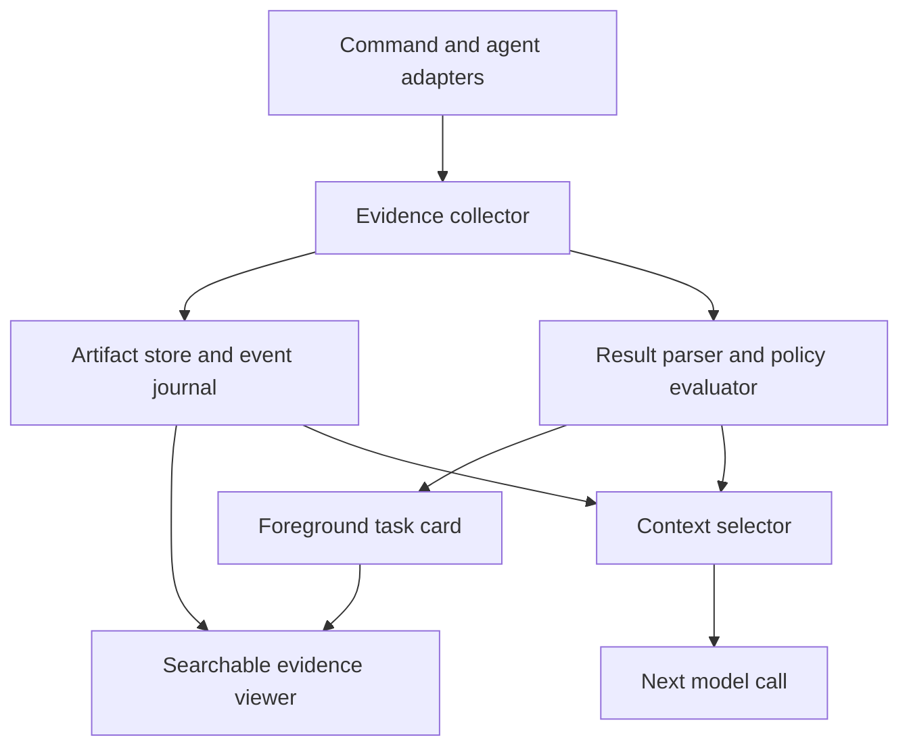

# Output Density and Progressive Disclosure in Agentic AI Coding Assistants

**Solving the Verbosity vs. Black-Box Dilemma**  
DX and systems architecture research report · 25 September 2026

## 1. Executive Summary

The best default is **a compact, evidence-backed task summary with automatic exception disclosure**. For a substantive engineering task, target 15–25 visible lines containing the outcome, changes, verification scope, warnings, remaining gaps, and evidence links. Preserve command output separately, and make the important portions directly accessible. Treat that line range as an initial product policy to validate—not an empirically established optimum.

The architectural objective is to make three things independently controllable:

1. **Presentation:** what the developer sees immediately.
2. **Evidence:** the complete execution record retained for inspection.
3. **Model context:** the evidence actually supplied to the next inference call.

Two human-facing surfaces are sufficient: a task card and an evidence viewer. Internally, a separate context selector is essential. A collapsed 5,000-token transcript can still occupy 5,000 context tokens. Conversely, logs streamed by a subprocess to disk need not become model-generated output at all.

The reviewed products demonstrate a direction toward progressive disclosure, but no common completion-card specification or universal line-count standard. Claude Code offers transcript detail controls; Devin links progress to command history; Cursor separates review and terminal surfaces and exposes structured CLI output; Aider retains terminal-oriented interaction and history files. GitHub Copilot CLI explicitly documents a Task subagent that summarizes successful execution and exposes full failure output. These are related mechanisms, not proof that every product implements the same audit guarantees. [S1–S11]

The main engineering risk is **false green**: interpreting a successful process exit as adequate verification. A command can finish successfully while running no tests, excluding relevant suites, passing only after retries, or emitting significant warnings. The foreground must therefore carry exceptions and verification limits even when assertions pass.

Recommended design decisions:

| Decision | Recommendation | Reason |
| --- | --- | --- |
| Default completion | One 15–25-line card per user task | Gives a useful receipt without repeating execution history |
| Raw output | Append-only evidence artifacts, exposed through an expandable viewer | Supports search, exact inspection, and later audit |
| Status | Separate execution, verification, and next-action eligibility | Prevents “process ended” from becoming “safe to release” |
| Warning handling | Count occurrences and unique causes; distinguish new from baseline | Preserves risk while suppressing duplicates |
| Pipeline output | One orchestrator owns the final card; children return structured results | Prevents repeated summaries from accumulating |
| Context management | Feed bounded facts and selected excerpts to the model | Visual folding alone does not reduce context use |
| Rendering | Generate factual fields deterministically from verified records | Avoids spending inference on reformatting facts or inventing counts |

Progressive disclosure has a well-established UX basis: place frequent, consequential information first, and make secondary details easy to find. Google SRE also describes how repeated low-signal notifications cause people to skim or ignore alerts. Applying those principles to coding-agent completion cards is a design inference; neither source establishes a 20-line coding-agent threshold. [S12, S13]

**Research scope and limitations.** This is a review of primary documentation, vendor engineering publications, and original research available on the report date. It is not a hands-on comparison of installed product builds. Completion wording varies with model, prompt, version, and configuration. No controlled, cross-product benchmark of 200-line versus 20-line completion summaries was identified in the reviewed sources. Cost and latency examples below are explicitly modeled, not claimed measurements.

## 2. Comparative Matrix

| Tool | Documented completion and output pattern | Where detail lives | Density controls and audit implications |
| --- | --- | --- | --- |
| **Cursor / Composer workflows** | Agent responses coexist with code review and terminal tools. Earlier official review documentation describes an end-of-response “Review changes” entry; current documentation also offers dedicated Agent Review. No fixed final-summary template was found. | Review interface, terminal/tool output, and CLI event output. | CLI supports `text`, `json`, and `stream-json`; its text mode emits the final assistant message without intermediate tool summaries. Structured mode is the stronger integration surface. A successful agent result is not independently a test certification. [S1–S4] |
| **Claude Code** | Configurable output styles. The current Concise style leads with the result and reduces narration while retaining necessary error and warning detail. No fixed line budget is specified. | CLI transcript viewer; Desktop detail modes; files for background Bash output. | CLI `Ctrl+O` reveals detailed activity. Desktop Normal collapses tool calls; Verbose expands intermediate activity. Background commands write output to a retrievable file. Presentation settings and stored execution evidence are distinct. [S5–S7] |
| **Devin** | Progress updates are connected to a broader session worklog. Structured-output examples include progress and test-result fields, but these are requested schemas rather than a universal final-card format. | Progress tab, Shell history, IDE, and browser activity. | Clicking a step exposes details; command history includes previews, copying, and time navigation. The cited structured-output page belongs to legacy API v1 and says updates occur on Devin’s schedule; do not treat it as a guaranteed current transactional event contract. [S8, S9] |
| **Aider** | Terminal-oriented prose plus edit/commit feedback; a published example illustrates that style but is not a current benchmark. `/test` adds output to the LLM chat when the command exits nonzero. | Terminal and configurable history files; default chat history is `.aider.chat.history.md`, with an optional separate LLM conversation log. | Separates some successful command output from model context. Exit-code-based inclusion does not itself guarantee that zero-exit warnings reach the model. History files are not automatically equivalent to complete per-command stdout/stderr evidence. [S10, S11, S14] |
| **GitHub Copilot CLI** | Its Task subagent is documented to give brief success summaries and full failure output. | Terminal interaction, subsidiary-agent contexts, and exportable session records. | Programmatic `-s` suppresses stats/decorations, not necessarily the agent’s prose length. `--share=PATH` exports a Markdown session. These offer useful building blocks; they do not establish a universal final-card or warning schema. [S15–S17] |

### What can reasonably be called industry convergence?

The evidence supports **layered visibility and inspectable execution**, rather than mandatory raw-log dumping into ordinary chat. It does not support a claim that every leading tool defaults to durable local log files or lossless collapsibles.

| Surface | Appropriate use | Limitation |
| --- | --- | --- |
| Chat summary | Outcome, evidence counts, consequential warnings, unresolved questions | Poor place for thousands of repetitive lines |
| Expandable tool block | Fast inspection of a relevant command or failure | May be truncated, session-bound, or inaccessible after export |
| Dedicated evidence viewer | Search, filtering, full output, jump-to-failure | Requires stable identity and discoverable navigation |
| Local artifact / retained remote artifact | Reproduction and inspection after the UI closes | Needs retention, access, and host/path handling |

A strong implementation combines these surfaces around the same evidence records. An expandable block can be a viewer over the log sink; it need not be a separate copy. Label controls specifically—for example, “Test output · 26 warnings · 41 KB”—instead of a generic “Details.”

## 3. The Dual-Surface Architecture

### 3.1 Data flow and trust boundaries



The collector captures output while a tool runs. The parser derives counts and findings. The policy evaluator determines whether evidence supports the requested task. The renderer displays facts; an optional model supplies a short explanation. The context selector decides which records or excerpts the next model call needs.

**The card is a projection of evidence, not the authority that creates evidence.** A generated sentence cannot override a failing required check or manufacture a missing test count.

Use native structured reporters where possible: JSON test results, JUnit XML, lint JSON, and coverage reports. Use textual pattern matching as a fallback with an explicit parser-confidence field. Unrecognized output means “unknown,” not zero warnings. `stderr` is a channel, not a severity classification: Jest’s JSON mode, for example, routes other output to stderr. [S18]

Trace and span identifiers, timestamps, and severity fields can follow OpenTelemetry conventions, allowing one user task to correlate its tools, skills, and child agents. OpenTelemetry supplies correlation primitives; the verification and UI policies proposed here are additional application design. [S19]

### 3.2 Foreground card schema

The foreground should answer six questions: what changed, what actually ran, what was established, what remains uncertain, where the evidence is, and what happens next.

| Field | Required content | Default budget |
| --- | --- | ---: |
| Outcome | Task result plus explicit status word | 1–2 lines |
| Changes | Main behavior and material files; full list linked if large | 3–5 lines |
| Verification | Exact command or short check ID, scope, meaningful counts | 4–6 lines |
| Caveats | New warnings, skips, retries, unrun checks, evidence limitations | 2–4 lines |
| Evidence | Links to diff, execution manifest, and relevant logs | 2–3 lines |
| Next action | Concrete follow-up and release/commit state when relevant | 1–2 lines |

These are allocations, not quotas. Do not pad a simple result to 15 lines. Reserve space for exceptions before polishing the success narrative.

The following is an **illustrative 20-line card**. Its IDs and paths are examples, not evidence produced by this research:

```text
AMBER — Retry handling implemented; warning review remains.
Run r42 · completed · 2m 14s · local Linux environment
Scope: retry bug fix, lint, typecheck, and unit tests.
Changes: 3 files; 2 implementation files and 1 test file.
src/client.ts — bounds retries and preserves the last error.
src/config.ts — validates the retry limit.
tests/client.test.ts — adds retry regression cases.
Verification:
L1  npm run lint — exit 0; 0 errors, 0 warnings.
T1  npm run typecheck — exit 0.
U1  npm run test:unit -- --runInBand — exit 0.
U1  Collected 260; passed 248; skipped 12; failed 0.
U1  Skips: 12 baseline allowlisted cases; no new skips.
Warnings: 26 occurrences; 2 causes; 1 new cause.
New: deprecated client API; location and context in W1.
Limits: E2E and load tests were outside this task's scope.
Evidence: diff D1 · command manifest M1 · unit log U1.
Warnings: W1 · all captured stdout/stderr available in M1.
Git: changes uncommitted; no release attempted.
Next: review W1; release readiness was not evaluated.
```

The interface resolves those IDs into links. A user should not need to ask the model to reconstruct a command that was already executed. Display full commands in evidence when they are too long for the card; never silently remove test-selection flags.

### 3.3 Background log sink and record schema

Use a configurable per-project artifact root, with one immutable directory per run. A suggested layout is `artifacts/agent-runs/<run-id>/`, excluded from ordinary commits unless the project intentionally versions evidence. This is a proposed layout, not a vendor standard.

| Artifact | Purpose |
| --- | --- |
| `manifest.json` | Run identity, provenance, snapshots, policy version, checks, and artifact index |
| `events.ndjson` | Append-only lifecycle events with producer and sequence identifiers |
| `commands/<id>.stdout.log` | Captured stdout, or explicitly marked redacted derivative |
| `commands/<id>.stderr.log` | Captured stderr, kept separately where pipes permit |
| `reports/` | Native machine-readable test, lint, coverage, and resource reports |
| `changes.patch` | Captured final change set for the run |
| `summary.json` | Validated factual result used by the renderer |

Recommended logical schema:

| Record | Essential fields |
| --- | --- |
| Run | `schema_version`, `run_id`, `task_id`, `parent_run_id`, `started_at`, `ended_at`, `execution_state`, `policy_version` |
| Workspace | `host_id`, `workspace_id`, `cwd`, `git_base`, `tested_snapshot`, `final_snapshot`, `diff_artifact_id` |
| Command | `command_id`, `span_id`, `argv` or exact shell text plus shell/version, `cwd`, start/end times, `exit_code`, `signal`, `timed_out` |
| Check | `check_id`, `required`, scope/selection, `status`, parser/version/confidence, report references, tested snapshot |
| Tests | `collected`, `selected`, `executed`, `passed`, `failed`, `skipped`, `deselected`, `xfailed`, `xpassed`, `flaky`, attempt records |
| Finding | stable `fingerprint`, severity, category, message, location, occurrences, baseline status, first/last occurrence, evidence references |
| Resource sample | metric and units, observation scope, peak, limit, baseline, sampler/method |
| Artifact | `artifact_id`, media type, storage location, host, size, digest, completeness, redaction status, retention deadline |
| Decision | `verification_status`, `verification_completeness`, `reason_codes`, `next_action_eligibility`, relevant finding IDs |

Use `null` for unmeasured counters rather than substituting zero. Define normalization semantics per reporter: frameworks differ in whether collection includes excluded cases and how retries or expected failures affect totals. Keep the original report beside normalized data.

For dirty working trees, a commit SHA alone is inadequate. Record the tested content snapshot, relevant untracked files, configuration, dependency lockfile, and selected environment metadata. If a formatter or commit hook changes code after tests, mark affected evidence stale and revalidate the affected checks. “Commit succeeded” describes a Git operation, not verification of its contents.

### 3.4 Capture requirements that make the evidence trustworthy

1. **Capture before summarization.** Stream to storage as bytes arrive, rather than asking the model to rewrite raw output into a file. Drain stdout and stderr concurrently to avoid pipe blockage. With a PTY, record that streams were merged.
2. **Preserve process semantics.** Record the tested process’s exit status, timeout, and signal. A shell pipeline ending in `tee` can otherwise report the logger’s success. Prefer a subprocess adapter that captures the child directly; shell-specific wrappers must preserve the relevant pipeline status.
3. **Represent partial evidence.** Track byte counts, dropped bytes, truncation, parser errors, and write failures. Disk-full or process-crash cases must produce incomplete/unknown verification, not a green card with broken links.
4. **Bound storage explicitly.** An example operational default is a 100 MiB per-run soft limit and seven-day development retention, both configurable. Compress or rotate before dropping data. Any loss must be visible; retain release evidence according to the project’s release policy.
5. **Make artifacts stable.** Flush/close logs and publish the manifest atomically before issuing completion. Bind every citation to run, command, and immutable artifact identity. A digest detects later byte changes; it does not establish that a compromised collector told the truth.
6. **Handle sensitive and hostile output.** Restrict access to raw logs; mark any redacted copy honestly. Do not persist complete environment variables by default. Strip terminal control sequences in viewers and treat logged text as data, including text that resembles instructions to an agent.
7. **Retrieve targeted evidence.** Support command ID, finding ID, text search, and byte/line ranges. Avoid loading an entire multi-megabyte log merely because a user expands the human-facing view.

These requirements are central to the proposed design: a local file that is missing, overwritten, or unrelated to the tested code does not provide deep auditability.

### 3.5 Clickable anchors across IDEs and terminals

There is no portable Markdown link syntax that every terminal, editor, and browser interprets as an actionable local-file link. Store a logical artifact locator—host, workspace, artifact ID, and optional location—and let a client adapter choose the rendering.

| Environment | Recommended implementation | Important fallback or constraint |
| --- | --- | --- |
| VS Code integrated terminal | Print an existing absolute path with a supported line/column suffix. VS Code recognizes forms such as `file:1:2`. | Keep a copyable path. Resolution depends on the terminal’s workspace and host context. [S20] |
| VS Code extension / chat integration | Resolve the artifact to a workspace URI; open it through editor APIs with a selection. A terminal link provider can map stable evidence IDs to this action. | Avoid assuming arbitrary Markdown permits executable command links; use a controlled native action. [S21] |
| VS Code command-line fallback | `code --goto '/absolute/path/unit.log:142:1'` | Requires the launcher and the appropriate local or remote workspace context. [S22] |
| OSC 8-capable terminal | Emit an OSC 8 hyperlink containing a properly encoded file URI and a readable label. | Support and allowed schemes vary. Include a copyable path; preserve host identity when working over SSH. [S23] |
| JetBrains IDE | Offer an action using its configured launcher; for example, `idea --line 142 /absolute/path/unit.log`. | Launcher names and native terminal link support vary; the CLI fallback is explicit. [S24] |
| Browser/cloud session | Use an authenticated artifact viewer or download endpoint keyed by artifact ID. | A server-local path is not a file on the viewer’s computer. Do not rely on a browser opening it directly. |
| Plain terminal / redirected output | Print the absolute path and a short, correctly quoted viewer command. | Do not emit interactive escape sequences into machine-readable output. |

OSC 8 uses an opening sequence containing the URI, a label, and a closing sequence. A file URI’s fragment does not portably mean “line 142”; line selection belongs in an editor-specific adapter. The OSC 8 proposal explicitly accounts for host identity because opening an SSH host’s path against the local filesystem would be wrong. [S23]

Validate link targets against the artifact registry and permitted roots. Display the real filename and host in the inspector. Test paths containing spaces, Windows drive letters, remote containers, moved workspaces, expired artifacts, and terminal multiplexers.

## 4. Concrete Guidelines

### 4.1 Exact output budgets and formatting conventions

The following are **proposed starting defaults**, not published industry benchmarks. Measure terminal budgets at an 80-column viewport, counting wrapped rows; for graphical cards, test a fixed viewport/font. Newline counts alone can conceal an unreadable amount of text.

| Situation | Foreground budget | Behavior |
| --- | ---: | --- |
| Trivial, low-risk edit | 5–10 lines | Outcome, file, verification or explicit non-verification |
| Routine substantive task | 15–25 lines | Standard evidence card; target 250–450 model-generated tokens if prose is generated |
| One routine child-stage transition | 1 line | Prefer updating the existing task status |
| Long-running operation | One mutable heartbeat every 30 seconds | Show actual stage, elapsed time, and last event age; do not invent progress percentages |
| Amber result | 25–40 lines total when needed | Keep warning causes and validation gaps visible |
| Failure, conflict, or missing required evidence | 35–60 lines initially | Cause, affected check, relevant exact excerpt, consequence, next step |
| Full diagnostic trace | No content cap in the evidence viewer | Use search, pagination or virtualization; retain all captured content |
| Explicit user request for complete output | User-directed | Allow full inspection/export regardless of the default card budget |

A compact card may remain under 25 lines when one concise warning fully describes the issue. Severity forces disclosure of needed evidence; it does not force padding.

Formatting rules:

- Put the consequential outcome in the first two lines. Use status words alongside color or icons.
- Use shallow bullets or label/value rows. Avoid nested verification tables inside a completion card.
- Name actual commands or link their exact definitions. Include test-selection scope and counts.
- Say “248 selected unit tests passed; 12 skipped,” rather than “all tests passed.”
- Show up to three unique warning causes initially, with occurrence totals and a link to every remaining cause. Never bury an action-blocking cause behind that cap.
- Show up to five material files, then a total and the complete diff/file index. Always expose security-relevant or public-interface changes that affect the user’s decision.
- Provide at most three primary links: changes, verification, and findings; keep the full artifact index one click away.
- Use a text-first accessible status and keyboard-operable disclosure. Expansion should not unexpectedly move focus or replace the user’s scroll position.
- Do not echo the plan, list every successful assertion, or repeat the same outcome in a closing recap.
- Prefer deterministic rendering. An output-token hard stop is a last safeguard, not a substitute for selecting essential content; truncation must not remove caveats.

### 4.2 The Amber Problem and false-green defense

Binary status collapses several different propositions: the process completed, assertions passed, the intended scope was checked, evidence is complete, and the next action is permitted. Those propositions can disagree.

Documented counterexamples include Jest’s `--passWithNoTests`, which allows an empty selection to pass; pytest’s separate no-tests-collected exit code; and Playwright’s classification of tests that pass on retry as flaky. Playwright provides `--fail-on-flaky-tests`, demonstrating that the acceptable gate is a policy decision rather than a universal implication of a final pass. [S18, S25, S26]

Use independent dimensions:

| Dimension | Suggested values | Example |
| --- | --- | --- |
| Execution | `running`, `completed`, `failed`, `cancelled` | Test process completed normally |
| Verification | `pass`, `warn`, `fail`, `unknown` | Assertions passed but a new deprecation exists |
| Completeness | `complete`, `partial`, `missing` | Required integration suite never ran |
| Next action | `eligible`, `blocked`, `not_evaluated` | Release blocked pending required integration evidence |

Green requires complete, current evidence for every applicable required check, with no unresolved warning that policy demands be surfaced as amber. A deliberately inapplicable check needs a recorded reason; its absence is not silently counted as a pass. A known warning can be accepted for a defined scope and duration while remaining visible in the evidence.

| Signal | Proposed escalation rule | Foreground consequence |
| --- | --- | --- |
| Required command fails, times out, or is killed | Always fail the relevant gate; distinguish test failure from infrastructure failure | Red/failure detail and exact error context |
| Zero tests executed where nonzero tests are required | Fail the verification gate even when process exit is 0 | “No tests executed”; show selector and config |
| Required suite absent, unreadable report, or missing completion event | Verification unknown/incomplete; block dependent action | Show exactly which evidence is missing |
| New skipped test | Always disclose; fail gate if a required test was skipped without policy allowance | Amber or blocked, with skip reason |
| Unexpected count decline | Flag a drop of more than 5% versus an explicit same-scope baseline; any missing required suite escalates regardless of percentage | Show expected versus observed scope |
| New warning cause | Always visible; escalate on any policy-relevant cause even if it occurs once | Name cause, source, and consequence |
| Warning flood | Auto-expand when there are at least 3 new unique causes, or more than 50 new occurrences, or more than 2× a nonzero comparable baseline | Group duplicates; show representative exact lines |
| Pass after retry | Amber by default; record every attempt; fail gate when flaky tests are prohibited | “Passed on retry,” never clean first-pass success |
| Memory pressure | Amber above 80% of an explicit resource limit; investigate a rise above 25% versus a comparable baseline | Peak, limit, method, and scope |
| OOM or hard resource ceiling exceeded | Failure; do not report a normal test pass from partial output | Show termination and incomplete evidence |
| Text says success but structured report disagrees | Mark inconsistent/unknown until reconciled | Expand both pieces of evidence |
| Tested snapshot differs from final code | Invalidate affected verification | “Checks stale after subsequent edits” |
| Log capture drops bytes or cannot save evidence | Mark evidence partial and disclose it | No claim of complete auditability |

Percentage thresholds require comparable test selectors, platforms, dependency versions, and measurement methods. With no baseline or configured limit, report “not measured” or the observation itself. Do not infer safety from the absence of measurements. Peak parent-process RSS alone may miss child workers; record whether the measurement covers a process, process tree, or container.

Warnings should have fingerprints based on category/code and normalized location/message. Keep occurrence counts; group repeated causes without deleting them. Baseline allowances should have an owner, reason, and expiration so that long-standing noise does not become permanent invisibility.

### 4.3 When to expand into an uncompressed diagnostic trace

Automatically open the relevant diagnostic section when any required gate fails, evidence is contradictory, an important warning is new, output is incomplete, or a scope/resource anomaly crosses the configured thresholds above.

The expansion should expose **exact tool evidence**, not a second model paraphrase: the failing command, selection/configuration, exit/signal, first causal error, relevant stack or assertion difference, and a link to the complete stream. Start with roughly 20–40 lines of exact diagnostic context within the larger failure budget. Preserve a complete short stack trace when splitting it would impair diagnosis.

For large output, “uncompressed” should mean every captured byte is available in a searchable evidence surface. Automatically pasting ten thousand lines into chat recreates the original problem. In a UI without a separate viewer, disclose the causal excerpt plus the saved artifact and a copyable path. A hard character cap that silently drops the cause is unacceptable.

Do not suppress an urgent finding until the final card. Emit the state change immediately and mark dependent actions blocked. After a repair, replace the active alert with its current state while retaining the prior failed attempt in the evidence history.

### 4.4 Multi-skill pipelines and intermediate suppression

The unit of presentation should be the **user’s task**, not each worker or skill. Four individually reasonable 20-line cards still create an 80-line thread.

Existing architectural precedents include Claude Code’s documented use of subagents to keep high-volume output outside the main conversation, and Copilot CLI’s Task agent returning brief successful results. Anthropic also describes specialized agents returning condensed findings to a coordinating agent. These establish context-isolation patterns; a single mutable pipeline card remains a product design choice rather than a universal documented default. [S15, S27, S28]

Recommended orchestration contract:

1. Assign one `run_id` to the user task and a `stage_id` to each lint, test, review, and commit operation.
2. Children send typed lifecycle events and result records to the coordinator. They do not independently write final user-facing essays.
3. The coordinator owns one status region and one terminal completion card. Update the region in place when the client supports it.
4. Emit one-line milestone changes such as “Tests running · lint complete · 41s elapsed.” Generate heartbeats from runtime state without an LLM call.
5. On append-only clients, emit start/meaningful transition/blocker messages rather than every heartbeat tick. Keep continuous liveness in the tool/status surface where available; do not pretend older messages can be edited.
6. Deduplicate findings by fingerprint, preserving every evidence reference. A test runner and reviewer observing the same root issue should not produce two independent alert blocks.
7. Evaluate the final result over required stages and their dependencies. A later successful Git commit must not overwrite an earlier failed test result.
8. Persist attempt IDs and producer sequence numbers. Reconnects or repeated completion events must not double-count tests or emit duplicate final cards.
9. Finalize only after required child work and artifact writes settle. A detached background check remains pending, rather than disappearing into an optimistic “done.”

For a Linter → Test Runner → Git Committer chain, a three-line milestone history plus a 20-line completion is approximately 23 visible lines, rather than 60 lines from three separate cards. In a mutable UI, one heartbeat region can replace the milestone history entirely.

Use a compact child-to-parent result containing status, changed files, check counts, unresolved findings, and artifact IDs. Routine results can target 200–500 tokens; complex diagnostic work can request more. The child’s internal work may still be expensive: suppressing its chat presentation does not reduce its reasoning or tool execution cost automatically.

### 4.5 Output token economics and latency

**Do not equate lines with tokens, display size with billing, or summary latency with total task latency.** A 200-line table may contain many more tokens than 200 short status lines. Use the actual target-model tokenizer or provider usage counters when benchmarking.

The distinction between output types matters:

| Content path | Typical token implication |
| --- | --- |
| Model generates a long Markdown summary | Generated output tokens; later input tokens if retained |
| Shell output is displayed directly by the UI | No model-generated output tokens merely from display |
| Shell output enters a tool result sent to the model | Input/context tokens, with possible repeated inclusion |
| Output is visually collapsed but still in messages | Display savings; context savings are not established |
| Collector streams output to disk; model receives a compact record | Reduces model-context exposure; full evidence remains retrievable |
| Model writes a long report through a file-writing tool | File contents may still be generated/billed tokens; the file destination alone does not save them |
| Application renders a card from structured facts | No extra model generation is needed for deterministic fields |

Anthropic’s latency guidance recommends reducing unnecessary input and output tokens, and distinguishes streaming’s perceived responsiveness from the completion of the response. It does not provide a cross-product 200-line/20-line benchmark. [S29]

#### Transparent worked scenario—not a measured benchmark

Assume a verbose completion is **4,000 tokens**, a compact completion is **400 tokens**, and each turn therefore saves **3,600 generated tokens**. These are illustrative workload sizes, not token counts measured from the named products. For a concrete pricing example, Claude Sonnet 4.6’s published standard rates on the research date are $3 per million input tokens, $15 per million output tokens, and $0.30 per million cache-hit input tokens. This is an example rate card, not a model recommendation or an estimate of subscription charges. [S30]

For output price `P_out`, input price `P_in`, and `n` turns:

```text
delta = verbose_tokens - compact_tokens
output_savings = n × delta × P_out / 1,000,000
extra_history_before_turn_n = (n - 1) × delta
replayed_input_savings = delta × n × (n - 1) / 2
uncached_replay_cost_savings = replayed_input_savings × P_in / 1,000,000
```

The replay formula assumes one model call per turn, all earlier summaries resent on every subsequent call, and no compaction. More tool-loop calls can replay history more often; selective context management can replay it much less.

| Session length | Generated tokens saved | Direct output cost saved | Cumulative replayed input tokens avoided | Uncached replay cost saved |
| --- | ---: | ---: | ---: | ---: |
| 1 turn | 3,600 | $0.054 | 0 | $0.000 |
| 10 turns | 36,000 | $0.540 | 162,000 | $0.486 |
| 25 turns | 90,000 | $1.350 | 1,080,000 | $3.240 |

In the uncached 25-turn scenario, the modeled total saving is **$4.59**. If every replayed token were charged at the cache-hit rate, the replay component would be **$0.324** instead of $3.24; that simplified comparison excludes cache-write charges and misses. Real caching depends on prefix matching, cache lifetime, and the request structure. Tool execution, reasoning tokens, other input, and artifact infrastructure are outside these calculations.

For effective generation throughput `r`, a simple completion-time approximation is:

```text
time ≈ fixed overhead + prefill time + generated_tokens / r
generation_time_saved ≈ 3,600 / r
```

| Assumed effective throughput | 4,000-token generation | 400-token generation | Generation time saved |
| --- | ---: | ---: | ---: |
| 30 tokens/s | 133.3 s | 13.3 s | 120 s |
| 60 tokens/s | 66.7 s | 6.7 s | 60 s |
| 100 tokens/s | 40.0 s | 4.0 s | 36 s |

These throughput points are sensitivity assumptions, not measurements of Claude, Cursor, Devin, Copilot, or Aider. At 60 tokens/s, 25 sequential completions would save 25 minutes of modeled generation time if all of that generation lies on the critical path. Parallel generation, overlapping tool work, reasoning changes, queueing, and compaction change end-to-end savings. A tenfold token reduction does not imply a tenfold faster engineering task.

#### Context effects in turns 10–25

Before turn 10, the verbose summaries in this scenario add **32,400** extra context tokens. Before turn 25, they add **86,400**. In a hypothetical 128,000-token context, the latter consumes **67.5%** of capacity before source files, tools, user requests, and new output. Larger windows reduce capacity pressure but do not prove that irrelevant history is free of cognitive or computational effects.

Liu et al.’s *Lost in the Middle* tested retrieval and question-answering tasks and found sensitivity to the location of relevant information in long contexts. Chroma’s original *Context Rot* report evaluated 18 models across length and distractor conditions and found nonuniform reliability. These support caution about excessive context; they do not establish a fixed error increase at turn 10 or turn 25 in current coding agents. [S31, S32]

The practical inference is to preserve decision-relevant state rather than every narrative recap. Keep current requirements, tested snapshot, unresolved warnings, failed attempts still relevant to diagnosis, action eligibility, and artifact IDs. Clear redundant old tool output from active context only after it is durably captured. Anthropic describes compaction, structured notes, and selective tool-result removal as methods for long-running agents. [S28]

Prompt caching reduces some repeated computation and cost. It does not make cached history absent from the model’s logical context, nor guarantee improved attention. Likewise, compaction is lossy: test that it retains unresolved risk and does not transform “passed after retry” into “passed.”

### 4.6 How to obtain defensible empirical results

Use two separate studies so that token savings do not conceal poorer debugging or weaker warning detection.

**Systems benchmark.** Assemble fixed command traces spanning clean success, deprecation flood, missing suite, zero tests, flaky retry, timeout, resource anomaly, stale verification, and a release chain. Replay the same traces through (A) full chat output, (B) short badge, and (C) compact evidence card. Hold model/version, effort settings, tool results, and task constant. Randomize order, separate cold and warm caches, and run repeated paired trials; 30 repetitions per selected condition is a practical pilot, with final sample sizes based on variance and desired precision.

Record actual input, output, cached, and reasoning-token counters where exposed; time to first token; time to first actionable result; final-response latency; total task duration; artifact bytes; renderer latency; and missing-evidence events. Test both 10- and 25-turn replay sessions. Report median, p95, confidence intervals, and the exact cache/compaction assumptions.

**Developer study.** Give developers the same underlying outcomes with the three presentations in counterbalanced order. Measure time to identify what changed, accuracy about which tests ran, detection of hidden warning/skipped-suite conditions, correct release decisions, time to reach supporting evidence, and subjective workload. Track calibrated trust—the ability to distinguish adequate and inadequate verification—not merely whether the interface feels reassuring. Determine participant count with a power analysis after a pilot.

Suggested acceptance criteria for an initial implementation:

- All critical exceptions in the seeded corpus appear in the foreground; benign duplicates do not create independent alerts.
- Every factual completion claim resolves to the recorded run and tested snapshot.
- Zero-exit/zero-test, missing required suite, stale snapshot, and failed-artifact-write cases never yield an unqualified green result.
- Repeated events and worker retries cannot double-count outcomes or produce duplicate completion cards.
- Routine cards stay within 25 rendered rows on the target viewport without hiding required caveats.
- Evidence remains inspectable after UI restart, and remote/local links resolve to the correct host.
- The compact condition improves decision time without reducing warning detection or verification-scope accuracy.

### Source register

All links were consulted on 25 September 2026. Product pages are living documentation. Historical examples and legacy API material are identified in the body; they are not treated as proof of current defaults. Numbered references keep this downloadable report usable outside the chat interface.

| ID | Primary source | Used for |
| --- | --- | --- |
| S1 | [Cursor: Diffs & Review](https://docs.cursor.com/en/agent/review) | Earlier documented review entry and file review |
| S2 | [Cursor: Agent Review](https://cursor.com/docs/agent/agent-review) | Current dedicated review surface |
| S3 | [Cursor: Terminal](https://cursor.com/docs/agent/tools/terminal) | Terminal integration and output surface |
| S4 | [Cursor: CLI output format](https://cursor.com/docs/cli/reference/output-format) | Text, JSON, and NDJSON event contracts |
| S5 | [Claude Code: Output styles](https://code.claude.com/docs/en/output-styles) | Concise style and exceptions |
| S6 | [Claude Code: Interactive mode](https://code.claude.com/docs/en/interactive-mode) | Transcript viewer and background-output files |
| S7 | [Claude Code: Desktop](https://code.claude.com/docs/en/desktop) | Normal and Verbose transcript views |
| S8 | [Devin: Session tools](https://docs.devin.ai/work-with-devin/devin-session-tools) | Progress, shell history, and detailed inspection |
| S9 | [Devin: Structured output, legacy API v1](https://docs.devin.ai/api-reference/v1/structured-output) | Requested schemas and update limitations |
| S10 | [Aider: In-chat commands](https://aider.chat/docs/usage/commands.html) | `/test` output inclusion |
| S11 | [Aider: Options reference](https://aider.chat/docs/config/options.html) | History files and output configuration |
| S12 | [Jakob Nielsen: Progressive Disclosure](https://www.nngroup.com/articles/progressive-disclosure/) | Initial/secondary information and discoverability |
| S13 | [Google SRE: Monitoring Distributed Systems](https://sre.google/sre-book/monitoring-distributed-systems/) | Signal, noise, and alert fatigue |
| S14 | [Aider: A complex multi-file change, with debugging](https://aider.chat/examples/complex-change.html) | Published historical interaction example |
| S15 | [GitHub: Using Copilot CLI](https://docs.github.com/en/copilot/how-tos/copilot-cli/use-copilot-cli/overview) | Task subagent and separate contexts |
| S16 | [GitHub: Copilot CLI programmatic reference](https://docs.github.com/en/copilot/reference/copilot-cli-reference/cli-programmatic-reference) | Silent/decorations behavior |
| S17 | [GitHub: Copilot CLI command reference](https://docs.github.com/en/copilot/reference/copilot-cli-reference/cli-command-reference) | Session export |
| S18 | [Jest: CLI options](https://jestjs.io/docs/cli) | Empty-suite success, JSON reports, output streams |
| S19 | [OpenTelemetry: Logs Data Model](https://opentelemetry.io/docs/specs/otel/logs/data-model/) | Correlation and event field conventions |
| S20 | [VS Code: Terminal Basics](https://code.visualstudio.com/docs/terminal/basics) | File detection and terminal link behavior |
| S21 | [VS Code: Extension API](https://code.visualstudio.com/api/references/vscode-api) | Native document opening and link providers |
| S22 | [VS Code: Command-line interface](https://code.visualstudio.com/docs/configure/command-line) | `--goto` file navigation |
| S23 | [Egmont Koblinger: Hyperlinks in Terminal Emulators](https://gist.github.com/egmontkob/eb114294efbcd5adb1944c9f3cb5feda) | Original OSC 8 proposal and remote host handling |
| S24 | [JetBrains: Open files from the command line](https://www.jetbrains.com/help/idea/opening-files-from-command-line.html) | Explicit file/line launcher fallback |
| S25 | [pytest: Exit codes](https://docs.pytest.org/en/stable/reference/exit-codes.html) | No-tests-collected distinction |
| S26 | [Playwright: Retries](https://playwright.dev/docs/test-retries) and [CLI](https://playwright.dev/docs/test-cli) | Flaky-test classification and failure policy |
| S27 | [Claude Code: Create custom subagents](https://code.claude.com/docs/en/sub-agents) | Isolation of high-volume operations |
| S28 | [Anthropic: Effective context engineering for AI agents](https://www.anthropic.com/engineering/effective-context-engineering-for-ai-agents) | Compaction, notes, and condensed subagent results |
| S29 | [Anthropic: Reducing latency](https://platform.claude.com/docs/en/test-and-evaluate/strengthen-guardrails/reduce-latency) | Token length and streaming distinction |
| S30 | [Anthropic: API pricing](https://platform.claude.com/docs/en/about-claude/pricing) | Explicit example input/output/cache rates |
| S31 | [Liu et al.: Lost in the Middle, TACL 2024](https://aclanthology.org/2024.tacl-1.9/) | Original long-context position-sensitivity research |
| S32 | [Chroma: Context Rot](https://www.trychroma.com/research/context-rot) | Original length/distractor evaluation and limits |
