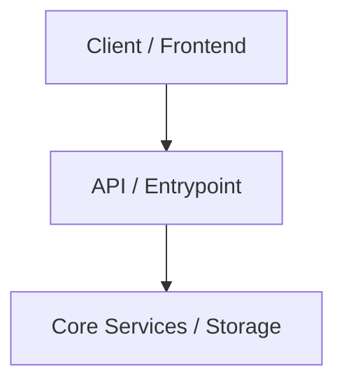

# High-Craft Developer README Template

Use this template when `docs-architect` writes or restructures a project's `README.md`. Designed for maximum developer conversion, zero marketing slop, and instant clarity.

---

````markdown
# [Project Name]

> **[One-sentence tagline explaining exactly what the project does and the primary problem it solves]**

[](https://github.com/[owner]/[repo]/actions)
[](LICENSE)
[](package.json)

---

## ⚡ 1-Command Quickstart

```bash
git clone https://github.com/[owner]/[repo].git && cd [repo] && cp .env.example .env && docker compose up -d
```

---

## 🏗️ Architecture Overview

Document only the real architecture observed in the codebase:



---

## ✨ Key Capabilities

| Capability | Technical Standard | Status |
|---|---|---|
| **[Verified Capability 1]** | [Protocol / Mechanism] | Active |

---

## ⚙️ Environment Configuration

| Variable | Description | Default | Required |
|---|---|---|:---:|
| `PORT` | HTTP port the server binds to | `8000` | No |
| `DATABASE_URL` | Database connection string | — | **Yes** |

---

## 🧪 Testing & Verification

```bash
npm test   # or: pytest
```

---

## 📄 License

Licensed under the [MIT License](LICENSE).
````
