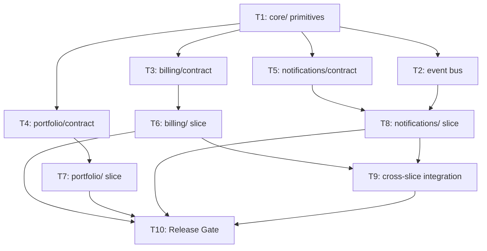

# Vertical Slice DAG Rules for Plan Master

Reference for structuring execution plans for projects that adopt the Vertical Slice Architecture. Every task in a slice-based project must conform to these rules so the agent never loads more than 600 lines of context per task.

---

## The 4 Golden Rules

1. **1-Slice-Per-Task**: A single task targets exactly one module slice (`src/modules/<slice>/`). Never plan a task that writes to two slices simultaneously.
2. **Bounded Context Windowing**: The `[CONTEXT SCOPE]` for a slice task lists only target slice files: `contract.ts` + `service.ts` + `routes.ts` + `<slice>.test.ts`. Limit active context to the 2–4 files or line ranges needed. Highly cohesive modules (state machines, parsers, schemas) are fully permitted up to 1,200–1,500 LOC; never mechanically chop them into shallow helpers.
3. **Cross-Slice Interface Only**: A task may read a sibling slice's `contract.ts` (the public interface). It must never import from a sibling's `service.ts` or any internal file.
4. **Sequential Foundation First**: Always build `core/` primitives before any slice. Always build slice contracts before slice implementations.

---

## Task Field Format for Slice Projects

```
| T-ID | Deliverable | [CONTEXT SCOPE] | Depends On | Acceptance Gate |
```

**`[CONTEXT SCOPE]`** — The exact files loaded into context. This is the blast-radius declaration.

---

## Sample 10-Task Vertical Slice Plan (Billing + Portfolio App)

> Demonstrates how to plan a production multi-module app across slice-isolated tasks.

### Foundation Phase

| ID | Deliverable | `[CONTEXT SCOPE]` | Depends On | Acceptance Gate |
|---|---|---|---|---|
| **T1** | `src/core/db.ts`, `src/core/auth.ts`, `src/core/logger.ts` — shared primitives | Only these 3 new files | None | `A1`: TypeScript compiles; DB connection established |
| **T2** | `src/core/events.ts` — in-process event bus | `core/db.ts` | T1 | `A2`: `emitEvent` / `onEvent` unit tests pass |

### Slice Contracts Phase (all run in parallel after T1)

| ID | Deliverable | `[CONTEXT SCOPE]` | Depends On | Acceptance Gate |
|---|---|---|---|---|
| **T3** | `modules/billing/contract.ts` — Zod schemas: `CreateInvoiceSchema`, `InvoiceRecord` | This file only | T1 | `A3`: TypeScript types compile; Zod parse tests pass |
| **T4** | `modules/portfolio/contract.ts` — Zod schemas: `CreatePortfolioSchema`, `PortfolioRecord` | This file only | T1 | `A4`: TypeScript types compile; Zod parse tests pass |
| **T5** | `modules/notifications/contract.ts` — Zod schemas: `SendNotificationSchema` | This file only | T1 | `A5`: TypeScript types compile |

### Slice Implementations Phase (each isolated; can run in parallel if using workers)

| ID | Deliverable | `[CONTEXT SCOPE]` | Depends On | Acceptance Gate |
|---|---|---|---|---|
| **T6** | `modules/billing/service.ts` + `modules/billing/routes.ts` + `modules/billing/billing.test.ts` | `billing/contract.ts` + the 3 billing files | T3 | `A6`: All billing tests pass: `exec-proxy.sh --label test_billing` |
| **T7** | `modules/portfolio/service.ts` + `modules/portfolio/routes.ts` + `modules/portfolio/portfolio.test.ts` | `portfolio/contract.ts` + the 3 portfolio files | T4 | `A7`: All portfolio tests pass: `exec-proxy.sh --label test_portfolio` |
| **T8** | `modules/notifications/service.ts` + `modules/notifications/routes.ts` + `modules/notifications/notifications.test.ts` | `notifications/contract.ts` + the 3 notification files + `core/events.ts` | T5, T2 | `A8`: Notification dispatch tests pass |

### Integration & Verification Phase

| ID | Deliverable | `[CONTEXT SCOPE]` | Depends On | Acceptance Gate |
|---|---|---|---|---|
| **T9** | Integration: billing emits `invoice.created` event → notifications slice listens via event bus | `billing/contract.ts` + `notifications/contract.ts` + `core/events.ts` only | T6, T8 | `A9`: End-to-end event test passes: invoice creation triggers notification |
| **T10** | Full test suite + release gate | All receipts | T6, T7, T8, T9 | `A10`: `verify-release-gate.sh` passes; all receipts green |

---

## What a Cross-Slice Violation Looks Like (BLOCKED)

```typescript
// ❌ modules/portfolio/service.ts — ILLEGAL cross-slice internal import
import { calculateInvoiceTax } from '../billing/service'  // BLOCKED

// ✅ Correct: reference only the contract
import { InvoiceRecord } from '../billing/contract'       // ALLOWED
```

This violation must be caught by `code-reviewer` as a `[CRITICAL]` finding before merge.

---

## Dependency DAG Visualization



---

## How This Breaks the 3,000-Line Ceiling

| Milestone | Lines of Code | Agent Context per Task | Regression Risk |
|---|---|---|---|
| After T1–T2 | ~150 lines | < 150 lines | Minimal |
| After T3–T5 | ~300 lines | < 100 lines per contract | Zero cross-contamination |
| After T6–T8 | ~3,000 lines | 400–600 lines per slice task | Hermetically isolated |
| After T9 | ~3,500 lines | ~200 lines (2 contracts + event bus) | Zero — contracts are frozen |
| Phase 2 adds `auth`, `analytics`, `exports`, `settings` slices | ~12,000 lines | Still 400–600 lines per task | Isolated |
| Phase 3 adds frontend, state machines, audit ledger, outbox | ~25,000 lines | Still 400–600 lines per task | Isolated |
