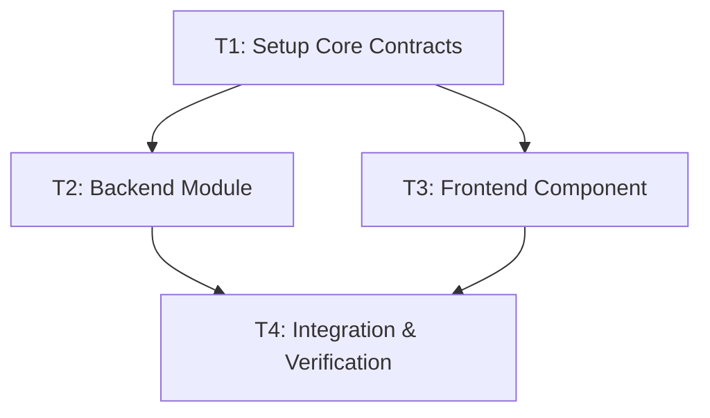

# Plan and handoff templates

Select and fill only the blocks needed for the request. Replace placeholders with grounded details; genuine unknowns must include their effect and a resolution path.

---

## 1. Compact Plan (Ultra-Lean, Text-Only)

Use for small changes, bugfixes, or single-worker tasks (<12 files). Strictly text-first (<400 tokens), zero diagrams, zero worktree ceremony.

```markdown
# [Feature or Fix] Plan (Compact)
Target: Solo Executor | Mode: [Planning only / Execution authorized]

## Outcome
[Goal, current state, and smallest recommended approach.]

## Scope and Assumptions
- Included: [bounded functionality]
- Excluded: [material exclusions]
- Assumptions: [grounded facts vs assumptions]

## Concrete Steps
1. [T1: Deliverable, target file path, and dependency.]
2. [T2: Deliverable, target file path.]
3. [T3: Verify against observable behavior.]

## Done When (Acceptance Criteria)
- [A1: User-visible outcome or meaningful measurable check.]
- [A2: Important edge case or failure behavior.]

## Next Action & Handoff
[First ready step or copyable prompt for execution.]
```

---

## 2. Standard or Detailed Plan (Inverted Pyramid UX)

Use for features, multi-phase systems, or parallel multi-worker tasks. Position the **Executive Card** and **1-Click Execution Prompt** at the very top.

````markdown
# [Project or Feature] Plan
Revision: [v1.0] | Mode: [Planning only / Execution authorized] | Target: [Solo / swarm]

> [!NOTE]
> ### 📋 Executive Outcome Card
> **Primary Goal**: [1-2 sentences on core deliverable and target state]  
> **Approach**: [Smallest recommended architectural approach]  
> **Readiness**: Ready for Execution | **Estimated Tasks**: [N] | **Concurrency**: [Solo / N Parallel Workers]

---

### ⚡ 1-Click Execution Prompt
```text
Execute [Project or Feature] Plan (Revision [v1.0]).
Scope: [Brief list of included files/modules].
Task Graph: Follow tasks T1 through Tn strictly respecting dependencies and 1-writer-per-file write isolation.
Verification: Run [specific command, e.g. npm test or pytest] after each integration step.
Stop Condition: Halt immediately if [specific baseline mismatch or test failure occurs].
```

---

### 🗺️ Visual Task Dependency Graph
*(Optional for artifact-enabled hosts; omit in plain CLI)*


---

### 📋 Authoritative Task & Acceptance Table

| ID | Task Deliverable & Scope | Write Scope (1-Writer) | Depends On | Acceptance Criteria & Verification |
| :---: | :--- | :--- | :---: | :--- |
| **T1** | [Core contract or schema] | `src/types/contract.ts` | None | **A1**: Type check passes (`npm run typecheck`) |
| **T2** | [Independent worker slice A] | `src/backend/` | T1 | **A2**: Unit tests pass (`pytest tests/unit/`) |
| **T3** | [Independent worker slice B] | `src/frontend/` | T1 | **A3**: Component renders without error |
| **T4** | [Coordinator integration] | Root manifests / lockfiles | T2, T3 | **A4**: Integration tests & `git diff` review pass |

---

### 🛡️ Risks, Stop Conditions & Rollback
- **Stop Condition 1**: [Material mismatch with observed codebase baseline.]
- **Stop Condition 2**: [Contract failure or shared-file write collision.]
- **Rollback Strategy**: [Git branch reset or safe rescue branch procedure.]

---

### 🚀 Immediate Next Action
[First ready task ID and required input.]
````

---

## 3. Spike / PoC Plan Template (for 🟡 Test First)

Use when Idea Council or user requests a proof-of-concept to validate uncertain technical hypotheses before full commitment.

```markdown
# 🔬 Spike / Proof-of-Concept Plan: [Topic]
Time-box: [e.g. 2 hours or 1 iteration] | Exit Goal: [Validate hypothesis H1]

## Hypothesis to Falsify
- **Hypothesis (H1)**: [Specific technical claim or feasibility assumption]
- **Risk if False**: [Why we must test before building]

## Minimum Viable Prototype Scope
- **Included**: [Minimal scratch script or isolated prototype in `scratch/`]
- **Excluded**: [Production styling, full test suite, migrations, refactoring]

## Go / No-Go Exit Criteria
| Criterion | Metric / Observable Evidence | Go (Proceed to Full Build) | No-Go (Drop or Redesign) |
| :--- | :--- | :--- | :--- |
| **Performance** | Latency / memory | `< 100ms` | `> 250ms` |
| **Compatibility** | API response | Successful parse | Format incompatible |

## Immediate Next Action
[Execute spike prototype script and record empirical metrics.]
```

---

## 4. Remediation Plan Template (for 🟠 Fix First)

Use when Idea Council or code review identifies critical flaws that must be redesigned before implementation.

```markdown
# 🔧 Remediation Plan: [Topic]
Source: [Idea Council Decision Record or Audit]

## Objections & Flaws to Resolve
1. **Flaw 1**: [Specific vulnerability, race condition, or architectural coupling identified]
2. **Flaw 2**: [Missing boundary or performance hotspot]

## Remediation Tasks
| ID | Resolution Deliverable | Target Artifact | Verification |
| :---: | :--- | :--- | :--- |
| **R1** | [Redesign interface contract] | `src/contracts/` | Zero-overlap write scopes confirmed |
| **R2** | [Implement fallback mechanism] | `src/core/fallback.ts` | Unit test simulates failure mode |

## Ready Criteria
Proceed to full feature build only when all Remediation tasks R1..Rn pass verification.
```

---

## 5. Scoped Task Brief for Parallel Worker

```text
Task and Plan Revision: [Tn, revision].
Role: [Worker name/number]; execute only this slice; do not delegate recursively.
Write Scope: [Strict list of owned files/directories]; do not touch shared root files.
Contract Excerpt: [Relevant interface or types needed].
Verification Target: [Supported command, e.g. npm test or pytest].
If Blocked: Report exact gap to coordinator; do not expand file ownership.
Return: Changed files, diff summary, verification output, and blockers.
```
